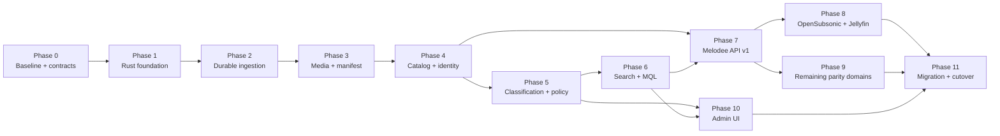

# Melodee Rust Rewrite — Implementation Guide

**Status:** Phased execution plan — **Phase 0 complete (2026-08-09)**, see
[design/evidence/phase-0/PHASE-0-REPORT.md](design/evidence/phase-0/PHASE-0-REPORT.md);
**Phase 1 complete (2026-08-09)**, see
[design/evidence/phase-1/PHASE-1-REPORT.md](design/evidence/phase-1/PHASE-1-REPORT.md);
**Phase 2 complete (2026-08-09)**, see
[design/evidence/phase-2/PHASE-2-REPORT.md](design/evidence/phase-2/PHASE-2-REPORT.md);
**Phase 3 complete (2026-08-10)**, see
[design/evidence/phase-3/PHASE-3-REPORT.md](design/evidence/phase-3/PHASE-3-REPORT.md);
**Phase 4 complete (2026-08-10)**, see
[design/evidence/phase-4/PHASE-4-REPORT.md](design/evidence/phase-4/PHASE-4-REPORT.md);
**Phase 5 complete (2026-08-10)**, see
[design/evidence/phase-5/PHASE-5-REPORT.md](design/evidence/phase-5/PHASE-5-REPORT.md);
**Phase 6 complete (2026-08-11)**, see
[design/evidence/phase-6/PHASE-6-REPORT.md](design/evidence/phase-6/PHASE-6-REPORT.md);
**Phase 7 complete (2026-08-12)**, see
[design/evidence/phase-7/PHASE-7-REPORT.md](design/evidence/phase-7/PHASE-7-REPORT.md);
**Phase 8 complete (2026-08-13)**, see
[design/evidence/phase-8/PHASE-8-REPORT.md](design/evidence/phase-8/PHASE-8-REPORT.md);
**Phase 9 complete (2026-08-14)**, see
[design/evidence/phase-9/PHASE-9-REPORT.md](design/evidence/phase-9/PHASE-9-REPORT.md).
**Date:** 2026-08-07  
**Governing documents:** [PRD.md](PRD.md), [SPEC.md](SPEC.md), accepted ADRs

## 1. Delivery strategy

The rewrite is delivered through vertical evidence and explicit release gates. The project will not
attempt a “big bang” code translation followed by late compatibility testing.

Each phase must produce:

- a bounded implementation increment;
- automated tests and reproducible evidence;
- updated requirement traceability;
- relevant ADR decisions;
- operational documentation;
- user-facing documentation in `/docs`, delivered **alongside** implementation (see below); and
- a clear exit decision.

Documentation is not a final phase after feature implementation. Every implemented feature
slice ships with its documentation work in the same change:

```text
Implement feature
      │
      ├── Tests
      ├── Compatibility
      ├── Documentation (/docs, same PR)
      ├── Traceability
      └── Release notes where appropriate
```

A phase exit review must not accept features whose public documentation is missing, incorrect,
or deferred to a TODO. Behavior that is planned but not implemented is documented only as
clearly-marked planned documentation, per `/docs/AGENTS.md`.

Phases may overlap only when dependencies are stable and work is isolated. An agent must not begin a
later phase merely because its code is interesting.

## 2. Workstream dependency map



## 3. Phase 0 — Baseline freeze and compatibility capture

### Objective

Turn the current C# application into an explicit, executable product oracle.

### Deliverables

- Frozen legacy baseline commit/tag and database/media fixture inventory.
- Native Melodee API v1 OpenAPI and route inventory.
- OpenSubsonic endpoint/status/extension inventory.
- Jellyfin compatibility route/auth inventory.
- Golden response fixtures for critical workflows.
- Authentication and refresh lifecycle captures.
- Streaming/range/seek captures.
- Current FFmpeg normalization profile and supported input-format behavior.
- Feature/configuration inventory.
- Performance baseline harness and first report.
- Real-client smoke-test scripts/checklists.
- Foundational ADR decisions.

### First ten implementation issues

The detailed issue text is in `design/agents/FIRST-10-ISSUES.md`.

1. Validate repository scaffold and generate `Cargo.lock`.
2. Tag/document the legacy baseline and capture server/system version metadata.
3. Capture all published OpenAPI documents and route manifests.
4. Implement a reusable HTTP snapshot/normalization format.
5. Add native Melodee API v1 critical-path scenarios.
6. Add OpenSubsonic critical-path scenarios.
7. Add Jellyfin critical-path scenarios.
8. Capture exact media normalization settings and representative conversions.
9. Add synthetic catalog/filesystem generators and benchmark schema.
10. Produce Phase 0 baseline report and ratify foundational ADRs.

### Exit criteria

- A clean checkout can run the capture tooling against a configured legacy server.
- Fixtures contain no secrets or private paths.
- Critical workflows have stable comparison rules.
- Baseline reports include commands, hardware context, dataset shape, and results.
- Phase 1 ADRs are accepted.

## 4. Phase 1 — Rust foundation

### Objective

Create a production-quality runtime skeleton without prematurely implementing feature breadth.

### Work

- Server composition root using Axum/Tokio.
- Graceful shutdown and structured tracing.
- Configuration layering: defaults, file, environment, database settings when appropriate.
- PostgreSQL connection pool and migration runner after schema ADR acceptance.
- Health, readiness, version, and diagnostics endpoints.
- CLI command framework and doctor command.
- Error envelope and correlation conventions for the new admin API only.
- Integration-test harness using disposable PostgreSQL.
- Dependency/FOSS audit and lockfiles.

### Exit criteria

- Server starts, reports health, connects to PostgreSQL, and shuts down cleanly.
- CI passes format, clippy, tests, docs validation, and dependency policy.
- No compatibility route is falsely advertised as implemented.
- Configuration and secret handling are documented.

## 5. Phase 2 — Durable ingestion engine

### Objective

Replace broad filesystem sweeps and in-memory progress with one durable work item per Release.

### Work

- ReleaseWorkItem schema and transition history.
- Discovery reconciliation and watcher acceleration.
- Settling snapshots and ready markers.
- Lease-based bounded claims using PostgreSQL locking.
- Retry/backoff, terminal failure, quarantine, and operator reprocess.
- Idempotency keys and stage orchestration.
- Processing queue/worker diagnostics API.

### Sub-slices

Sub-slices are work-management units **within** this official phase. They are never referred to
as "Phase 1A/1B/etc."; they exist only to bound work packages for coding agents.

- **2.1 Durable work execution** — ReleaseWorkItem schema, state machine, leasing, retries,
  recovery, failure evidence, transition history. **Status: complete** — see
  [design/evidence/phase-2/durable-work-execution/README.md](design/evidence/phase-2/durable-work-execution/README.md).
- **2.2 Discovery and settling** — inbound discovery, periodic reconciliation, settling
  snapshots, ready markers, source safety, idempotent rediscovery. **Status: complete** — see
  [design/evidence/phase-2/discovery-and-settling/README.md](design/evidence/phase-2/discovery-and-settling/README.md).
- **2.3 Diagnostics and Phase 2 closure** — processing queue/worker diagnostics API
  (state counts, bounded listing, work-item detail, event history, active-lease evidence),
  failure-isolation acceptance test, consolidated exit evidence. **Status: complete** — see
  [design/evidence/phase-2/PHASE-2-REPORT.md](design/evidence/phase-2/PHASE-2-REPORT.md).

### Watcher acceleration

PRD-INGEST-003 and SPEC section 11.3 establish that filesystem watchers are **optional
accelerators only**; periodic reconciliation is the authoritative correctness mechanism and
guarantees eventual discovery when watcher events are lost or unsupported. The current
implementation intentionally relies on periodic reconciliation as authoritative truth and does
**not** add a filesystem-watcher dependency. This satisfies PRD-INGEST-003: missed watcher
events cannot lose work because reconciliation recovers them (proven by
`lost_watcher_notification_is_recovered_by_scan`). A watcher may be added later as an
optimization that wakes/schedules reconciliation; it must never let watcher events directly
become authoritative durable state. Adding a watcher is **deferred** as an optional optimization
and is not required for Phase 2 completion.

### Exit criteria

- 200 candidates become independent durable work items. ✅
- Process termination at each stage is recoverable. ✅ (Phase 2 work-engine stages proven)
- One failed Release does not block others. ✅
- No Release disappears due to a global scan timestamp. ✅ (per-item durable state, no global
  scan timestamp gates discovery)

**Phase 2: COMPLETE (2026-08-09).**

## 6. Phase 3 — Media inspection, normalization, and manifests

### Objective

Produce validated, versioned manifests and canonical MP3 media safely.

### Work

- Metadata probe abstraction and Lofty/ffprobe implementations.
- Exact legacy-compatible high-quality VBR MP3 profile.
- FFmpeg child-process runner with bounded concurrency and cancellation.
- Content hashing and Chromaprint fingerprinting.
- Artwork extraction/validation/normalization.
- Sidecar parsing required for parity.
- Temp work directories, verification, atomic/resumable publication.
- Versioned manifest schema and upgrade tests.

### Sub-slices

- **3.1 Media inspection and Release manifest v1** — `melodee-media` boundary, Lofty/ffprobe
  observation, source file classification, artwork observation, sidecar inventory, streaming
  BLAKE3 byte hashing, ReleaseManifest schema v1, semantic manifest hashing, PostgreSQL JSONB
  manifest persistence, inspection worker, source-change-before/during-inspection protection,
  Ready→Inspecting→Normalizing handoff, 200-Release inspection scenario. **Status: complete** —
  see [design/evidence/phase-3/media-inspection-and-manifest/README.md](design/evidence/phase-3/media-inspection-and-manifest/README.md).
- **3.2 Media normalization and acoustic fingerprinting** — canonical high-quality VBR MP3
  normalization (PRD-MEDIA-002), FFmpeg child-process runner with bounded conversion concurrency
  and cancellation, Chromaprint/fpcalc acoustic fingerprints (PRD-FP-003), artwork
  extraction/validation/normalization, semantic sidecar parsing required for parity. **Status: complete** —
  see [design/evidence/phase-3/media-normalization/README.md](design/evidence/phase-3/media-normalization/README.md).
- **3.3 Verification and atomic canonical publication** — Release-level validation of the
  Phase 3.2 manifest/work-area result, atomic/resumable canonical storage publication
  (PRD-INGEST-006), publication crash/retry safety, and retained source disposition.
  **Status: complete** — see
  [design/evidence/phase-3/canonical-publication/README.md](design/evidence/phase-3/canonical-publication/README.md).
- **3.4 Phase 3 integration / release gate** — representative MP3/FLAC/OGG/WAV and pathology
  corpus passes, manifest completeness for catalog insertion, conversion crash/retry source
  safety, and a 200-Release bounded publication scenario. **Status: complete** — see
  [design/evidence/phase-3/PHASE-3-REPORT.md](design/evidence/phase-3/PHASE-3-REPORT.md).

### Exit criteria

- Representative MP3/FLAC/OGG/WAV and pathology corpus passes. ✅
- Manifests contain enough information for catalog insertion without rereading audio. ✅
- Conversion crashes/retries do not corrupt source or publish partial Releases. ✅

**Phase 3: COMPLETE (2026-08-10).** The consolidated decision and reproducible evidence are in
[design/evidence/phase-3/PHASE-3-REPORT.md](design/evidence/phase-3/PHASE-3-REPORT.md).

## 7. Phase 4 — Catalog, Artist identity, and contributions

### Objective

Implement the Melodee-owned semantic catalog and migrate current identity/user-visible IDs.

### Work

- Artist, alias, external identity, relationship, and membership models.
- Release/Track/MediaAsset models.
- ReleaseArtist, TrackArtist, Contribution, DisplayArtist.
- Evidence and match-decision persistence.
- Provisional identities, negative assertions, merge/split history.
- Date-aware group participation projection.
- Set-based manifest import and aggregates.
- Legacy public-ID preservation.

### Exit criteria

- Same-name bands remain distinct.
- Different names can resolve to one Artist through evidence/aliases.
- “Everything Colin Hay is on” includes solo, Men at Work, and guest participation according to role.
- Merge/split does not require media relocation.

**Phase 4: COMPLETE (2026-08-10).** The consolidated decision, exact acceptance metrics, and
reproducible evidence are in
[design/evidence/phase-4/PHASE-4-REPORT.md](design/evidence/phase-4/PHASE-4-REPORT.md).

## 8. Phase 5 — Classification, novelty, and policy

**Status:** Complete (2026-08-10).

### Objective

Replace scattered regex/validation/deletion behavior with explainable classification and policy.

### Work

- Multi-valued ReleaseTraits and classification evidence.
- Track novelty categories using IDs, metadata, hashes, fingerprints, and catalog context.
- Versioned policy rules and dispositions.
- Dry-run/test-against-catalog capability.
- Durable decision/audit record before destructive execution.
- Operator override and remembered decisions.

### Exit criteria

- Redundant Greatest Hits can be rejected safely.
- A collection with genuinely new/alternate material is not silently deleted.
- Directory-name evidence alone cannot trigger destructive action.
- Policy decisions are explainable in API/UI.

**Phase 5: COMPLETE (2026-08-10).** The consolidated decision, exact acceptance metrics, and
reproducible evidence are in
[design/evidence/phase-5/PHASE-5-REPORT.md](design/evidence/phase-5/PHASE-5-REPORT.md).

## 9. Phase 6 — Search and MQL

**Status:** COMPLETE (2026-08-11) — independently reviewed and accepted. See the Phase 6 report.

### Objective

Deliver lightning-fast, rebuildable search at large-catalog scale.

### Work

- Tantivy schema and outbox/checkpoint worker.
- Artist, Release, Track, aliases, display credits, participant IDs.
- MQL parser/AST and translators.
- Autocomplete and admin lookup.
- Full rebuild, incremental catch-up, corruption recovery.
- 10-million-Track benchmark dataset.

### Exit criteria

- Index deletion/rebuild does not require media re-ingestion.
- Warm p95 target is measured and met or deliberately revised by ADR.
- MQL compatibility tests pass.

## 10. Phase 7 — Native Melodee API v1

**Status:** Complete (2026-08-12) — independently reviewed and accepted. See the
[Phase 7 report](design/evidence/phase-7/PHASE-7-REPORT.md).

### Objective

Make existing native clients operate against Rust without a synchronized client release.

### Work

- Authentication/refresh/logout/password-reset/linked providers.
- Artists, albums/releases, songs/tracks, search, images, stream URLs.
- Playlists, queue, scrobble, genres, charts, recommendations, analytics.
- Requests, shares, podcasts, playback settings/backends, party routes.
- Exact DTO/error/pagination/nullability compatibility.
- Android/Android Auto and MeloAmp integration tests.

### Exit criteria

- Differential suite passes approved contract.
- Existing Android app browses, searches, queues, streams, seeks, refreshes auth, and scrobbles.
- Android Auto survives process recreation and continuous multi-Track playback.

## 11. Phase 8 — OpenSubsonic and Jellyfin adapters

**Status:** Complete (2026-08-13) — exit criteria met: OpenSubsonic matrix reproduced and
tested (81/81 endpoints, differential replay at zero unexpected differences); a supported
Jellyfin client (Feishin v1.15.1) completes the documented smoke workflows on both surfaces
(`design/evidence/phase-8/REAL-CLIENT-ACCEPTANCE.md`); unsupported non-music behavior remains
intentionally absent per the frozen captures. Report:
[design/evidence/phase-8/PHASE-8-REPORT.md](design/evidence/phase-8/PHASE-8-REPORT.md).

### Objective

Restore the implemented compatibility surfaces on the new core.

### Work

- OpenSubsonic auth and JSON/XML/JSONP envelopes.
- Supported endpoint groups, extensions, Gone/Not Implemented behavior.
- Direct/transcoded stream and range behavior.
- Jellyfin discovery/login/tokens, item views, artists, genres, playlists, sessions, images, audio.
- Representative real-client suites.

### Exit criteria

- OpenSubsonic matrix is reproduced and tested.
- Supported Jellyfin clients complete documented smoke workflows.
- Unsupported non-music behavior remains intentionally absent.

## 12. Phase 9 — Remaining parity domains

**Status:** Complete (2026-08-14) — exit criteria met: every domain below has its own parity
checklist under `design/evidence/phase-9/checklists/` and all twelve are green (74 rows ✅ with
linked test evidence, 4 rows 🚫 waived by accepted ADRs 0133/0136, 2 rows ➡ Phase 10); all 61
Phase-9-tagged requirements are terminal (52 tested, 2 implemented, 7 deferred under ADRs
0133/0136 or the Phase 10 boundary); the feature-parity matrix carries no unapproved gaps.
Report:
[design/evidence/phase-9/PHASE-9-REPORT.md](design/evidence/phase-9/PHASE-9-REPORT.md).

Implement and validate:

- users, groups, library ACLs, profiles, avatars;
- playlists/smart playlists and shares;
- requests/comments/activity;
- podcasts and resume/history;
- Last.fm and scrobbling;
- charts, recommendations, analytics, audio features, EQ;
- internet radio;
- party mode, jukebox, playback backends;
- scripting hooks/migration path;
- onboarding, config import/export, notifications/templates;
- themes/localization/user-facing web parity not covered by native clients; and
- CLI/maintenance capabilities.

Each domain requires its own parity checklist and tests.

**Phase 9: COMPLETE (2026-08-14).** Executed per
[design/agents/PHASE-9-PLAN.md](design/agents/PHASE-9-PLAN.md) (four waves, WP-01..WP-14) under
accepted ADRs 0133 (party/jukebox waiver), 0134 (parity-domain schema, §7 amended for Last.fm
session-key sealing), 0135 (Boa scripting runtime), and 0136 (non-Last.fm provider deferral);
ADR-0109 and ADR-0132 dispositions recorded as Accepted. Party mode/jukebox parity is preserved
as the frozen 404/410 absence under the ADR-0133 waiver; themes/localization/RTL remain Phase 10
scope. The consolidated decision, gate evidence, and honest limitations are in
[design/evidence/phase-9/PHASE-9-REPORT.md](design/evidence/phase-9/PHASE-9-REPORT.md).

## 13. Phase 10 — Admin UI

### Objective

Build the Carbon operator/curation SPA using the canonical screens.

### Work

- Application shell, localization, themes, light/dark/system, RTL.
- Overview, Processing Queue, Release Review, Artist Identity Review.
- Artist Detail, Release Detail, Policies/Rule Editor, System/Workers/Diagnostics.
- Shared components, server-side tables, inspector panels, decision dialogs, audio preview.
- Visual regression, accessibility, and responsive tests.

### Exit criteria

- Canonical workflows match approved information hierarchy.
- Destructive and identity decisions are safe and explainable.
- Existing supported languages and direction behavior are preserved.
- UI does not require proprietary component tiers.

## 14. Phase 11 — Migration, dual run, and cutover

### Objective

Move the current production installation safely with rollback.

### Work

- Repeatable migration tooling and dry runs.
- Public ID and user-state reconciliation.
- Media/manifest adoption without mandatory re-transcoding.
- Search build and validation.
- Dual-run differential traffic and real-client validation.
- Final delta sync/write freeze strategy.
- Cutover/rollback runbooks and backups.

### Exit criteria

All release gates in the PRD are satisfied with evidence, and rollback is proven before traffic moves.

## 15. Work item sizing and PR discipline

A normal PR should satisfy one coherent requirement slice and be reviewable without understanding the
entire future system. Prefer:

- one ADR per decision;
- one migration plus its tests per schema change;
- one endpoint group or compatibility scenario set;
- one worker stage/invariant; or
- one reusable UI pattern plus a canonical screen slice.

Avoid “foundation” PRs containing dozens of speculative abstractions.

## 16. Agent execution protocol

For every assigned issue:

1. Identify requirement IDs and ADRs.
2. Confirm phase scope.
3. Capture legacy behavior first when external behavior is involved.
4. Write acceptance tests/fixtures.
5. Implement the smallest safe slice.
6. Run checks and record evidence.
7. Evaluate documentation impact; update `/docs` in the same change when user-visible behavior
   changed (read `/docs/AGENTS.md` first).
8. Update traceability and internal docs.
9. Leave the tree in a buildable state.

## 17. Release-gate evidence package

Each phase stores evidence under `design/evidence/<phase>/` or a future artifact system, including:

- commands and versions;
- test reports;
- benchmark dataset description and results;
- compatibility diff summaries;
- migration counts/checksums;
- screenshots where relevant; and
- known limitations with issue links.
