# Melodee 1.0.0 Outstanding Implementation Plan

**Document status:** Active release-closure plan  
**Baseline date:** 2026-08-16  
**Baseline commit:** `a5ba0e88fdb7cb3a383d6a992f5b3738753440f7`  
**Target:** Initial production release `1.0.0`

This document is the executable backlog for closing the gap between the completed historical
implementation phases and the initial `1.0.0` release. It supplements
[`IMPLEMENTATION.md`](IMPLEMENTATION.md); it does not renumber, replace, or rewrite the historical
phase record.

The intended audience is a coding agent executing one bounded work package at a time. Each work
package defines its required result, governing requirements, evidence, and exit condition. An
implementing agent must not redesign an accepted contract, broaden product scope, or resolve an
architecture conflict silently.

## 1. Authority and execution rules

The authority order remains:

1. Accepted ADRs in [`design/adr/`](design/adr/README.md).
2. [`SPEC.md`](SPEC.md).
3. [`PRD.md`](PRD.md).
4. [`IMPLEMENTATION.md`](IMPLEMENTATION.md).
5. This release-closure plan.
6. Existing implementation patterns.
7. The frozen C# application as behavioral evidence only.

Apply these rules to every work package:

- Preserve all accepted ADR boundaries. Supersede an ADR instead of editing history to hide a
  prior decision.
- Use `Artist`, `Release`, `Track`, `ReleaseArtist`, `TrackArtist`, `Contribution`, `MediaAsset`,
  `ObservedArtist`, `ArtistMatch`, `ReleaseTrait`, and `Disposition` in core code.
- Keep PostgreSQL authoritative and Tantivy rebuildable.
- Do not use filesystem paths, normalized names, or legacy display strings as semantic identity.
- Do not merge native v1, OpenSubsonic, and Jellyfin wire DTOs.
- Do not add a broker, Redis, Elasticsearch/OpenSearch, GraphQL, a microservice, or a proprietary
  runtime dependency.
- Do not make destructive decisions from uncertainty.
- Add no production dependency without the repository-required dependency decision or ADR.
- Add no database schema without an accepted schema ADR, forward migration, recovery plan, and
  data-integrity tests.
- Use the existing lease and fencing model for background work. A stale worker may not commit,
  publish, or delete.
- Update public documentation in the same change as user-visible behavior.
- Update requirement traceability through the repository generator. Do not hand-edit generated
  requirement indexes.
- Run the smallest relevant checks during implementation and `./scripts/check.sh` before a work
  package is presented as complete.

## 2. Definition of the 1.0 scope

### 2.1 Mandatory for 1.0

The following outcomes are release-blocking:

- The durable inbound-to-staging correction governed by ADR-0145 is fully tested, evidenced, and
  represented truthfully in requirements and documentation.
- Every current non-terminal requirement is either implemented and evidenced or has an explicit
  accepted 1.0 exclusion.
- Mandatory media inspection, sidecar, streaming, concurrency, observability, security, and
  performance requirements are closed.
- Official Phase 11 migration, rehearsal, dual-run, cutover, and rollback work is complete.
- Existing public IDs, catalog data, user state, and approximately 5 TB of canonical media can be
  migrated without mandatory re-encoding or relocation.
- Native v1, OpenSubsonic, Jellyfin, Admin UI, and supported real-client gates remain green.
- Backup, restore, search rebuild, failure diagnosis, retry, and rollback are proven.
- Repository, requirements, Rust, Python, Admin UI, docs, dependency, container, security, and
  release gates pass from the release commit.
- The repository and public docs describe an initial code-complete application rather than an
  active sequence of implementation phases.
- Versioned OCI images, release notes, checksums, SBOMs, provenance, and the `1.0.0` GitHub Release
  are produced by the accepted release process.

### 2.2 Explicitly excluded from 1.0

These items are not implementation choices. They are excluded by accepted decisions or by the
existing optional requirement boundary:

| Item | 1.0 disposition | Governing authority |
|---|---|---|
| Enabled Party/Jukebox behavior | Excluded; preserve retired/absent behavior | ADR-0133, ADR-0140, ADR-0141 |
| Automatic device-profile stream selection | Excluded; profiles remain metadata | ADR-0134 |
| Non-Last.fm external metadata/image providers | Excluded | ADR-0136 |
| Metadata edit forms in the Admin UI | Excluded from the initial release closure | Phase 10 decision log |
| Interactive API explorer | Excluded from the initial release closure | Phase 10 decision log |
| Automatic staged-source deletion after publication | Excluded; retain staged source | ADR-0145 |
| New operator-delete semantics for staged bytes | Excluded; do not broaden deletion | ADR-0145 |
| Optional generated filesystem views | Excluded unless an accepted release decision makes them mandatory | `PRD-STORAGE-003`, ADR-0106 |
| Physical duplicate-media reclamation | Excluded; logical duplicate evidence remains authoritative | Existing ingestion/storage decisions |
| Filesystem watcher acceleration | Optional; reconciliation remains authoritative | Existing ingestion architecture |
| Optional Finamp/Streamyfin expansion beyond the accepted compatibility matrix | Excluded | Phase 8 accepted scope |
| New generic `Library(type=...)` abstraction | Prohibited | Current architecture and ADR-0106 |

Before 1.0, each excluded requirement must carry a truthful status and a reference to its accepted
decision. No excluded feature may remain labeled ambiguously as active implementation work.

## 3. Current baseline

### 3.1 Historical phase status

Phases 0 through 10 are accepted as complete. Their evidence remains historical and must not be
rewritten merely to remove phase-oriented language from current product documentation.

| Official phase | Subject | Status for this plan | Remaining 1.0 treatment |
|---|---|---|---|
| Phase 0 | Contract capture and foundation | Complete | Preserve compatibility evidence |
| Phase 1 | Domain and persistence foundation | Complete | Revalidate through current gates |
| Phase 2 | Ingestion discovery and settling | Complete with corrective follow-up | ADR-0145 closure in R0 |
| Phase 3 | Inspection and media normalization | Complete with mandatory residuals | Media matrix and sidecar closure in R2 |
| Phase 4 | Matching, policy, and review | Complete | Revalidate review retention and diagnostics |
| Phase 5 | Canonical publication and storage | Complete with corrective follow-up | Staged-source provenance and migration adoption |
| Phase 6 | Search, operations, and scale | Complete with production residuals | Scale, health, and sizing closure in R2/R4 |
| Phase 7 | Native API v1 and Android acceptance | Complete | Production auth and physical-client gate in R4/R5 |
| Phase 8 | OpenSubsonic and Jellyfin compatibility | Complete | Transcoding and final client gate in R2/R5 |
| Phase 9 | Remaining parity domains | Complete with accepted waivers | Traceability cleanup in R1 |
| Phase 10 | Admin UI | Complete with accepted deferrals | Final Admin UI and diagnostics gate in R5 |
| Phase 11 | Migration, dual run, and cutover | Not complete | Implemented through R3 and R4 |

### 3.2 Requirement status snapshot

The generated requirement registry currently contains 239 requirements (after R0 closure):

| Status | Count |
|---|---:|
| Tested | 182 |
| Implemented | 9 |
| In progress | 24 |
| Planned | 17 |
| Deferred | 6 |
| Captured | 1 |

This snapshot is a planning input, not release evidence. R1 must reconcile stale status labels
against accepted phase reports and current tests. R5 requires every requirement to be terminal:
`tested`, `implemented` with an approved reason that testing is inapplicable, `deferred` under an
accepted decision, or `superseded` by an identified requirement.

### 3.3 Known immediate blockers

- ~~ADR-0145 code has landed, but the corrective work does not yet have a fresh, complete release
  gate and final acceptance report from the current commit.~~ **Resolved in R0** —
  `design/evidence/r0/README.md`; full `./scripts/check.sh` green (933 Rust tests, 140 Python
  tests, admin-ui gate, cargo deny).
- ~~Stale pre-staging inspection test assumptions.~~ **Resolved in R0** —
  `script_gate_deny_retains_staged_candidate_for_retry` and
  `source_change_during_inspection_discards_manifest` assert the owned-staging lifecycle; the
  mutation fixture writes to the deterministic staged source, and acquisition-time mutation lives
  in the handoff fault suite (`tests/acquisition.rs`).
- Scheduled CI previously exposed Last.fm mock endpoint isolation based on shared process-global
  state. The full local gate passes from the R0 commit; a fresh scheduled run and the R2
  configured-state fixture work (per-test isolation) remain the verification path.
- ~~`PRD-INGEST-005` non-terminal.~~ **Resolved in R0** — status `tested` with R0 evidence.
- Public migration documentation correctly states that Phase 11 is not yet supported. It cannot
  be changed to supported until R3 and R4 pass.
- The workspace version remains pre-1.0 and must not be changed to `1.0.0` until R5 passes.

## 4. 1.0 closure phase map

The `R` labels below are release-closure work packages, not new official numbered implementation
phases. They exist to finish the official roadmap without creating a fictitious Phase 12.

```mermaid
flowchart LR
    H[Historical Phases 0-10\nComplete] --> R0[R0 Corrective baseline\nComplete]
    R0 --> R1[R1 Requirement and security closure\nNot started]
    R1 --> R2[R2 Mandatory runtime gaps\nNot started]
    R2 --> R3[R3 Official Phase 11 migration tooling\nNot started]
    R3 --> R4[R4 Rehearsal, dual run, cutover\nNot started]
    R4 --> R5[R5 Release-candidate hardening\nNot started]
    R5 --> R6[R6 1.0 documentation and publication\nNot started]
    R6 --> V[Melodee 1.0.0]
```



| Closure phase | Status | Depends on | Release result |
|---|---|---|---|
| R0 — Corrective baseline | Complete | Phases 0–10 | ADR-0145 complete and current baseline green |
| R1 — Requirement and security closure | Not started | R0 | Truthful terminal disposition plan and closed evidence-only gaps |
| R2 — Mandatory runtime gaps | Not started | R1 | All non-migration runtime requirements implemented |
| R3 — Official Phase 11 migration tooling | Not started | R2 | Repeatable legacy import and verification tooling |
| R4 — Production rehearsal, dual run, and cutover | Not started | R3 | Migration and rollback proven on production-shaped data |
| R5 — Release-candidate hardening | Not started | R4 | All Gates A–I green from a release candidate |
| R6 — 1.0 documentation and publication | Not started | R5 | Code-complete documentation, version, tag, images, and release |

Only one closure phase may be reported as `In progress` at a time. A later phase may be explored
for estimation, but its implementation may not be used to declare an earlier exit criterion
complete.

---

## 5. R0 — Corrective baseline and durable staging closure

**Status:** Complete (2026-08-16) — evidence: `design/evidence/r0/README.md`  
**Primary authority:** ADR-0145, ADR-0115, ADR-0116, ADR-0105, ADR-0106  
**Primary requirements:** `PRD-INGEST-005`, `PRD-INGEST-009`, `PRD-STORAGE-004`,
`PRD-TEST-005`, `PRD-TEST-006`, `PRD-TEST-007`

### 5.1 Objective

Finish and evidence the owner-approved lifecycle:

```text
Inbound -> durable Staging -> attempt-isolated Work -> Review/Quarantine -> Canonical Storage
```

After a verified handoff, inbound must be drained. All downstream source reads must resolve to
staging. Crash recovery, path reuse, delayed cleanup, and stale leases must be safe.

### 5.2 Work package R0.1 — Correct stale inspection tests

- Update script-gate denial assertions to the state transition defined by the current state
  machine. A denied candidate returns to the recoverable settling/unprocessed path for that pass;
  it is not mislabeled as a processing failure merely to preserve a stale test expectation.
- Update inspection-time mutation tests to locate the deterministic staged source through the
  owned-source resolver.
- Keep a separate acquisition-time mutation test that changes inbound during forced
  cross-filesystem copy and proves that handoff does not complete.
- Assert that no manifest is committed from a changed source tree.
- Assert that uncertainty retains recoverable bytes and actionable failure evidence.
- Do not make inspection reopen `source_root + relative_path` after handoff to satisfy a test.
- Run `cargo test -p melodee-ingestion --test inspection` before broader gates.

### 5.3 Work package R0.2 — Audit the handoff state machine

- Verify durable persistence can distinguish intent, physical staging finalization, durable
  receipt, inbound removal, and completed bookkeeping, or an equivalent set of monotonic facts.
- Verify every mutation is fenced by current work-item ownership and lease generation.
- Verify the deterministic final path is relative to the configured staging root and derived from
  a Melodee-owned acquisition/work-item identity.
- Verify source library ID, source library name, source-root identity, and original relative path
  are retained as provenance without placing configured absolute roots into semantic identity.
- Verify a completed occurrence releases any uniqueness reservation on the historical inbox path.
- Verify a second occurrence at the same relative path always creates a distinct acquisition.
- Verify the resolver has one authoritative rule: use inbound before acquisition and staging after
  durable acquisition. Do not scatter conditional path construction through processing modules.
- Verify `NeedsReview`, `Quarantined`, `Failed`, and `Published` work retains staged source.
- Verify no uncertain path calls staging cleanup or broadens the existing `Deleted` semantics.

### 5.4 Work package R0.3 — Same-filesystem handoff acceptance

- Create 200 stable release fixtures under one inbound root on the same filesystem as staging.
- Persist intent before changing the filesystem.
- Use the repository no-clobber rename primitive; do not implement `exists()` followed by
  overwriting `rename()`.
- Prove each final staging directory contains the complete source fixture byte-for-byte.
- Prove all 200 inbound candidate directories are gone after durable acquisition.
- Prove 200 work items and 200 complete acquisition receipts exist with no duplicate identity.
- Run reconciliation a second time and instrument the scan to prove zero historical candidates.
- Add one new release and prove exactly one new acquisition.
- Record release count, file count, byte count, handoff method, wall time, and second-scan candidate
  count as evidence, not as a production SLA.

### 5.5 Work package R0.4 — Cross-filesystem and crash convergence

- Use test-only dependency injection to force the cross-filesystem path when CI cannot provide two
  physical filesystems. Do not expose an unsafe production switch.
- Persist handoff intent before copying.
- Copy into a hidden attempt directory under staging.
- Stream BLAKE3 while copying and verify all owned regular files with bounded memory.
- Compare source generation/tree evidence before and after copy so additions, removals, byte
  changes, and replacements fail closed.
- Fsync file contents and required directories where the platform supports it.
- Atomically finalize the hidden tree to the deterministic no-clobber final path.
- Persist the durable receipt before removing inbound.
- Remove inbound only after revalidating containment, current lease, source occurrence identity,
  verified receipt, and unchanged source generation.
- Record inbound removal durably.
- Cover crashes before intent, after intent, during copy, after copy before verification, after
  verification before finalization, after finalization before receipt, after receipt before
  inbound removal, and after removal before bookkeeping.
- Restart and retry each crash point. Assert no loss, no overwrite, no duplicate acquisition, no
  partial authoritative final tree, and eventual inbound drain.

### 5.6 Work package R0.5 — Adversarial safety tests

- Test a matching existing final staging acquisition and prove safe adoption.
- Test a mismatching final staging tree and prove failure without overwrite or recursive deletion.
- Test source file mutation, addition, and removal during copy.
- Test spaces, Unicode, quotes, apostrophes, semicolons, ampersands, parentheses, and leading dash
  in inbound tree names.
- Test traversal input, symlink escape, staging collision, and configured-root symlink aliases.
- Test restart after staging acquisition with inbound absent and prove inspection continues.
- Test `NeedsReview` and `Quarantined` retention across restart.
- Test a stale worker losing its lease during copy and prove it cannot finalize, record receipt, or
  remove source.
- Test delayed cleanup after occurrence A is replaced by occurrence B at the same inbound path and
  prove A's cleanup does not delete B.
- Test concurrent claims for one occurrence and prove only one authoritative acquisition.

### 5.7 Work package R0.6 — Configuration, containers, and diagnostics

- Require an explicit absolute `MELODEE__INGEST__STAGING_ROOT` when ingestion has inbound sources.
- Reject missing staging configuration at startup with a role-specific error.
- Reject inbound/staging, inbound/work, inbound/canonical, staging/work, staging/canonical, and
  work/canonical overlap using canonical path-component containment rather than string prefixes.
- Preserve independently configurable inbound, staging, work, canonical, search-index, and podcast
  roots.
- Keep inbound writable by the runtime UID for candidate rename/removal while preserving the rule
  that media bytes are not modified before handoff.
- Keep staging, work, canonical, search-index, and any filesystem-backed podcast media locations
  writable according to their role.
- Show Inbound, Staging, Work, and Canonical roles in existing diagnostics without exposing secrets
  or building a dynamic settings system.
- Document that a shared filesystem enables rename and separate filesystems use verified
  copy-finalize-remove.

### 5.8 Work package R0.7 — Requirement and evidence correction

- Update PRD ingestion language that still says source is retained forever.
- Correct Release Gate B so it distinguishes inbound deletion after verified staging handoff from
  unauthorized deletion of durable staged or canonical source.
- Preserve ADR-0116's historical text and partial-supersession link.
- Update Phase 2, Phase 3, and Phase 5 corrective evidence according to repository convention;
  do not invent a new numbered phase.
- Update the strongest 200-release vertical scenario to prove staging acquisition, inbound drain,
  complete downstream processing, and an empty second reconciliation.
- Regenerate requirement artifacts with `python3 scripts/extract_requirements.py`.
- Search for stale inbound-retention, read-only-forever, direct-inbound-processing, and `/tmp` work
  claims. Retain historical ADR language only when its supersession is explicit.

### 5.9 R0 exit criteria

- Focused inspection, same-filesystem, forced cross-filesystem, crash, lease-loss, path-reuse,
  delayed-cleanup, restart, review-retention, and 200-release tests pass.
- The complete `./scripts/check.sh` gate passes from the current commit.
- A fresh scheduled workflow passes or any scheduler-only failure is corrected and rerun.
- `PRD-INGEST-005` and directly governed requirements have truthful terminal evidence.
- Inbound contains zero successfully acquired historical candidates.
- No downstream stage requires the historical inbound path.
- Public and operator documentation uses the four distinct storage roles consistently.
- The R0 evidence report records commands, counts, bytes, crash matrix, known limitations, and
  documentation impact.

---

## 6. R1 — Requirement, parity, security, and evidence closure

**Status:** Not started  
**Depends on:** R0  
**Primary authority:** Requirement index, feature-parity matrix, phase reports, Gates G and I

### 6.1 Objective

Convert the requirement registry from a mixture of historical planning labels and current truth
into a release-directed ledger. Close evidence-only gaps now, assign implementation gaps to R2–R5,
and attach accepted authority to every exclusion.

### 6.2 Work package R1.1 — Reconcile all non-terminal requirements

Use the following disposition map. An agent may correct a classification when direct evidence
proves it wrong, but must record the evidence and may not silently reduce scope.

| Requirements | Required disposition |
|---|---|
| `PRD-PRINCIPLE-001`, `PRD-PRINCIPLE-002` | Reconcile against Phase 9 parity evidence; close only after all unapproved parity gaps are gone |
| `PRD-PRINCIPLE-003`, `PRD-PRINCIPLE-004` | Close with separate native/OpenSubsonic/Jellyfin contract and real-client evidence |
| `PRD-PRINCIPLE-007` | Close with FOSS policy, dependency lock, `cargo deny`, SBOM, and no-proprietary-service evidence |
| `PRD-SCALE-001`, `PRD-SCALE-002` | Keep open through R4 production-shaped scale and bounded-resource evidence |
| `PRD-ARCH-001`, `PRD-ARCH-003` | Reconcile modular-monolith and PostgreSQL-authoritative evidence; add missing architecture tests only if needed |
| `PRD-INGEST-005` | Close in R0 with ADR-0145 acceptance evidence |
| `PRD-INGEST-009` | Close in R2 after all resource classes are bounded and observable |
| `PRD-MEDIA-001` | Close in R2 with an executable practical-format matrix |
| `PRD-MEDIA-005` | Reconcile against ADR-0143 and accepted artwork override tests |
| `PRD-MEDIA-006` | Close in R2 with CUE/sidecar behavior and fixtures |
| `PRD-STORAGE-003` | Mark explicit 1.0 exclusion under the optional generated-view boundary; do not implement opportunistically |
| `PRD-STORAGE-004` | Close across R0/R3 with staged-source provenance and in-place canonical adoption evidence |
| `PRD-API-M1-004` | Keep open through production Android phone/Auto and MeloAmp acceptance in R4/R5 |
| `PRD-API-M1-007` | Reconcile with versioned native API and independently gated adapter evidence |
| `PRD-STREAM-002` | Close in R2 with configured transcoding and cancellation tests |
| `PRD-PARTY-001`, `PRD-PARTY-002` | Retain deferred status with ADR-0133/0140/0141 references |
| `PRD-DEVICE-003` | Retain deferred status with ADR-0134 reference |
| `PRD-EXT-001`, `PRD-EXT-003`, `PRD-EXT-004` | Retain deferred status with ADR-0136 reference |
| `PRD-OBS-001`, `PRD-OBS-002` | Close in R2 with correlation, health, queue, disk, tool, and root diagnostics |
| `PRD-OBS-003` | Reconcile with Phase 10 diagnostics UI evidence and add only missing role/status display tests |
| `PRD-PERF-003`, `PRD-PERF-004` | Keep open through R2/R4 bounded-memory, fault, and production-scale evidence |
| `PRD-MIG-001` through `PRD-MIG-007` currently non-terminal | Close in R3/R4; no migration requirement is evidence-only |
| `PRD-TEST-001`, `PRD-TEST-002` | Keep open through final differential and performance gates |
| `PRD-TEST-003`, `PRD-TEST-004` | Reconcile against golden contract and real-client phase evidence |
| `PRD-TEST-005`, `PRD-TEST-006`, `PRD-TEST-007` | Keep open through R0/R2/R4 fault, media-corpus, and invariant suites |
| `PRD-SEC-001`, `PRD-SEC-002`, `PRD-SEC-003` | Close in R5 after filesystem, uncertainty, and untrusted-input security review |
| `PRD-SEC-005`, `PRD-SEC-006`, `PRD-SEC-007` | Close in R5 after headers, advisory, dependency, secret, and FOSS gates |

### 6.3 Work package R1.2 — Feature-parity matrix reconciliation

- Compare every matrix row with its accepted phase report, current route tests, and governing ADR.
- Correct stale `In progress` labels for completed artwork, diagnostics, adapter, chart, scheduled
  maintenance, CLI, admin-user, avatar, radio, or provider work when accepted evidence exists.
- Keep metadata-edit forms explicitly excluded by the Phase 10 decision; do not relabel them
  complete.
- Keep Party/Jukebox and non-Last.fm rows waived/deferred with direct ADR links.
- Add no parity row merely because a legacy class or scheduled job exists. Require user-visible
  behavior and governing requirements.
- Record configured-state Last.fm, live SMTP happy path, production OIDC, and physical-client gaps
  as R2/R4 acceptance tasks rather than vague residual risks.
- Ensure Gate G has no row without `Complete` evidence or an accepted release waiver.

### 6.4 Work package R1.3 — Security baseline inventory

- Inventory every path-consuming operation, subprocess invocation, upload, script, provider
  response, archive/sidecar parser, and filesystem removal operation.
- Map each operation to containment validation, symlink policy, race protection, size limit,
  timeout, cancellation, and audit evidence.
- Inventory all secrets and credentials accepted through environment/configuration and verify
  redaction in diagnostics and logs.
- Inventory HTTP security headers and authentication boundaries for native API, adapters, Admin
  API, static Admin UI, media streams, shares, callbacks, and health endpoints.
- Inventory dependency/advisory scanners, secret scan, container scan, SBOM, and provenance jobs.
- Produce actionable R2/R5 work items for missing controls. Do not declare the requirements tested
  from an inventory alone.

### 6.5 Work package R1.4 — Historical residual disposition

- Review each phase report's remaining-risk section.
- Mark a risk closed only with later accepted evidence.
- Assign production-scale PostgreSQL snapshot contention, Tantivy disk sizing, broad
  low-selectivity query behavior, real feed/provider behavior, live SMTP, physical Android Auto,
  production OIDC, and network/filesystem behavior to R2 or R4.
- Preserve lexical route-validator and Chromium-only visual limitations as documented testing
  boundaries unless a release gate requires expansion.
- Preserve timing-sensitive test history, but require deterministic current tests before R5.
- Record CUE splitting and mandatory sidecar behavior in R2.
- Record migration-only legacy schema gaps, including original release date preservation, in R3.

### 6.6 R1 exit criteria

- Every generated non-terminal requirement has one owner phase and one explicit closure method.
- Every accepted exclusion has an ADR or accepted phase decision reference.
- The feature-parity matrix has no stale status that contradicts accepted evidence.
- Security inventory has no unassigned release-blocking control gap.
- Requirement extraction and repository validation pass.
- No implementation work is falsely closed by documentation-only evidence.

---

## 7. R2 — Mandatory runtime implementation gaps

**Status:** Not started  
**Depends on:** R1  
**Primary requirements:** `PRD-INGEST-009`, `PRD-MEDIA-001`, `PRD-MEDIA-006`,
`PRD-STREAM-002`, `PRD-OBS-001`, `PRD-OBS-002`, `PRD-PERF-003`, `PRD-PERF-004`,
`PRD-TEST-005`, `PRD-TEST-006`, `PRD-TEST-007`

### 7.1 Objective

Close mandatory non-migration runtime behavior without changing accepted external contracts. The
result must be bounded, cancellation-aware, observable, restart-safe, and backed by real media and
fault fixtures.

### 7.2 Work package R2.1 — Practical media-format matrix

- Turn `PRD-MEDIA-001` from captured intent into an executable matrix covering every format named
  by PRD/SPEC and accepted compatibility evidence.
- At minimum preserve current expected handling for MP3, FLAC, Ogg/Vorbis, WAV, AAC/M4A, WMA, APE,
  AC-3, and Opus where the bundled FFmpeg/FFprobe toolchain supports them.
- For each format, test detection, metadata observation, duration, stream properties, embedded
  artwork when present, exact-byte manifest identity, normalization input, and actionable failure.
- Detect media from probed content/streams rather than trusting only filename extension.
- Include malformed, truncated, zero-length, unsupported-codec, oversized-tag, missing-duration,
  and multi-stream fixtures.
- Keep fixtures minimal and legally distributable. Generate synthetic fixtures through documented
  scripts when binary assets should not be committed.
- Stream large-file hashing and probing; no test or production path may require a complete 4 GB
  media file in memory.
- Record an explicit unsupported result for a format not required by accepted contracts. Do not
  silently skip it or invent support claims.

### 7.3 Work package R2.2 — CUE and sidecar behavior

- Implement the CUE behavior already specified by PRD/SPEC and frozen legacy captures.
- Parse CUE files without shell invocation and reject traversal or references outside the staged
  acquisition.
- Resolve referenced source audio through the owned staged-source resolver.
- Write any generated split audio only to the attempt-isolated normalization work area.
- Never rewrite, retag, split in place, or delete the staged original.
- Make generated segment identity deterministic for retries while keeping attempt output isolated.
- Preserve track ordering, index boundaries, artist/title observations, and actionable parser
  diagnostics required by the accepted behavior.
- Test UTF-8 and accepted legacy encodings, quoted filenames, spaces, Unicode, multiple files,
  pregaps, malformed timestamps, missing source audio, and out-of-range boundaries.
- Enumerate every other sidecar named by the accepted requirements/captures and provide a fixture
  for parse, ignore, or reject behavior. Arbitrary sidecars remain acquired as source evidence even
  when Melodee does not interpret them.
- Do not introduce a general plugin system for sidecars.

### 7.4 Work package R2.3 — Configured transcoding

- Replace any route behavior that silently ignores a supported `format`, bitrate, or transcoding
  request with the configured behavior required by that route's existing contract.
- Implement one internal transcoding application service shared at the application layer while
  retaining separate native, OpenSubsonic, and Jellyfin request/response DTOs.
- Keep direct-stream behavior unchanged when no transcode is requested or policy selects the
  original representation.
- Launch FFmpeg directly with argument arrays; never invoke a shell.
- Read canonical/staged media through validated resolvers and write generated output only to the
  configured attempt work area or stream pipe defined by the accepted implementation contract.
- Bound concurrent FFmpeg processes independently from ingestion claims, staging copies, and
  provider requests.
- Propagate client disconnect and server shutdown cancellation to FFmpeg and clean disposable
  attempt output safely.
- Preserve required content type, content length/chunking, range behavior, seek behavior, and
  adapter-specific error shape.
- Keep device profiles metadata-only. Do not add automatic profile-driven selection under
  `PRD-DEVICE-003`.
- Test direct play, supported transcodes, unsupported requests, seek/range, disconnect,
  cancellation, process failure, timeout, output-size bound, concurrency saturation, and retry.
- Re-run native, OpenSubsonic, Jellyfin, Android, and representative-client streaming suites.

### 7.5 Work package R2.4 — Bounded resource classes

- Enumerate current semaphores, queue capacities, lease batch sizes, subprocess limits, HTTP client
  pools, database pools, and file-copy concurrency.
- Establish an independent bound for inbound acquisition, inspection/probing, fingerprinting,
  normalization/FFmpeg, canonical publication, search indexing, external providers, podcast
  downloads, script execution, and migration work where those classes exist.
- Use existing configuration naming and parsing conventions. If a new operator-facing setting is
  unavoidable, add it with validation, documentation, diagnostics, and an accepted configuration
  decision before implementation.
- Ensure `claim batch x per-item parallelism` cannot multiply into an unbounded number of copies,
  probes, hashes, or subprocesses.
- Define backpressure behavior explicitly: work remains durable and queued rather than being
  dropped or spawned without limit.
- Expose current/maximum utilization, queue age, and saturation signals through existing metrics
  and diagnostics.
- Test saturation, cancellation while waiting for permits, lease expiry while waiting, shutdown,
  and recovery.

### 7.6 Work package R2.5 — Observability and operational health

- Propagate correlation identifiers through HTTP request, work item, lease attempt, provider call,
  media tool invocation, publication, outbox, and index update boundaries.
- Include work-item/acquisition IDs in structured events without logging secrets or configured
  absolute source roots unnecessarily.
- Extend health/diagnostics for PostgreSQL, Tantivy, inbound roots, staging root, work area,
  canonical storage, podcast storage, required tools, lease health, queue age, and free disk.
- Distinguish unavailable, degraded, read-only, misconfigured, and capacity-exhausted states.
- Verify operators can diagnose and retry failed ingestion through existing Admin UI and CLI.
- Show durable staging handoff status and provenance in existing diagnostics/work-item views.
- Do not build a second monitoring database or dynamic settings service.
- Add tests for redaction, degraded dependencies, stale leases, full disk simulation, missing tool,
  unwritable roots, index lag, and diagnostics authorization.

### 7.7 Work package R2.6 — Remaining scheduled and provider behavior

- Reconcile chart/aggregate refresh jobs against Phase 9 evidence and implement only behavior still
  required by a non-terminal requirement.
- Exercise Last.fm in both unconfigured and configured states with per-test isolated endpoints and
  sealed session-key handling.
- Exercise SMTP success against a disposable test server in addition to failure-path tests.
- Exercise podcast ingestion against deterministic HTTP fixtures that model redirects, conditional
  requests, partial responses, malformed feeds, and enclosure interruption.
- Do not implement non-Last.fm providers deferred by ADR-0136.
- Do not revive legacy scheduled jobs solely because their class names exist in C#.

### 7.8 Work package R2.7 — Performance and fault evidence

- Benchmark representative PostgreSQL catalog queries at production-shaped cardinality and report
  planner behavior for broad low-selectivity searches.
- Measure Tantivy index size, rebuild wall time, peak memory, and disk headroom on a documented
  catalog shape.
- Exercise 200+ releases with repeated termination across acquisition, inspection, normalization,
  validation, publication, and indexing.
- Record files, bytes, throughput, queue age, wall time, peak memory, and recovery counts.
- Exercise slow storage, interrupted network/provider calls, FFmpeg hangs, full work disk, full
  staging disk, PostgreSQL restart, and index rebuild interruption.
- Verify no fault produces duplicate authoritative catalog rows, lost durable work, partial
  canonical publication, or destructive uncertainty handling.
- Do not convert measured development timings into production SLAs unless PRD already defines the
  target.

### 7.9 R2 exit criteria

- Practical media matrix, CUE/sidecar, and configured transcoding requirements are tested.
- All runtime resource classes are bounded and observable.
- Configured Last.fm and live SMTP integration fixtures pass deterministically.
- Health covers every authoritative or substantial runtime storage/dependency role.
- Performance and fault reports close their assigned requirements without unexplained regressions.
- Native, OpenSubsonic, Jellyfin, Admin UI, ingestion, and media suites remain green.
- `./scripts/check.sh` passes.
- Public media, streaming, configuration, diagnostics, and troubleshooting docs match behavior.

---

## 8. R3 — Official Phase 11 migration tooling

**Status:** Not started  
**Depends on:** R2  
**Official roadmap phase:** Phase 11, migration/dual-run/cutover tooling portion  
**Primary requirements:** `PRD-MIG-001`, `PRD-MIG-002`, `PRD-MIG-003`, `PRD-MIG-004`,
`PRD-MIG-005`, `PRD-MIG-007`, `PRD-STORAGE-004`

### 8.1 Objective

Build a repeatable, restart-safe, auditable migration from the frozen C# PostgreSQL model to the
Rust PostgreSQL model while preserving public identity, catalog relationships, user state, and
canonical media. The tool must support inventory, dry-run planning, full import, incremental delta,
verification, and resumable recovery.

### 8.2 Work package R3.1 — Accept the migration contract ADR

No migration schema or importer code begins until an accepted ADR records the contract. The ADR
must fix, rather than delegate, these decisions:

- The legacy source database is opened read-only from an isolated snapshot or replica.
- The Rust target database is authoritative only after cutover.
- Existing public IDs are preserved through explicit durable mapping.
- Canonical media is adopted in place relative to configured storage roots; the migration does not
  move or re-encode the approximately 5 TB library by default.
- Tantivy data is rebuilt from migrated PostgreSQL state and is never copied as authority.
- Migration runs, checkpoints, entity mappings, issues, verification totals, and operator
  acknowledgements are durable PostgreSQL records.
- Resume is idempotent and keyed by source identity plus source row/version evidence, not display
  names.
- Existing `melodee-cli migrate` retains its current Rust schema-migration meaning.
- Legacy migration commands live under a distinct `melodee-cli legacy` command group.
- The command group provides `inventory`, `plan`, `import`, `verify`, `delta`, and `status` actions.
- Destructive source operations are prohibited. The source database and source media remain
  unchanged by migration.
- Original release date and every other identified legacy field without a Rust representation has
  an explicit map, intentional transformation, or accepted exclusion.
- Rollback restores traffic and write authority; it does not attempt to reverse partially imported
  target rows destructively.

The ADR must include schema names/columns, state transitions, fencing, retry keys, privacy/logging,
and rollback. Once accepted, coding agents implement it literally.

### 8.3 Work package R3.2 — Migration crate and durable run model

- Add a dedicated migration application crate only if the accepted ADR specifies it; keep domain
  types free of SQL and filesystem dependencies.
- Add forward-only PostgreSQL migrations for the accepted run, checkpoint, mapping, issue, and
  verification records.
- Represent run state as monotonic, auditable transitions such as planned, importing, verifying,
  delta-ready, cutover-ready, complete, failed, or cancelled exactly as specified by the ADR.
- Fence active migration ownership so two processes cannot advance the same run concurrently.
- Store source database identity and snapshot markers without persisting credentials.
- Store public-ID mappings and source primary-key mappings separately from semantic catalog
  identity.
- Store per-domain counts, checksums where useful, first/last source key, checkpoint, elapsed time,
  and issue totals.
- Make retries idempotent after process death between target insert and checkpoint update.
- Test migrations forward from the prior schema and verify no existing production data is altered.

### 8.4 Work package R3.3 — Inventory and dry-run plan

- Implement `legacy inventory` to read source schema/version, row counts, ID ranges, relationship
  counts, media-root references, user-state counts, settings/provider records, and unsupported
  anomalies without writing target domain data.
- Implement `legacy plan` to compare inventory with target state and produce a durable run plan.
- Fail closed on an unsupported legacy schema version or mismatched frozen baseline.
- Report missing media roots, duplicate public IDs, broken foreign keys, invalid timestamps,
  malformed settings, unsupported provider secrets, and orphan relationships before import.
- Estimate rows/files/bytes and required target database/search/work disk headroom without scanning
  or hashing the full 5 TB library unless explicitly requested.
- Make machine-readable output stable for rehearsal comparison and human-readable output actionable.
- Redact credentials, session keys, password hashes, and filesystem details not required for
  operator action.

### 8.5 Work package R3.4 — Identity and catalog import

- Import Artists, Releases, Tracks, ReleaseArtists, TrackArtists, Contributions, MediaAssets,
  traits, genres, tags, and all accepted catalog relationships in dependency-safe bounded batches.
- Preserve every externally visible public ID required by native, OpenSubsonic, Jellyfin, shares,
  playlists, bookmarks, and clients.
- Never use normalized names as uniqueness or mapping keys.
- Map legacy `Album`/`Song` data into Rust `Release`/`Track` only inside the migration boundary.
- Preserve original release date separately from edition/release date according to the accepted
  schema contract.
- Persist an issue instead of silently dropping an unrepresentable row.
- Use set-based PostgreSQL operations where safe and bounded cursor/keyset batches elsewhere.
- Test same-name artists, duplicate release titles, missing optional relationships, shared media,
  historic identifiers, and retry after every batch boundary.

### 8.6 Work package R3.5 — User and operational state import

- Import users, credential migration state, groups, roles, permissions, favorites, ratings,
  bookmarks, play history, play counts, playlists and ordering, shares, API keys/tokens where
  permitted, podcast subscriptions/state, radio state, device metadata, scripts, policies,
  settings, provider configuration, themes, and artwork overrides required by accepted parity.
- Preserve ownership and visibility relationships.
- Re-seal secrets into the Rust secret-storage contract rather than copying legacy protection
  blobs blindly.
- Require password reset only when the accepted migration contract proves a legacy credential
  cannot be safely validated/migrated; report affected users before cutover.
- Do not migrate retired Party/Jukebox behavior as an enabled feature.
- Do not invent non-Last.fm provider implementations; preserve only configuration required by the
  accepted deferred-data policy.
- Test privacy boundaries, role equivalence, playlist ordering, share expiration, provider secret
  redaction, and repeat import.

### 8.7 Work package R3.6 — Canonical media adoption

- Map existing canonical files relative to the operator-configured canonical root.
- Validate path containment, symlink policy, file existence, expected size, and available stored
  identity without modifying source files.
- Register existing media and manifests in bounded batches without mandatory transcoding,
  fingerprinting, relocation, or whole-library rehash.
- Schedule optional/incremental hash, inspection, or fingerprint backfill as durable low-priority
  work only where the accepted migration contract requires missing evidence.
- Never treat a missing backfill as authority to delete or replace existing media.
- Preserve accepted Release-centric canonical publication layout for newly published Releases.
- Make old path layouts relocatable through database-relative references or accepted root mapping;
  do not persist host-specific roots as semantic identity.
- Test 5-TB-shaped metadata using sparse/synthetic fixture techniques and a smaller real-file set.

### 8.8 Work package R3.7 — Delta import and verification

- Implement `legacy delta` using the source change marker selected by the accepted ADR.
- Make repeated deltas convergent and safe when the source has not changed.
- Detect source rows that changed after initial import and update only fields authorized by the
  migration mapping.
- Handle source deletions as reported reconciliation issues unless an accepted rule authorizes a
  corresponding target disposition.
- Implement `legacy verify` for source/target counts, public IDs, relationship totals, user-state
  totals, playlist ordering, share state, media references, and intentional transformations.
- Produce exact mismatch samples and bounded aggregate reports.
- Verify target foreign keys, uniqueness, no duplicate public IDs, no orphan mappings, and no
  unexplained missing domain rows.
- Verify search is not considered complete until rebuilt from target PostgreSQL in R4.

### 8.9 Work package R3.8 — Migration integration tests and docs

- Build a deterministic legacy source fixture from the frozen schema and representative captured
  pathologies.
- Test empty, minimal, mixed, and production-shaped databases.
- Test process death before/after source read, target transaction, checkpoint, mapping, issue,
  verification, and completion transitions.
- Test concurrent invocation and stale ownership.
- Test unsupported source schema, malformed source data, missing media, read-only source
  enforcement, target conflict, and insufficient disk.
- Test full import twice and prove the second run creates no duplicate authority.
- Document source snapshot creation, connection permissions, inventory, dry run, import, resume,
  verification, issue resolution, delta, and status commands.
- Document that this tooling does not move the canonical library or transcode media by default.

### 8.10 R3 exit criteria

- The migration contract ADR is Accepted.
- Inventory, plan, import, verify, delta, and status commands are implemented and documented.
- All required catalog, identity, user, and operational domains have explicit mappings and tests.
- Canonical media adoption works without mandatory relocation or transcoding.
- Repeated execution and crash recovery are idempotent.
- Source database and source media remain read-only.
- PostgreSQL integration and migration fixture suites pass without ignored correctness tests.
- `./scripts/check.sh` passes.
- Phase 11 tooling is ready for a production-sized rehearsal but is not yet called cutover-ready.

---

## 9. R4 — Production rehearsal, dual run, cutover, and rollback

**Status:** Not started  
**Depends on:** R3  
**Official roadmap phase:** Phase 11, rehearsal and cutover portion  
**Primary gates:** A, C, D, E, F, H

### 9.1 Objective

Prove the Rust system can replace the C# system with no unexplained data loss, no media rewrite,
no required synchronized client upgrade, and a rehearsed return path before production traffic is
moved.

### 9.2 Work package R4.1 — Rehearsal environment and immutable baseline

- Create the rehearsal from a documented production database snapshot and media-root mapping.
- Never point rehearsal mutation tools at the live production database or canonical media.
- Record source schema version, snapshot marker, database size, catalog counts, user-state counts,
  media file/byte totals, and source configuration fingerprint with secrets redacted.
- Provision PostgreSQL, staging, work, canonical mapping, search, podcast, and diagnostics capacity
  matching the planned production topology.
- Verify backup integrity before import begins.
- Capture an immutable baseline report that later deltas and verification can compare.

### 9.3 Work package R4.2 — Full production-sized migration rehearsal

- Run inventory, plan, import, verify, search rebuild, and diagnostics against the snapshot.
- Resolve every unexplained mismatch; do not hide mismatches in broad tolerance percentages.
- Document each intentional transformation with requirement/ADR authority and exact affected count.
- Measure rows, files, bytes, database growth, search growth, peak memory, queue age, wall time, and
  failure/retry counts.
- Confirm the canonical media tree remains byte-for-byte untouched by migration operations.
- Exercise incremental backfill under bounded load and verify it does not starve API, ingestion,
  or search work.
- Repeat the rehearsal after fixes from a clean target to prove repeatability.

### 9.4 Work package R4.3 — Search rebuild and validation

- Rebuild Tantivy entirely from migrated PostgreSQL authoritative state.
- Test interruption and restart without accepting a partial index as current.
- Compare searchable Artist/Release/Track counts and representative query results with accepted
  compatibility expectations.
- Run exact, prefix, normalized, broad, Unicode, punctuation, and low-selectivity query suites.
- Record index bytes, build time, peak memory, query p50/p95, and disk headroom.
- Prove an operator can trigger, observe, diagnose, and retry rebuild through supported CLI/Admin
  surfaces.

### 9.5 Work package R4.4 — Dual-run differential traffic

- Replay the frozen compatibility corpus against C# and Rust from equivalent source snapshots.
- Compare native v1, OpenSubsonic, and Jellyfin status, headers, bodies, pagination, IDs, range
  behavior, auth, and intentional `410`/`501` behavior.
- Replay representative read-only production traffic with secrets and personal data removed.
- Classify every difference as a bug, accepted transformation, nondeterministic field with a
  comparator rule, or approved waiver.
- Do not share wire DTOs or change contracts merely to make a comparator easier.
- Store differential summaries and approved exceptions as release evidence.

### 9.6 Work package R4.5 — Real-client acceptance

- Run the current Android application on a physical phone through login, token refresh, browse,
  search, direct play, configured transcode, seek, next/previous, background playback, playlists,
  and reconnect.
- Run Android Auto using a physical head unit or documented DHU setup through the accepted smoke
  workflow.
- Run MeloAmp through required authentication, browse, search, playback, playlist, and error flows.
- Run representative OpenSubsonic clients from the accepted Phase 8 matrix.
- Run representative Jellyfin music clients from the accepted Phase 8 matrix.
- Record exact client versions, platform versions, server commit, configuration, and results.
- Treat any public contract change as blocked pending compatibility evidence and accepted decision.

### 9.7 Work package R4.6 — Production integration validation

- Exercise production Google OIDC callback/login/logout with the approved deployment domain and
  secrets redacted from evidence.
- Exercise configured Last.fm authorization, scrobble/now-playing, retry, rate limiting, and sealed
  session-key recovery.
- Exercise SMTP delivery through the production-intended provider using a non-sensitive test
  recipient.
- Exercise representative real podcast feeds while retaining deterministic fixture tests as the
  correctness gate.
- Exercise the intended storage topology, including same-filesystem and separate-filesystem
  inbound/staging paths.
- Exercise backup target, restore target, TLS termination, proxy headers, range streaming, and
  shutdown behavior in the deployment environment.

### 9.8 Work package R4.7 — Final delta and write-freeze rehearsal

- Document who initiates freeze, how clients are notified, which legacy writes are disabled, and
  how freeze success is verified.
- Take a final source marker, run delta, verify counts/IDs/state, rebuild or catch up search, and
  compute a cutover-ready report.
- Measure freeze duration and define the operator abort point from rehearsal evidence.
- Prove writes arriving before the marker are imported and writes after the enforced freeze cannot
  be accepted by legacy.
- Prove no target background worker acts on incomplete migration state before cutover authorization.
- Practice the sequence more than once until it is deterministic and fits the documented window.

### 9.9 Work package R4.8 — Backup, cutover, and rollback rehearsal

- Produce verified backups of the legacy database, Rust database, configuration/secrets metadata,
  and search-rebuild inputs before rehearsal cutover.
- Verify restore into isolated infrastructure, not merely backup command success.
- Switch rehearsal traffic using the same proxy/DNS/container mechanism planned for production.
- Run immediate health, authentication, browse, search, playback, Admin UI, queue, and diagnostics
  smoke checks.
- Inject a cutover-blocking failure and execute rollback to legacy.
- Verify legacy write authority, client access, and data reconciliation after rollback.
- Preserve the failed Rust target for forensic analysis instead of destructively reversing it.
- Record rollback decision owners, objective triggers, maximum decision window, commands, and
  verification steps.

### 9.10 R4 exit criteria

- At least one clean, repeatable production-sized migration rehearsal passes.
- Gate A count, identity, relationship, user-state, and media checks have no unexplained mismatch.
- Search rebuild and production-shaped performance evidence pass.
- Native, Android phone/Auto, MeloAmp, OpenSubsonic, and Jellyfin client gates pass.
- Production-intended OIDC, Last.fm, SMTP, podcast, storage, proxy, and backup integrations pass.
- Final delta/write-freeze and rollback are rehearsed and timed.
- Cutover and rollback runbooks can be followed by an operator who did not write the code.
- `./scripts/check.sh` passes from the rehearsal candidate commit.

---

## 10. R5 — Release-candidate hardening and complete gate

**Status:** Not started  
**Depends on:** R4  
**Primary authority:** PRD Release Gates A–I, Definition of Done, ADR-0144

### 10.1 Objective

Produce a release candidate with no known correctness blocker, no unapproved parity gap, terminal
requirements, repeatable official artifacts, and complete operational evidence.

### 10.2 Work package R5.1 — Data-loss threat model review

- Review every operation capable of rename, copy, remove, recursive remove, finalize, adopt,
  publish, migrate, reconcile, or restore.
- For each operation, record path containment, expected acquisition/entity identity, current lease
  or migration ownership, source-generation validation, precondition evidence, crash-before state,
  crash-after state, retry behavior, and stale-worker behavior.
- Review all `remove_dir_all` and equivalent calls individually.
- Verify no constructed or user-controlled path reaches a shell.
- Verify uncertainty preserves recoverable source and records actionable evidence.
- Verify migration never modifies legacy source data/media.
- Treat any credible silent-loss path as a release blocker.

### 10.3 Work package R5.2 — Security and FOSS gate

- Run filesystem traversal, symlink, race, path-reuse, delayed-cleanup, upload, artwork, config,
  script, provider-response, and sidecar adversarial suites.
- Verify authentication, authorization, CSRF/cookie strategy, callback state, share access, Admin API
  gating, and diagnostics redaction.
- Verify HTTP security headers for public, authenticated, media, static, and Admin surfaces.
- Run dependency advisory, license, secret, container vulnerability, SBOM, and provenance checks.
- Triage every finding against the accepted severity policy. Do not suppress findings without a
  documented rationale and owner.
- Verify no required production feature depends on a proprietary SDK, hosted-only service, or
  paid-only UI component.

### 10.4 Work package R5.3 — Full correctness matrix

- Run `cargo fmt --all --check`.
- Run workspace Clippy with all targets/features and `-D warnings`.
- Run `cargo test --workspace --all-features`.
- Run PostgreSQL integration suites.
- Run ingestion acquisition, same-filesystem, forced cross-filesystem, crash, lease-loss,
  path-reuse, delayed-cleanup, source-change, conflict, restart, and 200-release suites.
- Run media corpus, CUE/sidecar, fingerprint, normalization, publication, and transcode suites.
- Run native, OpenSubsonic, Jellyfin, compatibility differential, and golden contract suites.
- Run Python legacy-oracle/capture tests.
- Run Admin UI typecheck, lint, i18n, unit, build, Playwright e2e, accessibility, responsive, RTL,
  and visual suites.
- Run docs check, link check, and production build.
- Run requirements drift and repository validation.
- Run `cargo deny check`, secret scan, container/Compose validation, image smoke, and vulnerability
  scan.
- Run `./scripts/check.sh` last from a clean release-candidate tree.
- Keep correctness tests active. Only benchmarks may be ignored.

### 10.5 Work package R5.4 — Flake and scheduled-run closure

- Run the full gate repeatedly enough to expose order dependence and global test-state leakage.
- Run scheduled/nightly workflows from the exact candidate SHA.
- Replace process-global mock endpoints, timing sleeps, and shared mutable fixtures with isolated
  servers, deterministic clocks, barriers, or dependency injection.
- Do not fix a flake by serializing the entire suite unless the production invariant is genuinely
  process-global and documented.
- Record failed and successful workflow URLs in release evidence.
- Require zero unexplained intermittent failures before promotion.

### 10.6 Work package R5.5 — Requirement and release-gate closure

- Regenerate the requirement registry and inspect every status override.
- Require all 239 requirements, plus any added during closure, to have terminal truthful status.
- Require all feature-parity rows to be complete or linked to an accepted waiver.
- Evaluate PRD Gates A through I individually and link direct evidence for every bullet.
- Correct Gate B wording/evidence to the ADR-0145 lifecycle: inbound may be removed after verified
  staging acquisition, while durable staged/canonical deletion remains separately authorized.
- Produce one gate report that identifies commit, environment, commands, counts, failures, reruns,
  approved exceptions, and residual risks.
- Do not use a passing aggregate script to conceal a missing manual/physical-client gate.

### 10.7 Work package R5.6 — Release candidate artifacts

- Set a release-candidate version only after R5.1–R5.5 are green.
- Build Linux `amd64` and `arm64` OCI images through the ADR-0144 workflow.
- Run image smoke tests as the non-root runtime UID.
- Verify container labels, digest, SBOM, provenance, vulnerability result, and bundled tool versions.
- Validate Compose examples with distinct inbound, staging, work, canonical, search, podcast, and
  PostgreSQL persistence.
- Verify fresh install, upgrade from the latest pre-1.0 schema, restore, and configuration failure
  behavior.
- Publish an RC only when the release owner authorizes it; preparation alone does not authorize a
  public tag or image.

### 10.8 R5 exit criteria

- All PRD Gates A–I are green with direct evidence.
- No correctness test is ignored or flaky.
- No known critical/high data-loss or security defect remains.
- Every requirement is terminal and every parity gap is approved.
- Full local, scheduled, docs, UI, compatibility, dependency, security, and container gates pass
  from the same candidate SHA.
- Release candidate images are reproducible for both accepted architectures.
- The release owner accepts the candidate for final documentation/version promotion.

---

## 11. R6 — Code-complete documentation, versioning, and 1.0 publication

**Status:** Not started  
**Depends on:** R5  
**Primary authority:** ADR-0144, repository release process

### 11.1 Objective

Rebaseline the repository from an active phased rewrite to an initial code-complete application,
publish `1.0.0` through the accepted process, and preserve historical implementation evidence.

### 11.2 Work package R6.1 — Remove active phased-implementation framing

- Update root `AGENTS.md` so its current-state section describes a maintained 1.0 application,
  current support policy, and release workflow instead of awaiting another implementation phase.
- Update `IMPLEMENTATION.md` to identify phases 0–11 as the completed historical implementation
  roadmap and link to the final Phase 11 report.
- Do not delete phase definitions, phase reports, decision logs, requirement history, or ADRs.
- Update README and public docs that call migration, cutover, or core capability “planned,” “future,”
  “current phase,” or “not yet implemented.”
- Remove instructions that forbid work merely because the next numbered phase has not been
  assigned. Replace them with normal contribution, compatibility, ADR, and release rules.
- Keep historical phrases inside accepted/superseded ADRs when context and supersession remain
  clear.
- Search case-insensitively for `phase`, `planned`, `future`, `not implemented`, `rewrite`,
  `parity`, and version pre-release claims. Classify every match rather than blindly deleting it.
- Preserve “phase” where it describes a protocol phase, test phase, migration stage, historical
  report, or accepted ADR context.

### 11.3 Work package R6.2 — Public documentation completion

- Document supported source-build and official-container installation.
- Document PostgreSQL setup, backup, restore, upgrade, search rebuild, and disaster recovery.
- Document inbound, staging, work, canonical, search, podcast, and any other large-data root with
  required durability and permissions.
- Document migration inventory, plan, import, resume, verify, delta, freeze, cutover, and rollback.
- Document native, OpenSubsonic, Jellyfin, Admin UI, OIDC, Last.fm, SMTP, podcast, and streaming
  support boundaries.
- Document diagnostics, queue saturation, failed ingestion, retry, review, quarantine, and staged
  source retention.
- Document all accepted 1.0 exclusions without implying accidental incompleteness.
- Update troubleshooting for staging handoff, cross-filesystem verification, missing tools, root
  overlap, full disk, migration mismatch, search rebuild, and client playback/transcode errors.
- Run docs checks, link checks, and production build.

### 11.4 Work package R6.3 — Final implementation report

- Create the official Phase 11 report with migration fixture, production rehearsal, dual-run,
  real-client, cutover, rollback, performance, and gate evidence.
- Create a 1.0 completion report linking Phase 0–11 reports and ADRs without duplicating all
  historical evidence.
- Record final requirement counts by terminal status.
- Record accepted exclusions and post-1.0 backlog.
- Record exact source and target versions, release commit, image digests, database schema version,
  toolchain, client versions, and test counts.
- Record material residual risks only; do not repeat already closed historical risks.
- State documentation, compatibility, data/migration, security, operational, and performance impact.

### 11.5 Work package R6.4 — Version and release notes

- Change the workspace/package version from the current pre-1.0 value to `1.0.0` only after the
  accepted candidate is unchanged except for release metadata/docs.
- Regenerate and commit `Cargo.lock` if package metadata changes it.
- Update version assertions, container labels, docs examples, and compatibility metadata through
  existing centralized mechanisms.
- Write release notes covering install/upgrade, migration prerequisites, storage lifecycle,
  compatibility surfaces, supported architectures, known limitations, backup/rollback, and
  accepted exclusions.
- Provide checksums/digests and links to SBOM/provenance generated by the workflow.
- Do not claim semantic-version compatibility beyond documented public contracts.

### 11.6 Work package R6.5 — Final release execution

- Verify branch is `main`, worktree is clean, `origin` is correct, and local/remote have not
  diverged.
- Verify the final commit is the commit that passed all release gates.
- Create the signed/annotated release tag required by repository convention only with release-owner
  authorization.
- Push without force and allow the ADR-0144 workflow to build official artifacts.
- Verify both image architectures, image smoke, vulnerability scan, SBOM, provenance, and GitHub
  Release attachments.
- Verify fresh pull/install from published instructions.
- Run post-release health and client smoke checks against the published image.
- Do not create an additional tag, release, or unrelated feature commit.

### 11.7 R6 exit criteria

- Active docs no longer describe an unfinished phased rewrite.
- Historical phase/ADR/evidence records remain intact and discoverable.
- Public documentation describes only shipped behavior and explicit exclusions.
- Workspace version and official artifacts are `1.0.0`.
- GitHub Release and GHCR multi-architecture images are published with SBOM and provenance.
- Fresh install, migration, upgrade, restore, and post-release smoke evidence passes.
- `main` contains the release commit and the worktree is clean.

---

## 12. Final 1.0 release gates

The release is not complete until every row is true.

| Gate | Required proof |
|---|---|
| A — Data integrity | Reconciled catalog/user counts, preserved public IDs, no unexplained missing relationships, unchanged canonical media |
| B — Ingestion resilience | 200+ staged acquisitions, inbound drain, repeated restart, no loss/duplicates, verified handoff before inbound removal |
| C — Native API/client | Differential suite, physical Android phone, Android Auto, MeloAmp required workflows |
| D — OpenSubsonic | Full accepted matrix and representative-client workflows |
| E — Jellyfin | Full accepted music-route matrix and representative-client workflows |
| F — Search/performance | Search p95 target, bounded memory, no unexplained API regression, production-shaped evidence |
| G — Feature parity | Every supported capability complete or explicitly waived by accepted ADR |
| H — Operations | Backup/restore, migration/rollback, search rebuild, diagnostics, failed-ingestion retry |
| I — Security/FOSS | License/advisory/secret/container scans, headers/auth review, no proprietary requirement |

## 13. Required final configuration audit

R0 establishes the four-role correction; R5/R6 must publish the complete matrix using actual
implemented defaults and validation. At minimum the final report must include:

| Purpose | Configuration key | Required | Durable | Writable | 1.0 rule |
|---|---|---|---|---|---|
| Inbound inbox | `MELODEE__INGEST__SOURCE_ROOT` or supported multi-source form | When ingestion uses filesystem sources | No | Yes for candidate rename/removal | Drained after verified acquisition |
| Durable staging | `MELODEE__INGEST__STAGING_ROOT` | With configured inbound ingestion | Yes | Yes | Never defaults to temporary storage |
| Normalization work | `MELODEE__NORMALIZATION__WORK_AREA` | When normalization/transcoding requires files | No | Yes | Attempt-isolated and disposable |
| Canonical library | `MELODEE__STORAGE__ROOT` | For media publication/serving | Yes | Yes for publication | Release-centric authoritative media |
| Search index | Existing search index root key | When search is enabled | Rebuildable | Yes | Separate from PostgreSQL authority |
| Podcast media | Existing podcast storage key | When podcast downloads are enabled | Yes | Yes | Independently configurable |

The final audit must add any current filesystem-backed user images, theme assets, templates, chart
images, exports, migration scratch, or other substantial runtime data actually discovered. It must
not invent roots for features that do not store data on disk. No substantial runtime-data path may
remain hard-coded and unconfigurable.

## 14. Evidence and completion protocol for every work package

Each work package report must contain:

- Baseline and ending commit SHA.
- Requirements satisfied or dispositioned.
- ADRs applied, superseded, or proposed.
- Files and migrations changed.
- Focused test commands and exact results.
- Full gate command and exact result when the package exits a closure phase.
- Compatibility impact for native, OpenSubsonic, Jellyfin, and legacy migration.
- Data and migration impact.
- Security and data-loss impact.
- Performance/operational impact.
- Documentation impact with exact files, or a reason no user-facing documentation changed.
- Material unresolved risks and the closure phase that owns each risk.

An agent must report a work package `Incomplete` when any mandatory assertion is false. Passing
compilation, unit tests, or a subset of CI is not sufficient to advance the phase map.

## 15. Post-1.0 backlog boundary

The following work may begin only after `1.0.0` or after a product-owner decision explicitly moves
it into the release:

| Post-1.0 candidate | Required governance before implementation |
|---|---|
| Metadata editing forms | Product scope and API mutation contract |
| Interactive API explorer | Security/exposure decision and documentation design |
| Non-Last.fm provider ecosystem | Superseding ADR for ADR-0136 plus provider contracts |
| Device-profile automatic transcode selection | Superseding ADR for ADR-0134 |
| Party/Jukebox replacement | Superseding ADRs for ADR-0133/0140/0141 and new product requirements |
| Staged-source retention/deletion automation | Destructive-retention ADR, audit, authorization, recovery, and operator policy |
| Generated filesystem views | Explicit product requirement and ADR-0106-compatible design |
| Physical deduplication/reclamation | Destructive-policy ADR and byte-identity/recovery evidence |
| Additional compatibility clients | Named client/version acceptance contract |
| Hot-reloaded policy versions and persisted ad hoc policy runs | Product/operational contract |

These entries must not be used to label the shipped 1.0 behavior incomplete when their accepted
exclusion is represented truthfully.

## 16. 1.0 completion statement

The initial release may be declared code complete only when:

1. R0 through R6 are complete.
2. Official Phases 0 through 11 have accepted reports.
3. Every requirement has a terminal truthful disposition.
4. Every PRD Release Gate A through I passes.
5. Migration and rollback are proven before production traffic moves.
6. No known silent data-loss path remains.
7. No supported client requires a synchronized contract-breaking upgrade.
8. No substantial runtime storage location is unconfigurable.
9. Public documentation matches the released container and source behavior.
10. Historical phased implementation material remains as evidence, while active guidance describes
    a maintained `1.0.0` application.

Until all ten statements are true, the correct release status is:

```text
MELODEE 1.0.0: INCOMPLETE
```
