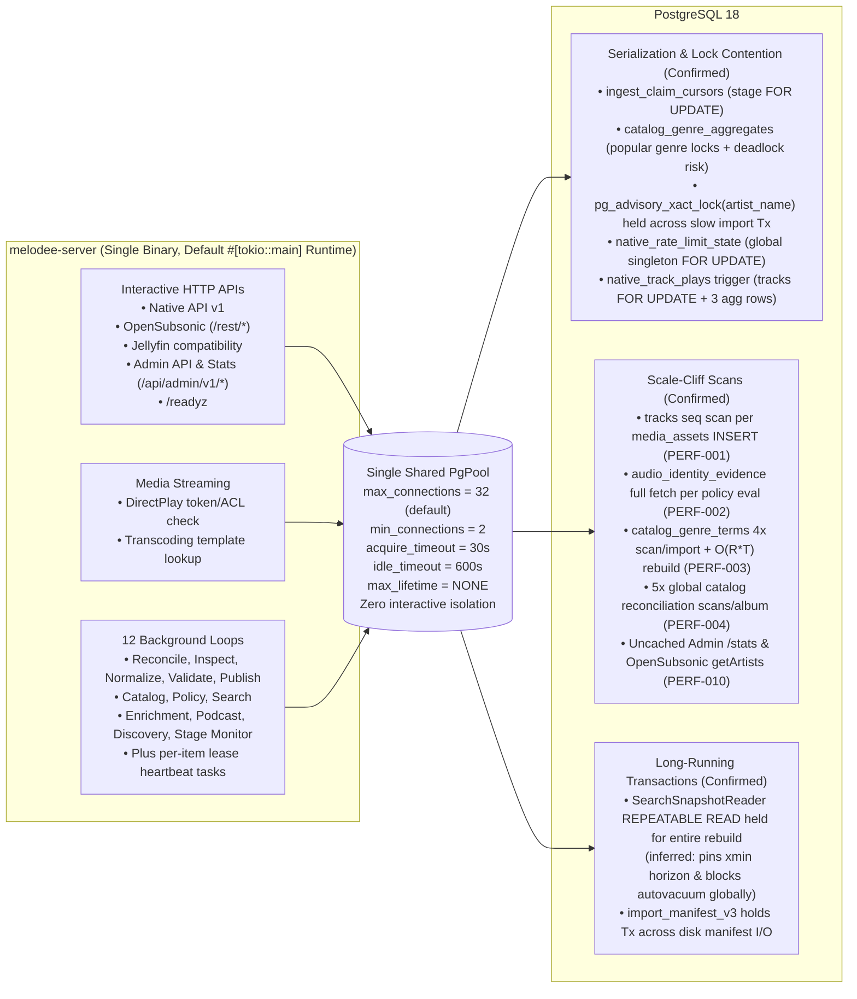
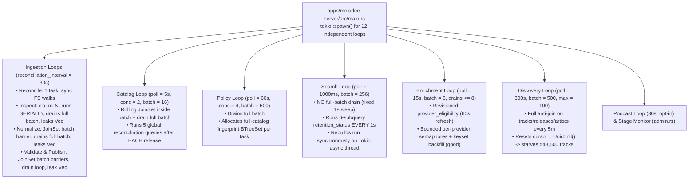
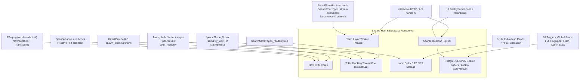

# Melodee-rs Processing and Database Performance Audit

**Audit scope:** Ground-up Rust server (`apps/melodee-server`), persistence/migrations (`crates/melodee-persistence`), ingestion (`crates/melodee-ingestion`), media processing (`crates/melodee-media`), catalog import (`crates/melodee-catalog`), policy persistence (`crates/melodee-persistence/src/policy.rs`, `apps/melodee-server/src/policy_worker.rs`), search (`crates/melodee-search`), and shared application services (`crates/melodee-application`).  
**Audit mode:** Read-only static code, SQL, schema, and architecture inspection (no application source, migrations, dependencies, or tests modified; no live database mutated).  
**Representative baseline scale:** 35,000 Artists / 50,000 Releases / 560,000 Tracks / ~5 TB media storage / 200+ album inbound bursts.  
**Target scalability horizon:** 1M, 5M, 10M, and 25M Tracks; 100,000+ Artists; hundreds of thousands to 1M+ Releases; concurrent ingestion, indexing, browsing, searching, and streaming.

---

## A. Executive summary

### Overall performance posture
**The architecture is fundamentally sound, but the current implementation contains severe scale-cliff defects that are invisible on small development databases, severely degrade the representative 560,000-track workload, and fail catastrophically toward 1M–10M+ tracks.**

Melodee-rs already incorporates several strong performance-conscious decisions: PostgreSQL as the authoritative state store, Tantivy as a rebuildable search projection, externalized content-addressed filesystem storage for binary assets and manifest evidence (ADR-0210, ADR-0213), revisioned provider eligibility and bounded keyset backfills (ADR-0212), bounded processed search-outbox retention with hourly aggregates (ADR-0214), weighted 3:1 ordinary-vs-bulk work lanes (ADR-0209), NFS publication I/O budgeting, and semaphore-bounded concurrency for password hashing, image resizing, direct play, and transcoding.

Despite those investments, tracing complete workflows across crate and SQL boundaries uncovered **four P0 critical scalability defects** and **six P1 high-impact production bottlenecks**. Several of these turn per-album ingestion and policy evaluation from $O(\text{tracks\_in\_release} \times \log N)$ into $O(N)$ per album ($O(N^2)$ over catalog growth), causing massive PostgreSQL sequential scans, lock serialization, multi-gigabyte memory spikes, Tokio async executor stalls, and extreme disk/subprocess amplification.

### Most significant bottlenecks
1. **O(N²) `tracks` sequential scan on every `media_assets` INSERT (PERF-001, P0):** `tracks(playable_media_asset_id)` has no index. In `persist_prepared_import`, `tracks` is inserted before `media_assets`, and `0019`'s `AFTER INSERT ... FOR EACH ROW` trigger on `media_assets` runs `SELECT track.id FROM tracks WHERE track.playable_media_asset_id = NEW.id`. Importing 200 albums (2,500 tracks) into a 560K-track library triggers **2,500 full sequential scans of `tracks` (~1.4 billion rows scanned)**; at 10M tracks, **25 billion rows scanned**. `PolicyStore::load_context`'s exact byte-hash check suffers from the same missing index.
2. **Catalog-wide acoustic fingerprint fetch per Release in `PolicyStore::load_context` and `load_dry_run_contexts` (PERF-002, P0):** `PolicyStore::load_context` omits the `= ANY($2)` digest filter and pulls **every acoustic fingerprint digest in the entire catalog** (`WHERE owner.release_id <> $1`) into a Rust `BTreeSet<String>` for every evaluated Release (~65–80 MB Rust heap/task at 560K tracks; **>1.3 GB/task → OOM at 10M tracks**). `load_dry_run_contexts` runs this as a correlated `array_agg(DISTINCT ...)` subquery across up to 10,000 releases.
3. **Unindexed `catalog_genre_terms` + 4× full-table recount triggers per album import + O(Releases × Tracks) search rebuild scan (PERF-003, P0):** `catalog_genre_terms` lacks both `(surface, display_value)` and `(release_id, surface)` indexes. Every album import triggers 2 full scans via `INSERT INTO catalog_imports`, plus **2 more full scans** 20 lines later when `UPDATE releases SET current_overlay_id = $2` fires `release_status_catalog_genre_aggregates` (declared `AFTER UPDATE ON releases` without `OF status`). Concurrent catalog importers also serialize on popular genre rows (`Rock`, `Pop`) in `catalog_genre_aggregates`. Worse, `RELEASE_SELECT_BY_ID` scans `catalog_genre_terms` per release during Tantivy rebuild (`50K × 560K = 28B` checks at baseline; `1M × 10M = 10T` at 10M tracks).
4. **Five unscoped global catalog reconciliation scans executed after EVERY single Release import (PERF-004, P0):** After every album commit, each concurrent catalog worker executes 5 heavy full-catalog multi-table analytical queries across `artists`, `releases`, `tracks`, `observed_artists`, and `artist_match_decisions` (which also lacks an index on `artist_id`). A 200-album import runs **1,000 full-catalog analytical queries**.
5. **Tantivy per-request index open/drop, 1,000-row synchronous rebuild commits, and 1 Hz outbox scans (PERF-005, PERF-006, P1):** Every interactive search/autocomplete opens and immediately unmaps a fresh Tantivy `Index` + `IndexReader` from disk (after sync `SearchRoot::open` + manifest BLAKE3 hashing on Tokio async threads). The outbox worker sleeps 1,000 ms after every 256-row batch (hard ~256 entities/s ceiling), hydrates via N+1 queries, opens/drops a 50 MB `IndexWriter` per batch, and executes a 6-subquery `retention_status` scan at **1 Hz (86,400×/day)** just to check an hourly timer. Full rebuild commits every 1,000 rows synchronously on a Tokio async thread, runs 10M unnecessary `TermQuery` lookups on an empty generation, and holds a single `REPEATABLE READ` snapshot open for hours (blocking autovacuum globally).
6. **Media processing I/O and subprocess amplification + async thread blocking + head-of-line blocking (PERF-007, PERF-009, P1):** A single album undergoes **6–12 full-album byte reads/hashes** (several synchronously on Tokio async worker threads, including back-to-back duplicate `tree_hash` calls one line apart in `normalize_one`), spawns **5–7 OS subprocesses per track** (13,500–16,000 subprocesses per 200 albums) with 10 ms `try_wait` polling and uncapped FFmpeg thread counts, runs inspection serially despite `inspection_concurrency`, normalizes tracks serially within an album, stalls workers on batch-barrier `JoinSet`s, and leaks memory unboundedly in `Vec<ReconcileResult>`.
7. **Single shared 32-connection `PgPool` and single Tokio runtime across HTTP + 12 background workers (PERF-008, P1):** No interactive connection reservation or pool isolation exists, and `import_manifest_v3` performs filesystem manifest reads/verification while holding an open `FOR UPDATE` PostgreSQL transaction.

### Database performance posture
**Fragile at 560K tracks; unsustainable at 1M–10M tracks without remediation.** The schema and domain model are rich and carefully normalized, and recent ADRs (0212–0214) solved real production issues (enrichment backlog, manifest JSONB TOAST bloat, outbox growth). However, missing foreign-key/projection indexes, unscoped reconciliation and policy queries, non-incremental aggregate triggers, ~12 duplicate/superseded indexes, and uncached heavy dashboard/browse queries dominate database cost.

### Processing pipeline efficiency
**Correctness-first and fault-tolerant, but heavily over-verified and I/O-amplified.** Durable staging handoff (ADR-0145) and manifest provenance are well engineered, but redundant full-tree BLAKE3 re-reads, duplicate `ffprobe`/`ffmpeg` invocations, lack of intra-album track parallelism, serial inspection, and batch-barrier `JoinSet`s leave substantial CPU and I/O throughput on the table while synchronously blocking Tokio async worker threads.

### Scalability & architectural verdict
- **Capable of supporting the representative production workload today?** **Not reliably under concurrent load.** Ingestion of 200-album bursts into a 560K-track catalog will experience severe PostgreSQL CPU/I/O thrashing, multi-second per-album catalog/policy latency, high search tail latency, and risk of interactive pool starvation.
- **Are substantial architectural changes necessary?** **No.** The modular monolith + PostgreSQL 18 + Tantivy + filesystem storage architecture can comfortably support both the 560K-track baseline and **10 million tracks** without introducing Redis, Kafka, RabbitMQ, or external search clusters—once the targeted SQL, index, trigger, Tantivy lifecycle, pool-isolation, and pipeline-I/O fixes in this report are applied.
- **Confidence in findings:** **High** for all schema, index, SQL, trigger, concurrency, and I/O amplification findings (directly verified in source code and migrations). Quantitative latency/throughput impact estimates are analytical/complexity-derived (**Confirmed** for operation counts and complexity; **Probable** for exact wall-clock timings pending isolated release-build benchmarks).

---

## B. Architecture and execution flow

All diagrams below document the **actual implemented runtime architecture** verified in source code. Where runtime behavior under load is inferred rather than directly measured, it is explicitly labeled *(inferred)*.

### 1. Media processing pipeline (implemented)

```mermaid
flowchart TB
    Inbound[("Inbound Source Root(s)\n(reconcile_inbound_source\nevery 30s)")]
    Reconcile["Reconciler (reconcile.rs)\n• SYNC discover_release_candidates on Tokio async thread\n• SYNC source_generation & snapshot_release_directory\n• Sequential N+1 DB queries per candidate"]
    Acq["Durable Staging Acquisition (acquisition.rs)\n• Same-dev: rename_noreplace + 1x tree_hash\n• Cross-dev: 4x tree_hash + copy (3 MiB buffers + fsync/file)\n• Delayed cleanup: 5th tree_hash before remove"]
    Inspect["Inspection Loop (inspect.rs)\n• Claims N = inspection_concurrency (default 2)\n• Executes items SERIALLY in for-loop!\n• 2x SYNC tree_hash + 2x SYNC snapshot on async thread\n• spawn_blocking: BLAKE3 hash + Lofty + ffprobe/track\n• Unbounded results.push() memory leak"]
    Norm["Normalization Loop (normalize.rs)\n• JoinSet batch barrier (waits for slowest album)\n• 3x SYNC tree_hash (2 back-to-back!) + 2x SYNC snapshot on async thread\n• spawn_blocking: 3x tool_version/album; serial per-track:\n  2x hash + 2x ffprobe + ffmpeg (no -threads) + fpcalc\n  + output hash + embedded art ffmpeg + 3rd hash\n• Unbounded results.push() memory leak"]
    Val["Validation Loop (publication_worker.rs)\n• JoinSet batch barrier + unbounded results.push()\n• spawn_blocking: verify & hash normalized work assets"]
    Pub["Publication Loop (publication_worker.rs)\n• JoinSet batch barrier + unbounded results.push()\n• Shared Mutex NfsIoBudget (default 8 MiB/s)\n• Write + exclusive hard-link + post-seal reread"]
    Cat["Catalog Loop (melodee-catalog/importer.rs)\n• Rolling JoinSet (concurrency=2, batch=16)\n• Inside open FOR UPDATE Tx: disk manifest read & parse!\n• INSERT tracks before media_assets -> O(N) tracks seq scan/row!\n• INSERT catalog_imports + UPDATE releases -> 4x genre table scans!\n• Post-Tx: 5x GLOBAL full-catalog reconciliation scans/album!"]
    Pol["Policy Loop (policy_worker.rs)\n• Concurrency=4, batch=500\n• load_context fetches ALL catalog fingerprints into BTreeSet!\n• exact_hash_rows joins unindexed tracks.playable_media_asset_id"]
    Search["Search Outbox Loop (melodee-search/worker.rs)\n• Fixed 1,000ms sleep after every 256-row batch (no drain)\n• 1 Hz 6-subquery retention_status scan\n• N+1 load_catalog_record (RELEASE scans catalog_genre_terms!)\n• Open 50 MB IndexWriter -> TermQuery/doc -> commit -> DROP"]

    Inbound --> Reconcile --> Acq --> Inspect --> Norm --> Val --> Pub --> Cat --> Pol --> Search
```



### 2. Database access and transaction flow (implemented)



### 3. Background worker execution & scheduling (implemented)



### 4. Search indexing & query flow (implemented)

```mermaid
flowchart LR
    subgraph Incremental["Incremental Outbox Path (worker.rs)"]
        Outbox[("catalog_projection_outbox")] --> Claim["claim_outbox(batch=256)"]
        Claim --> LoopHydrate["for item in 0..256:\nload_catalog_record(id)\n(N+1 sequential DB queries;\nRELEASE scans catalog_genre_terms!)"]
        LoopHydrate --> OpenW["spawn_blocking: SearchStore::open\n(allocates 50 MB IndexWriter +\nmerge threads + IndexReader)"]
        OpenW --> Upsert["For each doc:\nexisting_revision() TermQuery + DocStore read\ndelete_term + add_document"]
        Upsert --> CommitW["writer.commit() + reader.reload()\n+ 3x Count stats() + DROP writer"]
        CommitW --> Sleep["sleep(1000ms)"]
    end

    subgraph Rebuild["Full Rebuild Path (rebuild.rs)"]
        Snap["SearchSnapshotReader::begin\n(REPEATABLE READ Tx held until end!)"] --> Page["Keyset pages of 1,000 rows\n(releases_page scans catalog_genre_terms!)"]
        Page --> SyncIdx["ON TOKIO ASYNC THREAD (no spawn_blocking):\nupsert_* (TermQuery/doc on empty index!)\n+ store.commit() EVERY 1,000 rows!"]
    end

    subgraph Query["Interactive Query Path (service.rs)"]
        Req["Search / Autocomplete / Artist Lookup"] --> Meta["active_generation_path:\nSYNC SearchRoot::open + PG query\n+ SYNC manifest read + BLAKE3 hash"]
        Meta --> OpenR["spawn_blocking:\nSearchStore::open_readonly\n(mmaps all segments + builds IndexReader)"]
        OpenR --> RunQ["Execute 1 query -> DROP Index & Reader"]
    end
```



### 5. Shared resource contention (implemented + inferred load interactions)



---

## C. Performance scorecard

| Area | Score (1–10) | Justification |
|---|---:|---|
| **Database query efficiency** | **3** | Unfiltered full-catalog fingerprint fetch in `PolicyStore::load_context` and `load_dry_run_contexts`; 5 unscoped full-catalog reconciliation scans per imported release; uncached multi-scan `/api/admin/v1/stats`; N+1 search outbox hydration; O(R×T) unindexed `catalog_genre_terms` scan in `RELEASE_SELECT_BY_ID`; unindexed correlated `AVG(rating)` in OpenSubsonic `getArtists.view`; short-token `ILIKE`, `COUNT(*)`, and per-row ACL functions in Native v1. |
| **Database indexing** | **4** | Solid foundational partial/covering indexes (migrations 0018, 0029, 0047, 0057), but missing high-impact indexes (`tracks(playable_media_asset_id)`, `catalog_genre_terms(release_id, surface)`, `catalog_genre_terms(surface, display_value)`, `artist_match_decisions(artist_id)`, `native_artist_user_states(artist_id)`, `releases(release_date DESC NULLS LAST)`, `native_track_plays(played_at)`) create scale cliffs while ~12 duplicate/superseded indexes add write amplification. |
| **Database write efficiency** | **3** | Main catalog tables use multi-row `QueryBuilder`, but per-row `media_assets` and statement-level `catalog_genre_terms` triggers create O(N) scans per album import; acoustic/external ID inserts loop row-by-row; `QueryBuilder` churns prepared statement caches; `renew_lease` breaks HOT updates across 7 indexes and appends unbounded events. |
| **Transaction management** | **4** | Atomic lease-fenced state transitions and outbox commits are well designed, but `import_manifest_v3` reads/verifies manifest files from disk inside an open `FOR UPDATE` transaction; `catalog_genre_aggregates` locks serialize concurrent importers; `SearchSnapshotReader` holds `REPEATABLE READ` for hours during rebuild; `record_rate_limit_attempt` uses a global singleton `FOR UPDATE` lock. |
| **Connection pooling** | **3** | One shared `PgPool` (`max_connections = 32`, `acquire_timeout = 30s`, no `max_lifetime`) serves all interactive APIs, streaming, and 12 background workers with zero isolation or interactive reservation. |
| **Rust async implementation** | **4** | `password_work`, `image`, `asset_files`, and `normalize_release` properly use `spawn_blocking`, but synchronous recursive FS walks, full-album `tree_hash`, `SearchRoot::open`/manifest hashing, `stream_file` `openat`/`seek`, and the entire Tantivy rebuild run synchronously on Tokio async worker threads. |
| **Concurrency management** | **5** | Explicit semaphores protect streaming, transcoding, image processing, passwords, and provider enrichment. Undermined by serial inspection (ignoring `inspection_concurrency`), batch-barrier head-of-line blocking in normalization/validation/publication, serial per-track normalization, and uncapped FFmpeg thread counts. |
| **Memory efficiency** | **4** | Policy evaluation allocates full-catalog `BTreeSet<String>` per task (OOM risk at 10M tracks); OpenSubsonic `getArtists.view` materializes all 35K–100K+ artists as `serde_json::Value` (`IndexMap`) trees; ingestion loops leak `Vec<ReconcileResult>` unboundedly; direct-play allocates a fresh 64 KiB `Vec` per chunk; cross-device copy allocates 3 MiB of layered buffers per file. |
| **Filesystem I/O** | **3** | 6–12 full-album reads/hashes across acquisition, inspection, and normalization (including back-to-back duplicate `tree_hash` calls one line apart in `normalize_one`), plus per-file `fsync` on cross-device copy. Partially offset by `NfsIoBudget`, ADR-0209 NFS reread removal, and content-addressed `asset_files`. |
| **Media processing throughput** | **3** | 13,500–16,000 OS subprocess spawns per 200-album batch (including redundant `tool_version`, redundant source/output `ffprobe` on retainable MP3s, redundant embedded artwork `ffmpeg`), 10 ms `try_wait` polling, serial track processing, and low default concurrency (`2`). |
| **Background job processing** | **6** | Strong durable PostgreSQL lease/claim model (`FOR UPDATE SKIP LOCKED`), 3:1 priority lanes (ADR-0209), and revisioned provider eligibility (ADR-0212). Weakened by search's 1s fixed sleep + 1 Hz `retention_status`, discovery's cursor-reset starvation, and unbounded `release_work_item_events` growth. |
| **Search performance** | **3** | Sound Tantivy schema and generational activation design, undermined by per-request `open_readonly`, per-batch `IndexWriter` open/drop, N+1 hydration, 1,000-row synchronous rebuild commits, and 10M wasted `existing_revision` lookups during rebuild. |
| **Interactive responsiveness** | **4** | Good stream/transcode admission caps, but shared pool exhaustion, Tokio async blocking, per-request Tantivy opens, uncached heavy `/api/admin/v1/stats`, OpenSubsonic `getArtists` correlated scans + `u+p` per-request bcrypt, and Native short-`ILIKE`/`DESC NULLS LAST` queries threaten tail latency under background load. |
| **Scalability** | **3** | Current O(N²) `media_assets` trigger, O(N) per-release fingerprint load, O(N) per-import genre scans, and 5× global reconciliation scans hit a hard ceiling well before 1M tracks and fail at 5M–10M tracks—though the underlying architecture can reach 10M+ once these defects are fixed. |
| **Performance observability** | **4** | Structured `tracing` spans with correlation IDs, `ResourceBounds` gauges, `stage_health` stall detection, and `EventBuffer` are solid baselines, but latency percentiles/histograms, DB pool wait duration, per-stage throughput counters, and cache hit rates are missing, and `SLOW_REQUEST_MILLIS` is 10,000 ms. |

---

## D. Prioritized findings

### Summary table

| ID | Severity | Finding | Category | Evidence | Confidence | Impact | Effort |
|---|---|---|---|---|---|---|---|
| **PERF-001** | **P0** | Missing index on `tracks(playable_media_asset_id)` causes O(N²) full `tracks` seq-scan on every `media_assets` INSERT and policy hash join | Database / Indexing | Confirmed | High | Catastrophic import stall (1.4B–25B rows scanned per 200 albums) | Small |
| **PERF-002** | **P0** | `PolicyStore::load_context` & `load_dry_run_contexts` load every acoustic fingerprint digest in the entire catalog per Release | Database / Memory | Confirmed | High | Multi-GB RAM / OOM crash & DB saturation | Small |
| **PERF-003** | **P0** | Missing `catalog_genre_terms` indexes + 4× full-table recount triggers per import/update + O(R×T) Tantivy rebuild scan | Database / Contention | Confirmed | High | 4× full scans/import, worker serialization, rebuild stall | Medium |
| **PERF-004** | **P0** | Five unscoped full-catalog reconciliation scans execute after every single Release import (+ missing `artist_match_decisions(artist_id)` index) | Database / Pipeline | Confirmed | High | 1,000 full-catalog analytical queries per 200 albums | Medium |
| **PERF-005** | **P1** | Tantivy opens/drops `Index`+`IndexReader` per query; outbox opens/drops `IndexWriter`, sleeps 1s/batch, N+1 hydrates, and runs 6-subquery `retention_status` at 1 Hz | Search / Database | Confirmed | High | High search p99 latency, 256/s indexing cap, 86.4K idle DB scans/day | Medium |
| **PERF-006** | **P1** | Tantivy rebuild commits every 1,000 rows synchronously on Tokio async thread, executes 10M `TermQuery` lookups on an empty index, and holds `REPEATABLE READ` for hours | Search / Async / MVCC | Confirmed | High | Multi-hour rebuilds, async starvation, global MVCC table bloat | Medium |
| **PERF-007** | **P1** | Media pipeline I/O & subprocess amplification (6–12× full-album reads, sync `tree_hash` on async threads, 13.5K–16K subprocesses/200 albums, serial inspection & tracks, uncapped FFmpeg threads) | Media / Async / FS I/O | Confirmed | High | Dominates 200-album wall time & stalls Tokio runtime | Medium–Large |
| **PERF-008** | **P1** | Single shared 32-conn `PgPool` & single Tokio runtime across HTTP + 12 workers, plus disk manifest I/O inside open DB transactions | Pooling / Contention | Confirmed | High | Background ingestion starves interactive APIs & streaming | Medium |
| **PERF-009** | **P1** | Batch-barrier head-of-line blocking across ingestion workers + unbounded `Vec<ReconcileResult>` memory leak | Concurrency / Memory | Confirmed | High | Up to ~50% worker slot idle waste & unbounded RSS growth | Small |
| **PERF-010** | **P1** | Expensive interactive APIs: uncached multi-scan `/api/admin/v1/stats`, OpenSubsonic `getArtists` unindexed `AVG(rating)`/sort/DOM, Native `DESC NULLS LAST` & short-`ILIKE` & per-row ACLs & Admin artist `OR ILIKE` | API / Database | Confirmed | High | Multi-second interactive tail latency at 560K–10M tracks | Medium |
| **PERF-011** | **P2** | ~12 duplicate/superseded indexes + non-HOT `release_work_items` heartbeats + unbounded `release_work_item_events` / settling history | Database / Maintenance | Confirmed | High | Elevated write amplification, WAL volume, index RAM, & table bloat | Small–Medium |
| **PERF-012** | **P2** | Discovery worker resets keyset cursor to `Uuid::nil()` every 5 min, permanently starving >48,500 tracks, all releases/artists, and chart relinking while running full anti-joins | Background Workers | Confirmed | High | Wasted full-table anti-joins every 5 min + broken popularity sync | Small |
| **PERF-013** | **P2** | Streaming/auth/cache inefficiencies: per-64-KiB `spawn_blocking` + sync `openat`/`seek` on async thread, OpenSubsonic per-req bcrypt/DB lookups, `BlacklistCache` stampede, singleton rate-limit lock, redundant artwork SHA-256 | API / Async / Caching | Confirmed | Medium–High | Elevated streaming blocking-pool load & auth contention | Small–Medium |
| **PERF-014** | **P2** | Catalog write loops (`audio_identity_evidence`, external IDs, advisory locks), `QueryBuilder` prepared-statement churn, and per-play `native_track_plays` trigger locking | Database / Writes | Confirmed | Medium | Extra DB round trips, statement cache eviction, play lock contention | Small–Medium |
| **PERF-015** | **P2** | Performance observability blind spots (no histograms/percentiles, pool wait, or stage throughput) & benchmarks hiding production bottlenecks | Observability / Benchmarks | Confirmed | High | Production regressions go undetected until scale | Small–Medium |

---

### Detailed finding descriptions

---

#### PERF-001 — Missing index on `tracks(playable_media_asset_id)` causes O(N²) full `tracks` sequential scan on every `media_assets` INSERT and policy exact-hash check
- **Severity:** P0 — Critical | **Confidence:** High | **Evidence:** Confirmed
- **Affected source files:**
  - `crates/melodee-persistence/migrations/0019_phase7_native_route_bounds.sql`
  - `crates/melodee-persistence/migrations/0007_phase4_catalog.sql`
  - `crates/melodee-persistence/src/catalog.rs`
  - `crates/melodee-persistence/src/policy.rs`
- **Specific functions, symbols, and SQL statements:**
  - `refresh_native_track_file_name_from_media()`, trigger `media_assets_native_file_name_refresh` (`0019_phase7_native_route_bounds.sql:51-69`)
  - `tracks` table & index definitions (`0007_phase4_catalog.sql:402-472`)
  - `persist_prepared_import()` (`catalog.rs:3733-3784`)
  - `PolicyStore::load_context()` `exact_hash_rows` (`policy.rs:2204-2213`)
- **Execution path:** `start_catalog_loop` → `import_once_with_cancellation` → `CatalogStore::import_manifest_v3` → `persist_prepared_import`:
  1. Executes multi-row `INSERT INTO tracks` (`catalog.rs:3733-3758`), firing `tracks_native_file_name_refresh` (`FOR EACH ROW`), which queries `tracks JOIN media_assets` — finding **0 rows** because `media_assets` has not been inserted yet — and runs a wasted `DELETE FROM native_track_file_names` per track.
  2. Immediately executes multi-row `INSERT INTO media_assets` (`catalog.rs:3760-3784`), firing `media_assets_native_file_name_refresh` (`AFTER INSERT OR UPDATE OF canonical_relative_path ... FOR EACH ROW`), which runs:
     ```sql
     PERFORM refresh_native_track_file_name(track.id)
     FROM tracks track
     WHERE track.playable_media_asset_id = NEW.id;
     ```
  3. Downstream in `PolicyStore::load_context` (`policy.rs:2204-2213`), runs:
     ```sql
     SELECT DISTINCT m.byte_hash
       FROM tracks t
       JOIN media_assets m ON m.id = t.playable_media_asset_id
      WHERE t.release_id <> $1 AND m.byte_hash = ANY($2)
     ```
- **Explanation of current behavior & why it is inefficient:** Across all 59 migrations, **no index on `tracks` has `playable_media_asset_id` as its leading column** (migration `0008:299` adds `UNIQUE (id, release_id, audio_identity_id, playable_media_asset_id)`, which leads with `id` and cannot serve lookups by `playable_media_asset_id`). Therefore:
  - Every single `media_assets` row inserted during catalog import performs a **full sequential scan of the entire `tracks` table**.
  - In `PolicyStore::load_context`, `m.byte_hash = ANY($2)` hits `media_assets_byte_hash_idx` and always matches at least the current release's own newly inserted assets (typically 10–20 rows), and then probing `tracks` on `playable_media_asset_id` requires scanning `tracks` (or building a massive hash join).
- **Workloads affected:** Every catalog import, bulk ingestion burst, legacy migration, release merge/rewrite, and policy evaluation.
- **Expected behavior as data volume increases:**
  - **560K tracks:** 1 album (12 tracks) scans `12 × 560K = 6.72M` rows; a 200-album import (2,500 tracks) scans **`1.4 billion` rows** of `tracks`.
  - **1M tracks:** 200-album import scans **2.5 billion** rows.
  - **10M tracks:** 200-album import scans **25 billion** rows; building a 10M-track library via ingestion is strictly $O(N^2)$ (~50 trillion row checks).
- **Estimated resource impact:** At 560K tracks (~150–250 MB heap for `tracks`), 2,500 sequential scans read **375–625 GB** of shared/OS buffer pages and saturate PostgreSQL CPU cores; at 10M tracks (~3–5 GB heap), catalog import collapses to minutes per album.
- **Recommended remediation:**
  1. Add `CREATE INDEX CONCURRENTLY tracks_playable_media_asset_idx ON tracks (playable_media_asset_id) INCLUDE (release_id);`.
  2. Insert `media_assets` **before** `tracks` in `persist_prepared_import` (safe because `tracks_exactly_one_playable_asset_fk` is `DEFERRABLE INITIALLY DEFERRED`), so `tracks_native_file_name_refresh` succeeds on the first pass.
  3. Restrict `media_assets_native_file_name_refresh` to `AFTER UPDATE OF canonical_relative_path ON media_assets FOR EACH ROW WHEN (OLD.canonical_relative_path IS DISTINCT FROM NEW.canonical_relative_path)` (an `INSERT` into `media_assets` before `tracks` can never have referencing tracks).
  4. Convert `tracks_native_file_name_refresh` from `FOR EACH ROW` to a `FOR EACH STATEMENT` transition-table trigger (or a single set-based `INSERT INTO native_track_file_names` inside `persist_prepared_import`).
- **Trade-offs and potential regressions:** Adding one narrow index (~350 MB at 10M tracks) is completely offset by dropping the exact duplicate `tracks_native_random_candidate_idx` (PERF-011). Any caller inserting `tracks` before `media_assets` (e.g., legacy importer or tests) must be checked so `native_track_file_names` still populates; retaining the index makes even the update path $O(\log N)$.
- **Estimated implementation effort:** Small (1 migration + ~20 lines in `catalog.rs` + regression test).
- **Validation method:** Run `EXPLAIN (ANALYZE, BUFFERS)` on `INSERT INTO media_assets` and `exact_hash_rows` against a 560K-track isolated test DB; confirm Index Scan with <10 buffer hits per track vs ~20,000+ before.

---

#### PERF-002 — `PolicyStore::load_context` and `load_dry_run_contexts` fetch every acoustic fingerprint digest in the entire catalog per Release
- **Severity:** P0 — Critical | **Confidence:** High | **Evidence:** Confirmed
- **Affected source files:**
  - `crates/melodee-persistence/src/policy.rs`
  - `crates/melodee-persistence/migrations/0043_acoustic_identity_evidence_indexes.sql`
- **Specific functions, symbols, and SQL statements:**
  - `PolicyStore::load_context()` (`policy.rs:2266-2277`)
  - `PolicyStore::load_dry_run_contexts()` (`policy.rs:2572-2580`)
  - Index `audio_identity_evidence_acoustic_digest` (`0043_acoustic_identity_evidence_indexes.sql`)
- **Execution path:** `start_policy_loop` → `evaluate_policy_once` (up to `MELODEE__POLICY__CONCURRENCY = 4` concurrent tasks) → `PolicyStore::load_context` → executes:
  ```sql
  SELECT DISTINCT evidence.payload->>'fingerprint_digest'
    FROM audio_identity_evidence evidence
    JOIN tracks owner ON owner.id = evidence.track_id
   WHERE evidence.evidence_kind = 'acoustic_fingerprint'
     AND evidence.payload ? 'fingerprint_digest'
     AND owner.release_id <> $1
  ```
  And in `load_dry_run_contexts` (`policy.rs:2572-2580`, up to `MAX_POLICY_TEST_RELEASES = 10_000` releases):
  ```sql
  COALESCE((
    SELECT array_agg(DISTINCT evidence.payload->>'fingerprint_digest')
      FROM audio_identity_evidence evidence
      JOIN tracks owner ON owner.id = evidence.track_id
     WHERE evidence.evidence_kind = 'acoustic_fingerprint'
       AND evidence.payload ? 'fingerprint_digest'
       AND owner.release_id <> ci.release_id
  ), ARRAY[]::text[]) AS acoustic_fingerprints
  ```
- **Explanation of current behavior & why it is inefficient:** Although migration `0043` specifically created the partial expression index `audio_identity_evidence_acoustic_digest ON audio_identity_evidence ((payload ->> 'fingerprint_digest'))`, neither `load_context` nor `load_dry_run_contexts` filters by the digests belonging to the Release being evaluated. Every single policy evaluation therefore:
  1. Scans **every** acoustic fingerprint row in `audio_identity_evidence` and joins **every** row in `tracks`.
  2. Runs a catalog-wide `DISTINCT` hash/sort aggregation in PostgreSQL.
  3. Streams all 64-byte hex digests across the wire and allocates a `BTreeSet<String>` containing the entire catalog's fingerprints in Rust—solely to test whether ~12 tracks from the claimed Release exist in the set.
  4. In `load_dry_run_contexts`, materializes that entire array **once per sampled release** (up to 10,000 copies in a single query!).
- **Workloads affected:** Every ingested Release passing through Policy evaluation; every Admin Policy dry-run.
- **Expected behavior as data volume increases:**
  - **560K tracks:** ~40 MB wire transfer + ~65–80 MB Rust heap per concurrent policy task (~260–320 MB across 4 tasks). A 200-album import scans **112M evidence rows**, transfers **~8 GB**, and churns **~16 GB** of Rust heap. One 10,000-release dry-run attempts to construct `5.6 billion` array elements (instant PostgreSQL OOM/temp-disk crash).
  - **5M–10M tracks:** ~650 MB–1.3 GB Rust heap **per single policy task** (>5 GB across 4 concurrent tasks → OOM kill on typical servers; multi-second spill-to-disk hash aggregates in PostgreSQL).
- **Recommended remediation:**
  1. In `PolicyStore::load_context`, extract `digests: Vec<String>` from `tracks` (`audio_fingerprint_digest`), return an empty `BTreeSet` immediately if empty, and bind `AND (evidence.payload->>'fingerprint_digest') = ANY($2)` so PostgreSQL uses `audio_identity_evidence_acoustic_digest`.
  2. In `load_dry_run_contexts`, restrict the correlated subquery to `AND (evidence.payload->>'fingerprint_digest') IN (SELECT track_fact.fingerprint_digest FROM release_work_item_manifest_track_facts track_fact WHERE track_fact.manifest_row_id = wm.id AND track_fact.fingerprint_digest IS NOT NULL)` (matching the scoped `EXISTS` pattern already used at `policy.rs:1327`).
- **Trade-offs and potential regressions:** None; semantically identical result set (downstream novelty code only checks `catalog_acoustic_fingerprints.contains(track_digest)`).
- **Estimated implementation effort:** Small (<1 day).
- **Validation method:** `EXPLAIN (ANALYZE, BUFFERS)` confirming Index Scan on `audio_identity_evidence_acoustic_digest`; policy unit/integration tests + 560K-track dry-run & 200-album RSS profiling.

---

#### PERF-003 — Missing `catalog_genre_terms` indexes + 4× full-table recount triggers per album import + O(Releases × Tracks) search rebuild scan
- **Severity:** P0 — Critical | **Confidence:** High | **Evidence:** Confirmed
- **Affected source files:**
  - `crates/melodee-persistence/migrations/0038_catalog_genre_serving_projection.sql`
  - `crates/melodee-persistence/migrations/0059_manifest_evidence_files.sql`
  - `crates/melodee-persistence/src/catalog.rs`
  - `crates/melodee-persistence/src/search.rs`
- **Specific functions, symbols, and SQL statements:**
  - `catalog_genre_terms` indexes (`0038:29-35`)
  - `refresh_inserted_catalog_genre_aggregates()`, `refresh_deleted_catalog_genre_aggregates()`, `refresh_release_status_catalog_genre_aggregates()`, triggers `catalog_genre_terms_insert_aggregates`, `release_status_catalog_genre_aggregates` (`0038:105-239`)
  - `project_catalog_import_genres()` (`0059:196-232`)
  - `persist_prepared_import()` `INSERT INTO catalog_imports` (`catalog.rs:4128`) and `UPDATE releases SET current_overlay_id = $2` (`catalog.rs:4173`)
  - `RELEASE_SELECT_BY_ID` (`search.rs:1825-1830`)
- **Execution path:**
  1. **Catalog import (`persist_prepared_import`):** `INSERT INTO catalog_imports` fires `project_catalog_import_genres()`, which runs two `INSERT INTO catalog_genre_terms` (`'native'` and `'opensubsonic'`). Each fires `catalog_genre_terms_insert_aggregates`, executing:
     ```sql
     SELECT term.surface, term.display_value, count(*)::bigint,
            count(DISTINCT term.release_id)::bigint
       FROM catalog_genre_terms term
       JOIN releases release ON release.id = term.release_id AND release.status = 'active'
       JOIN (SELECT DISTINCT surface, display_value FROM inserted_genre_terms) affected
            USING (surface, display_value)
      GROUP BY term.surface, term.display_value
     ON CONFLICT (surface, display_value) DO UPDATE ...
     ```
  2. **Overlay pointer update (20 lines later, same transaction):** `UPDATE releases SET current_overlay_id = $2 WHERE id = $1` (`catalog.rs:4173`) fires `release_status_catalog_genre_aggregates` — declared **`AFTER UPDATE ON releases`** (missing `OF status`!) — executing **two more** full scans (`INSERT ... ON CONFLICT` + `DELETE ... WHERE NOT EXISTS`) across `catalog_genre_terms`.
  3. **Search rebuild & outbox (`RELEASE_SELECT_BY_ID`, `search.rs:1825-1830`):**
     ```sql
     SELECT genre.display_value AS term
       FROM catalog_genre_terms genre
      WHERE genre.release_id = release.id
        AND genre.surface = 'native'
     ```
- **Explanation of current behavior & why it is inefficient:**
  1. `catalog_genre_terms` has **only** `PK(track_id, surface, display_value)`, `(surface, match_value, release_id, track_id)`, `(track_id, surface, match_value)`, and `(surface, normalized_value, track_id)`. Because `match_value` is a generated column (`btrim(display_value)`), PostgreSQL **cannot** use `catalog_genre_terms_release_match_idx` for `USING (surface, display_value)`. And **no index leads with `release_id`**.
  2. Therefore, **every single album import triggers FOUR full sequential scans of `catalog_genre_terms`** (~1.12M rows at 560K tracks; ~20M rows at 10M tracks).
  3. Even with an index on `(surface, display_value)`, recomputing `COUNT(DISTINCT release_id)` across all 150K–2.5M `'Rock'` rows on every album import is $O(\text{genre\_cardinality})$, and `ON CONFLICT (surface, display_value) DO UPDATE` acquires exclusive row locks on `catalog_genre_aggregates('native', 'Rock')` and `('opensubsonic', 'Rock')` for the remainder of the transaction—**completely serializing concurrent catalog workers** importing popular genres and risking deadlocks on multi-genre albums (no deterministic `ORDER BY` before `ON CONFLICT`).
  4. During a Tantivy search rebuild, `RELEASE_SELECT_BY_ID` scans `catalog_genre_terms` for every single release: **50,000 × 560,000 = 28 billion rows** at baseline, and **1M × 10M = 10 trillion rows** at 10M tracks.
- **Workloads affected:** Catalog import, concurrent bulk imports, release updates/merges/overlays, search outbox hydration, and full Tantivy rebuilds.
- **Recommended remediation:**
  1. **Immediate:** Add `CREATE INDEX CONCURRENTLY catalog_genre_terms_release_surface_idx ON catalog_genre_terms (release_id, surface) INCLUDE (display_value);` and change `release_status_catalog_genre_aggregates` to `AFTER UPDATE OF status ON releases`.
  2. **Structural:** Replace full-recount triggers on `catalog_genre_aggregates` with **incremental delta maintenance**: track per-`(surface, display_value, release_id)` track counts in a small helper table (or update `catalog_genre_aggregates` via sorted-key delta updates / asynchronous batch refresh) so importing a 12-track `'Rock'` album does $O(1)$ work per distinct genre on that album instead of recounting 150K–2.5M rows. Always `ORDER BY surface, display_value` before `ON CONFLICT DO UPDATE` to prevent deadlocks.
- **Trade-offs and potential regressions:** Synchronous delta maintenance via a per-release-genre count table adds 1 small table (~50K–1M rows, one per release×genre) while preserving exact synchronous consistency; asynchronous batch refresh removes all row-lock contention on popular genres at the cost of a few seconds of eventual consistency on genre counts.
- **Estimated implementation effort:** Medium (2–3 days).
- **Validation method:** `EXPLAIN (ANALYZE, BUFFERS)` on `RELEASE_SELECT_BY_ID` and `INSERT INTO catalog_imports`; 4-worker concurrent import of 200 `'Rock'`/`'Pop'` albums verifying linear throughput and zero lock waits in `pg_stat_activity`.

---

#### PERF-004 — Five unscoped full-catalog reconciliation scans execute after every single Release import (plus missing `artist_match_decisions(artist_id)` index)
- **Severity:** P0 — Critical | **Confidence:** High | **Evidence:** Confirmed
- **Affected source files:**
  - `crates/melodee-catalog/src/importer.rs`
  - `crates/melodee-persistence/src/catalog.rs`
  - `crates/melodee-persistence/migrations/0007_phase4_catalog.sql`
- **Specific functions, symbols, and SQL statements:**
  - `import_once_with_cancellation()` (`importer.rs:176-177`) calling `reconcile_artist_identities_once` (`importer.rs:221-226`) and `reconcile_strong_release_identities` (`importer.rs:502`)
  - `CatalogStore::strong_artist_merge_candidates()` (`catalog.rs:857-970`)
  - `CatalogStore::same_release_track_artist_merge_candidates()` (`catalog.rs:977-1050`)
  - `CatalogStore::repeated_artist_credit_merge_candidates()` (`catalog.rs:1402-1580`)
  - `CatalogStore::name_only_artist_match_proposal_candidates()` (`catalog.rs:1589-1660`)
  - `CatalogStore::strong_release_merge_candidates()` (`catalog.rs:1666-1715`)
  - `artist_match_decisions` indexes (`0007_phase4_catalog.sql:680-722`)
- **Execution path:** Inside `import_once_with_cancellation`, **every single spawned task** (`concurrency = 2+`), immediately upon `store.import_manifest_v3(...)` returning `Ok(result)`, executes all five unscoped queries across the entire database.
- **Explanation of current behavior & why it is inefficient:**
  1. None of the five queries accept the just-imported `release_id`, touched `artist_id`s, or touched `normalized_name`s. Every single album import scans:
     - All `artist_external_identities` (with regex `~*` check + global `GROUP BY`).
     - All active `releases` joined to `release_artists`, `artists`, `release_classifications`, `artist_match_decisions`, `observed_artists`.
     - All active `artists` with 7 correlated `EXISTS`/`NOT EXISTS` subqueries + `UNION` of all `release_artists` and all `track_artists JOIN tracks` (560K–10M rows!).
     - All `observed_artists` (600K–12M rows!) joined to `artist_match_current`, `artist_match_decisions`, and self-joined `artists`.
     - All trusted `release_external_identities`.
  2. `artist_match_decisions` has **no index on `artist_id`** (only PK `id`, `(id, observed_artist_id)`, `(observed_artist_id, outcome)`, `one_root_idx(observed_artist_id)`, and `one_successor_idx(predecessor_decision_id)`), forcing sequential scans or full hash builds on `WHERE decision.artist_id = artist.id`.
  3. Concurrent catalog workers run these identical global scans simultaneously and collide on the same merge candidates (`MutationConflict`).
- **Workloads affected:** All catalog imports; 200-album bursts execute **1,000 full-catalog multi-table analytical scans**.
- **Expected behavior as data volume increases:** Per-album import time grows as $O(N)$ with total catalog size. At 560K tracks, these 5 queries will consume seconds per album; at 5M–10M tracks (~12M `observed_artists` & `artist_match_decisions`), each album import will take tens of seconds to minutes and saturate PostgreSQL CPU and buffer pool.
- **Recommended remediation:**
  1. Add `CREATE INDEX CONCURRENTLY artist_match_decisions_artist_idx ON artist_match_decisions (artist_id, observed_artist_id);`.
  2. Return the imported release's touched `release_id`, `normalized_names`, and embedded external IDs in `CatalogImportResult`, and write **scoped** variants of the 5 queries filtering `WHERE normalized_name = ANY($1)` / `WHERE release.id = $1` / `WHERE external_id = ANY($1)`.
  3. Keep the unscoped global sweep strictly for startup (already called once in `scheduler.rs:48`) or an explicit maintenance CLI / low-frequency scheduled job (e.g., daily).
- **Trade-offs and potential regressions:** Scoped queries only inspect entities that the just-committed import could possibly have affected (identical convergence semantics for new imports, since unchanged historical entities were already reconciled at startup or previous imports).
- **Estimated implementation effort:** Medium (2–3 days).
- **Validation method:** Compare `pg_stat_statements` mean/total execution time for a 200-album import into a 560K-track synthetic catalog before and after; confirm >95% drop in reconciliation DB time and zero full-table scans on `observed_artists` / `tracks`.

---

#### PERF-005 — Tantivy opens/drops `Index`+`IndexReader` per search request; outbox worker opens/drops `IndexWriter`, sleeps 1s/batch, N+1 hydrates, and runs 6-subquery `retention_status` at 1 Hz
- **Severity:** P1 — High | **Confidence:** High | **Evidence:** Confirmed
- **Affected source files:**
  - `crates/melodee-search/src/service.rs`
  - `crates/melodee-search/src/store.rs`
  - `crates/melodee-search/src/worker.rs`
  - `crates/melodee-persistence/src/search_retention.rs`
- **Specific functions, symbols, and SQL statements:**
  - `query_plan_active()`, `query_active_kind()`, `autocomplete_active()`, `resolve_artist_ids_active()`, `active_generation_path()`, `validate_active_manifest()` (`service.rs:47-96, 173-204`)
  - `SearchStore::open()`, `open_readonly()`, `from_index()` (`store.rs:58-107`)
  - `start_search_loop()`, `run_outbox_maintenance_if_due()`, `apply_outbox_once_with_cancel()`, `apply_batch()` (`worker.rs:240-330, 483-500, 765-815`)
  - `retention_status()` (`search_retention.rs:220-310`)
- **Execution path:**
  - *Interactive search:* Request → `active_generation_path` (sync `SearchRoot::open` + DB `active_generation` + sync file read & BLAKE3 hash of manifest on Tokio async thread) → `spawn_blocking` → `SearchStore::open_readonly(&path)` → runs 1 search → drops `Index` & `IndexReader`.
  - *Outbox loop (every 1,000 ms):* `ensure_initial_rebuild` → `run_rebuild_once` → `run_outbox_maintenance_if_due` (`SettingsResolver::from_env` + `retention_status` executing 6 aggregate subqueries over `catalog_projection_outbox`) → `claim_outbox(256)` → sequential loop calling `load_catalog_record` up to 256 times → `spawn_blocking(apply_batch)` which calls `SearchStore::open` (allocates 50 MB `IndexWriter` + merge threads), runs `existing_revision` per doc, commits, runs 3× `Count` stats, drops `SearchStore` → unconditional `sleep(1000ms)`.
- **Explanation of current behavior & why it is inefficient:**
  1. **Per-request `Index::open_in_dir` + `index.reader()`:** Re-parses `meta.json`, opens and mmaps every segment file, initializes segment readers/FSTs, and immediately tears down/unmaps them on every single query. Under concurrent search traffic on a 560K–10M track index, this causes severe p95/p99 latency and kernel `mmap`/`munmap` contention.
  2. **1 Hz 6-subquery outbox scan:** `run_outbox_maintenance_if_due` calls full `retention_status` (6 subqueries counting `eligible`, `protected`, `failed`, `pending`, `leased`, `oldest_retained_completion` across `catalog_projection_outbox`) **every 1,000 ms (86,400×/day)** only to return immediately because `last_prune_at > now - 1 hour`.
  3. **Hard ~256 entities/sec throughput cap:** No drain-on-full-batch loop exists in `start_search_loop`; 200 albums (~3,000 outbox events) require at least ~12 seconds of pure sleep even with zero work time.
  4. **N+1 hydration + 50 MB `IndexWriter` churn:** 256 sequential DB round trips per batch (despite `search.rs:2050-2100` already having `ANY($1)` batch SQL for rebuild!), followed by allocating/tearing down a 50 MB `IndexWriter` and flushing a tiny segment every second, inflating segment counts and merge write amplification.
- **Workloads affected:** All Tantivy search, autocomplete, smart playlists, artist resolution, incremental search indexing, and idle PostgreSQL load.
- **Recommended remediation:**
  1. Introduce a shared `Arc<SearchReaderRegistry>` holding the currently active `(generation_id, Arc<SearchStore>)` (opened read-only with `ReloadPolicy::OnCommitWithDelay` or explicit `reader.reload()` triggered by the local writer / short 2–5s generation-check TTL). Move manifest checks off async threads.
  2. Retain a long-lived `SearchStore` writer in `start_search_loop` (reopened only on generation change or error), drain consecutive full batches before sleeping, and coalesce commits (e.g., up to 1,000–4,000 docs per commit) while preserving commit-before-ack semantics.
  3. Batch `load_catalog_record` by `entity_type` using `ANY($1)` (at most 3 DB queries per 256-row batch instead of 256).
  4. Track `last_maintenance_check: Instant` in memory inside `start_search_loop` so `run_outbox_maintenance_if_due` only hits PostgreSQL once per hour (and checks only `last_prune_at`, not full 6-subquery `retention_status`).
- **Trade-offs and potential regressions:** Cached reader may observe a generation swap with up to 1–5s delay if another process activates a rebuild (acceptable for a search projection; local worker updates the handle immediately upon swap).
- **Estimated implementation effort:** Medium (3–4 days).
- **Validation method:** Concurrent k6 search test (50 VUs) at 560K and 10M docs verifying p95 <50 ms; measure outbox drain rate for 200 albums (target >1,500 docs/s); verify `pg_stat_statements` shows 0/sec idle `catalog_projection_outbox` count scans.

---

#### PERF-006 — Tantivy full rebuild commits every 1,000 rows synchronously on Tokio async thread, runs 10M unnecessary `TermQuery` lookups, and holds `REPEATABLE READ` open for hours
- **Severity:** P1 — High | **Confidence:** High | **Evidence:** Confirmed
- **Affected source files:**
  - `crates/melodee-search/src/rebuild.rs`
  - `crates/melodee-search/src/store.rs`
  - `crates/melodee-persistence/src/search.rs`
- **Specific functions, symbols, and SQL statements:**
  - `execute_claimed_rebuild()` (`rebuild.rs:138-215`)
  - `SearchStore::existing_revision()`, `upsert_artist()`, `upsert_release()`, `upsert_track()` (`store.rs:117-205`)
  - `SearchSnapshotReader::begin()`, `artists_page()`, `releases_page()`, `tracks_page()` (`search.rs:2029-2110`)
- **Execution path:** `start_search_loop` → `run_rebuild_once_with_cancel` → `execute_claimed_rebuild` → opens `SearchSnapshotReader::begin` (`REPEATABLE READ`) → loops over 1,000-row pages calling `store.upsert_*` and `store.commit()` directly inside the `async fn`.
- **Explanation of current behavior & why it is inefficient:**
  1. **Synchronous CPU + `fsync` on Tokio async thread:** `store.upsert_*` and `store.commit()` are NOT wrapped in `spawn_blocking`, pinning a Tokio worker thread continuously for the entire rebuild.
  2. **100× excessive commit frequency:** Calling `store.commit()` on every `snapshot_page_size = 1,000` page executes **645 commits at 560K tracks** and **10,085 commits at 10M tracks** (vs 100 commits in `phase6_benchmark.rs`), triggering constant segment flushes, reader reloads, and merge storms.
  3. **10,000,000 wasted `TermQuery` + `DocStore` reads:** Every `upsert_*` calls `existing_revision`, executing a Tantivy `TermQuery` and decompressing a stored doc—even though `SearchStore::create` just created a brand-new empty index and keyset pagination emits each PK strictly once.
  4. **Multi-hour `REPEATABLE READ` PostgreSQL transaction:** Holding `SearchSnapshotReader` open for the entire rebuild pins PostgreSQL's global `xmin` horizon, preventing autovacuum from reclaiming dead tuples across **all tables** in the database for hours.
- **Workloads affected:** Initial index creation, schema upgrades, operator-triggered rebuilds, and all concurrent HTTP/DB writes during rebuild.
- **Recommended remediation:**
  1. Add an unchecked bulk-insert API on `SearchStore` (`insert_rebuild_*`) that bypasses `existing_revision` and `pending_revisions`, run document building + Tantivy indexing/commits on a dedicated blocking thread fed via a bounded `mpsc` channel, raise rebuild writer heap budget (e.g., 256–512 MiB configurable), and commit every 100,000–250,000 docs (or once per entity phase).
  2. Replace the single long-lived `REPEATABLE READ` snapshot with short read-committed keyset pages after recording the starting `max_outbox_id` watermark; let the already-implemented idempotent `catch_up_and_activate` outbox replay reconcile any concurrent mutations committed during the scan.
- **Trade-offs and potential regressions:** Document-count validation after scan must account for rows created/deleted during the scan window (compare against post-catch-up counts or live snapshot count after replay).
- **Estimated implementation effort:** Medium (2–3 days).
- **Validation method:** Time full rebuild on 560K and 10M synthetic catalogs while running concurrent writes; verify <2 min (560K) / <30 min (10M), max PG xact age <5s, and zero Tokio async poll stalls.

---

#### PERF-007 — Media pipeline I/O & subprocess amplification, synchronous Tokio blocking, serial inspection/tracks, and uncapped FFmpeg threads
- **Severity:** P1 — High | **Confidence:** High | **Evidence:** Confirmed
- **Affected source files:**
  - `crates/melodee-ingestion/src/reconcile.rs` (`:103, 122, 169`)
  - `crates/melodee-ingestion/src/acquisition.rs` (`:478-495, 647-686, 760-780, 845-875`)
  - `crates/melodee-ingestion/src/inspect.rs` (`:48-104, 190, 204, 344`)
  - `crates/melodee-ingestion/src/normalize.rs` (`:157-174, 211, 351`)
  - `crates/melodee-media/src/normalize.rs` (`:173-175, 295-320, 1028-1115, 1467-1575`)
- **Specific functions & behaviors:**
  1. **6–12× full-album byte reads/hashes:**
     - Cross-device `stage_source` (`acquisition.rs:647-686`): `tree_hash(inbound)` (#1) → `copy_tree` (#2, with 3 MiB layered `BufReader`+`Vec`+`BufWriter` & `sync_all()` per file) → `tree_hash(inbound)` (#3) → `tree_hash(&partial)` (#4) → `cleanup_inbound` `tree_hash(inbound)` (#5).
     - `inspect_one:190`: immediate `verify_owned_source` (`tree_hash`, #6) right after `acquire_owned_source` already verified it!
     - `inspect_release` (`melodee-media/src/lib.rs`): hashes every file (#7).
     - `inspect_one:344`: `verify_owned_source` (`tree_hash`, #8).
     - `normalize_one:157`: `owned_source_root` calls `verify_existing_receipt` (`tree_hash`, #9).
     - `normalize_one:173`: **literally the very next statement**, `verify_owned_source` calls `tree_hash` again (#10)!
     - `process_audio_file:1028, 1112` + `normalize_release:319`: hashes every audio file **three times** inside normalization (including back-to-back at `:1112` and `:319`) (#11–12), plus `normalize_one:351` (`tree_hash`, #13).
  2. **Synchronous FS I/O directly on Tokio async worker threads:** `discover_release_candidates`, `source_generation`, `snapshot_release_directory`, `owned_source_root`, and `verify_owned_source` all execute blocking `std::fs` recursion and full-file BLAKE3 reads without `spawn_blocking`.
  3. **Inspection ignores `inspection_concurrency`:** `inspect_ready_once` (`inspect.rs:48-104`) claims `N = ingestion.inspection_concurrency` items and then runs them **serially in `for item in items`**, leaving items #2..N idle with ticking leases and no heartbeats.
  4. **13,500–16,000 subprocesses per 200 albums (2,500 tracks):**
     - `tool_version` spawns `ffmpeg -version`, `fpcalc -version`, and `ffprobe -version` (discarded into `_ffprobe_version`!) on every album (600 spawns/200 albums).
     - `process_audio_file` re-runs `ffprobe` on the source already probed in inspection (+2,500), runs `ffmpeg` (full decode for retainable MP3s or transcode with **no `-threads` cap**), runs `ffprobe` + `hash_file` on output even when `retained == true` (byte-identical copy of source!) (+2,500), runs `fpcalc` (+2,500), and runs `ffmpeg` per track for embedded artwork (calling `ensure_output_absent` on duplicate cover hashes across tracks 2..N!).
     - Every subprocess polls `child.try_wait()` with `thread::sleep(10ms)` and spawns 1–2 `std::thread`s for pipes.
     - Audio tracks within an album are normalized **strictly sequentially** (`for file in &manifest.files`).
- **Workloads affected:** 200-album bursts, initial ingestion, and interactive responsiveness (via Tokio async thread stalls and CPU/disk saturation).
- **Recommended remediation:**
  1. Move all synchronous FS/hash work (`reconcile`, `owned_source_root`, `verify_owned_source`, `snapshot_release_directory`) into `spawn_blocking`.
  2. Hash-on-the-fly inside `copy_regular_file` (with a single 256 KiB–1 MiB reusable buffer), eliminate back-to-back duplicate `tree_hash`/`hash_source` calls (`inspect.rs:190`, `normalize.rs:173`, `melodee-media/src/normalize.rs:319`), and use `(dev, ino, size, mtime)` checks on immutable Melodee-owned staging between stages.
  3. Cache `tool_version` once per binary path; reuse inspection `ffprobe` metadata instead of re-probing source; skip output `ffprobe` & `hash_file` when `retained == true` (compute hash during copy); deduplicate embedded artwork by `embedded.content_hash` before running normalization (and consider using the already-linked `image` crate for JPEG resize).
  4. Pass `-threads 1` (or configurable `-threads N`) to FFmpeg; enable bounded intra-album track parallelism via a shared media-worker semaphore; make `inspect_ready_once` execute claimed items concurrently.
  5. Replace `try_wait` + `sleep(10ms)` with async `tokio::process::Command` or event-driven wait/kill.
- **Trade-offs and potential regressions:** Preserves all content integrity and ADR-0145/0146 invariants; deduplicating embedded artwork eliminates spurious `ensure_output_absent` warning findings on tracks 2..N.
- **Estimated implementation effort:** Medium–Large (1–2 weeks across staged PRs).
- **Validation method:** 1-album and 200-album (FLAC + MP3) release-build benchmarks measuring wall time, `iostat` read/write amplification (target <=2.5× source bytes), subprocess count, and concurrent HTTP p99 latency.

---

#### PERF-008 — Single shared 32-connection `PgPool` and single Tokio runtime across HTTP + 12 workers, plus disk manifest I/O inside open DB transactions
- **Severity:** P1 — High | **Confidence:** High | **Evidence:** Confirmed
- **Affected source files:**
  - `apps/melodee-server/src/main.rs` (`:230-235, 300-415, 650-655`)
  - `crates/melodee-persistence/src/config.rs` (`:27-109`)
  - `crates/melodee-persistence/src/catalog.rs` (`:768-785, 3347-3385`)
- **Specific functions & behaviors:**
  1. `DatabasePoolConfig` creates one `PgPool` (`max_connections = 32`, `min_connections = 2`, `acquire_timeout = 30s`, `idle_timeout = 600s`, no `max_lifetime`) passed via `pool.clone()` to HTTP routes, streaming, transcoding, `/readyz`, and all 12 background loops.
  2. `load_manifest_binding` (`catalog.rs:3347-3385`) runs inside `import_manifest_v3`'s open `tx` (already holding `FOR UPDATE` on `release_work_items` and `FOR SHARE` on manifests/plans/receipts) and calls `manifest_evidence::load_manifest_on_connection(&mut *tx, row.0)` (disk/NFS read + SHA-256 verification of up to >10 MiB chunked manifest files) followed by `PreparedImport::build` JSON deserialization before issuing catalog writes.
- **Explanation of why it is inefficient:** During a 200-album burst + search rebuild + enrichment + discovery pass, background workers and lease heartbeats can exhaust all 32 connections, queueing interactive HTTP and stream-token requests for up to 30 seconds until they fail. Holding an open DB transaction and locks across filesystem/NFS reads multiplies connection hold time and lock duration.
- **Workloads affected:** Concurrent interactive browsing, searching, streaming, and background ingestion.
- **Recommended remediation:**
  1. Split into `interactive_pool` (e.g., 16–20 conns, 5s acquire timeout) and `worker_pool` (e.g., 12–16 conns, 30s acquire timeout), both configured with `max_lifetime(Duration::from_secs(1800))`.
  2. In `import_manifest_v3`, fetch the immutable manifest reference metadata first, release the read connection, load/verify/parse the manifest file from disk and run `PreparedImport::build` **outside any transaction**, then open the write transaction and re-verify `manifest_hash`/`lease_owner` before writing.
- **Trade-offs and potential regressions:** Keeps total PostgreSQL connections bounded (~32–36) so PG contention does not increase, while guaranteeing interactive traffic cannot be starved by background workers.
- **Estimated implementation effort:** Medium (2–3 days).
- **Validation method:** k6 interactive + streaming load test during simultaneous 200-album ingestion + rebuild; confirm interactive pool acquire wait p99 <5 ms and zero 503s.

---

#### PERF-009 — Batch-barrier head-of-line blocking in ingestion workers and unbounded `Vec<ReconcileResult>` memory leak
- **Severity:** P1 — High | **Confidence:** High | **Evidence:** Confirmed
- **Affected source files:**
  - `crates/melodee-ingestion/src/normalize.rs` (`:94-140, 563`)
  - `crates/melodee-ingestion/src/publication_worker.rs` (`:88-140, 944`)
  - `crates/melodee-ingestion/src/inspect.rs` (`:62-120, 490-530`)
- **Specific functions & behaviors:**
  1. `normalize_once_with_shutdown`, `validate_once_with_shutdown`, and `publish_once_with_shutdown` spawn `N` tasks into a `JoinSet` and drain the entire `JoinSet` (`while let Some(...) = tasks.join_next().await`) before claiming the next batch—causing severe head-of-line blocking whenever one large album (e.g., multi-disc lossless box set) shares a batch with short MP3 albums.
  2. `start_inspection_loop` (`inspect.rs:519`), `start_normalization_loop` (`normalize.rs:563`), and `start_validation_loop`/`start_publication_loop` (`publication_worker.rs:944`) append a `ReconcileResult` to an unbounded `Vec` on **every single poll tick and batch for the entire lifetime of the server** (returned only on shutdown).
- **Workloads affected:** Long-running production servers; heterogeneous 200+ album ingestion batches.
- **Recommended remediation:**
  1. Convert normalization, validation, publication, and inspection loops to a sliding-window `JoinSet` that immediately claims 1 replacement item whenever `tasks.len() < concurrency`, sleeping only when no runnable work is returned.
  2. Retain only the most recent `Option<ReconcileResult>` (or bounded ring buffer) instead of pushing forever into a `Vec`.
- **Trade-offs and potential regressions:** Minimal; preserves exact graceful shutdown semantics.
- **Estimated implementation effort:** Small (1–2 days).
- **Validation method:** Mixed-size batch test (short singles + long box sets) confirming >90% slot utilization; unit test running 10,000 ticks confirming O(1) memory.

---

#### PERF-010 — Expensive interactive API queries (Admin Stats, OpenSubsonic `getArtists`, Native v1 browse/search/ACLs, Admin artist search)
- **Severity:** P1 — High | **Confidence:** High | **Evidence:** Confirmed
- **Affected source files:**
  - `apps/melodee-server/src/admin_stats.rs` (`:213-470`)
  - `apps/melodee-server/src/opensubsonic/browse.rs` (`:269-380`)
  - `crates/melodee-persistence/migrations/0011_phase7_native_user_state.sql` (`:10-70`)
  - `apps/melodee-server/src/native/catalog.rs` (`:654-680, 1393-1418, 1635-1755, 2145-2205`)
  - `crates/melodee-persistence/migrations/0010_phase7_native_auth.sql` (`:108-146`)
  - `crates/melodee-persistence/src/catalog_browse.rs` (`:584-630`)
- **Specific inefficiencies:**
  1. **`/api/admin/v1/stats` (`admin_stats.rs`):** Uncached; runs 11+ sequential queries including **4 full scans of `media_assets`**, **2 full scans of `tracks`**, a **3-table `releases JOIN tracks LEFT JOIN media_assets GROUP BY` scan** for `largest_releases` (ignoring `release_catalog_aggregates`!), and **4 full scans of `native_track_plays`** (with no index on `native_track_plays(played_at)`).
  2. **OpenSubsonic `getArtists.view` / `getIndexes.view` (`opensubsonic/browse.rs:269-380`):** Correlated `SELECT AVG(ratings.rating) FROM native_artist_user_states WHERE artist_id = artist.id` across 35K–100K+ artists with **no index leading with `artist_id`**; `ORDER BY sort_name COLLATE "C"` mismatches `artists_native_browse_name_idx` (forcing full sort); materializes all 35K–100K+ artists into `Vec<serde_json::Value>` (`preserve_order` `IndexMap` per artist) spiking heap RAM.
  3. **Native v1 browse & autocomplete (`native/catalog.rs`):**
     - `album_order_sql("release_date", "desc")` uses `ORDER BY release_date DESC NULLS LAST, public_api_id ASC`, which **cannot use `releases_native_browse_date_idx` (`ASC NULLS LAST`)** because backward scan yields `NULLS FIRST` (forcing a full sort of all active releases).
     - `search_suggest` runs PostgreSQL `ILIKE '%q%'` (not Tantivy) with **unconditional** per-row `native_user_can_access_artist`/`native_user_can_access_release` calls even when no ACL bindings exist; for 1–2 char inputs (`"n"`, `"ne"`), `pg_trgm` GIN indexes **cannot be used**, causing 3 full sequential scans (`artists`, `releases`, `tracks`) + `LATERAL` joins per keystroke.
     - When ACL bindings exist, `fetch_songs` / `recent_songs` runs `SELECT count(*) FROM tracks JOIN releases WHERE native_user_can_access_release(...)`, invoking a 4-table SQL function 560K–10M times per page.
     - `OFFSET` pagination up to `MAX_PAGE_OFFSET = 1_000_000` scales linearly with offset depth.
  4. **Admin artist search (`catalog_browse.rs:584`):** `OR`'d `ILIKE` across `canonical_name`, `sort_name`, and `EXISTS (artist_aliases)` defeats trigram index usage.
- **Recommended remediation:**
  1. **Admin stats:** Read `largest_releases` from `release_catalog_aggregates` (indexed on `(media_bytes DESC, release_id)`); fold the 4 `media_assets` queries into 1 `GROUP BY container, codec` query; index `native_track_plays(played_at DESC) INCLUDE (duration_seconds)`; run independent queries concurrently via `tokio::try_join!`; cache `StatsDto` for 30–60s (single-flight).
  2. **OpenSubsonic `getArtists`:** Add partial index `native_artist_user_states (artist_id) INCLUDE (user_id, rating) WHERE rating > 0`, replace correlated `AVG` with a pre-aggregated `LEFT JOIN`, and serialize typed `#[derive(Serialize)]` structs instead of `serde_json::Value` `Map`s.
  3. **Native v1 & Admin browse:** Add `releases_native_browse_date_desc_idx ON releases (release_date DESC NULLS LAST, public_api_id) WHERE status = 'active'`; cache `has_library_bindings` (short TTL) and guard `search_suggest`; avoid full-table `ILIKE` on 1–2 char queries (or route through warm Tantivy reader); replace per-row ACL function calls with set-based `LEFT JOIN` on allowed libraries; flatten Admin artist search into an indexed `UNION`.
- **Estimated implementation effort:** Medium (3–5 days).
- **Validation method:** `EXPLAIN (ANALYZE, BUFFERS)` + k6 p95/p99 latency & RSS measurements at 560K and 5M tracks.

---

#### PERF-011 — Duplicate/superseded indexes, non-HOT lease heartbeats, and unbounded job/event table growth
- **Severity:** P2 — Medium | **Confidence:** High | **Evidence:** Confirmed
- **Affected source files:**
  - Migrations `0001`, `0005`, `0006`, `0007`, `0008`, `0009`, `0018`, `0029`, `0039`, `0047`, `0053`, `0058`
  - `crates/melodee-persistence/src/work_items.rs:2787-2825` (`renew_lease`)
- **Current behavior & why it is inefficient:**
  1. **Exact duplicate indexes:** `tracks_native_random_candidate_idx` (`0018:29`, duplicates `tracks_pkey`), `artist_track_associations_native_track_idx` (`0018:39`, duplicates `artist_track_associations_track_idx`), `search_outbox_hourly_totals_age_idx` (`0058:23`, duplicates PK).
  2. **Subsumed/overlapping indexes:** `releases_native_search_title_idx` (`0018:57`, subsumed by `0029:68` & unused by Native v1), `catalog_projection_outbox_pending_idx` (`0007:980`, overlaps `0009:20`), `tracks_audio_identity_idx` (`0007:470`, overlaps `0047:20`), and 6 superseded `release_work_items_*_claim_idx` partial indexes replaced by `0053`'s `ingest_priority_queue`.
  3. **Heartbeat write amplification & event bloat:** `renew_lease` runs 2 round trips (`SELECT FOR UPDATE` + `UPDATE`), updates indexed columns `updated_at` and `lease_expires_at` (blocking PostgreSQL HOT updates across 7 indexes), and inserts a permanent `LeaseRenewed` row into `release_work_item_events` every 30s with no retention/pruning policy (likewise `release_work_item_settling_snapshots*`).
- **Recommended remediation:** Verify `idx_scan = 0` via `pg_stat_user_indexes` and `DROP INDEX CONCURRENTLY` duplicates/superseded indexes; collapse `renew_lease` to a single fenced `UPDATE` that leaves `updated_at` untouched and omits `LeaseRenewed` rows; add bounded retention (ADR-0214 style) for terminal `release_work_item_events` and settling snapshots.
- **Estimated implementation effort:** Small–Medium (2 days).
- **Validation method:** Compare index sizes (~1–1.5 GB saved at 10M tracks), WAL volume during 200-album import, and `pg_stat_user_tables.n_tup_hot_upd`.

---

#### PERF-012 — Discovery worker resets keyset cursor to `Uuid::nil()` every 5 minutes, permanently starving >48,500 tracks, all releases/artists, and chart relinking
- **Severity:** P2 — Medium | **Confidence:** High | **Evidence:** Confirmed
- **Affected source files:**
  - `crates/melodee-persistence/src/discovery.rs` (`:190-245, 318-375`)
  - `apps/melodee-server/src/discovery_worker.rs` (`:29-31`)
- **Current behavior & why it is inefficient:** Every 300s, `refresh_discovery_aggregates` runs 3 full `NOT EXISTS` anti-joins across `tracks`, `releases`, and `artists` (burning 3 batches even when 0 candidates are missing), then calls `correct_candidate_popularity("track")` starting from `cursor = Uuid::nil()`. With `batch_size = 500` and shared `max_batches = 100`, the pass exhausts its budget after **48,500 tracks** (97 batches) and sets `stats.truncated = true`—permanently skipping tracks #48,501..N, **all** releases, **all** artists, and **all** `relink_chart_items`, while re-scanning the same first 48,500 tracks every 5 minutes forever.
- **Recommended remediation:** Persist a durable `(entity_type, last_entity_id)` cursor (wrapping on completion, mirroring `provider_enrichment_backfills`), give `relink_chart_items` its own batch budget, and run `insert_missing_candidates` only on wrap-around/startup.
- **Estimated implementation effort:** Small (1 day).
- **Validation method:** Integration test with 100,000 synthetic tracks proving all tracks, releases, artists, and unlinked charts are visited across consecutive passes.

---

#### PERF-013 — Streaming, auth, and caching inefficiencies (`native_stream.rs`, OpenSubsonic auth, `BlacklistCache`, singleton rate-limit lock, artwork caches)
- **Severity:** P2 — Medium | **Confidence:** Medium–High | **Evidence:** Confirmed
- **Affected source files:**
  - `apps/melodee-server/src/native_stream.rs` (`:845-910`)
  - `apps/melodee-server/src/opensubsonic/auth.rs` (`:205-260`)
  - `apps/melodee-server/src/security.rs` (`:183-210`)
  - `crates/melodee-persistence/src/auth.rs` (`:684-755`)
  - `apps/melodee-server/src/opensubsonic/media.rs` (`:706-725`)
- **Current behavior & why it is inefficient:**
  1. `stream_file` runs synchronous `openat`/`fstat`/`seek` on Tokio async worker threads (risky on 5 TB NFS) and dispatches a fresh `spawn_blocking` + `vec![0u8; 65536]` heap allocation for **every 64 KiB chunk** (~160 blocking tasks & allocs per 10 MB MP3).
  2. OpenSubsonic `u+p` clients execute `bcrypt` on **every request** (saturating `password_work`'s 4-active semaphore during 20-tile cover-art bursts); `t+s` clients execute 2 DB round trips (`user_for_auth` + `load_user_secret`) per request.
  3. `BlacklistCache` (`std::sync::RwLock`, 10s TTL) has no single-flight refresh lock, allowing concurrent request stampedes against `SettingsResolver` every 10s.
  4. `record_rate_limit_attempt` locks the singleton row of `native_rate_limit_state FOR UPDATE`, serializing all login/refresh/public-share attempts globally and executing `DELETE` + `SELECT count(*)` inside the lock.
  5. `resized_stored_artwork` re-hashes already content-addressed `asset_key` bytes with SHA-256 and uses a FIFO cache unshared with Native v1 or Jellyfin image routes.
- **Recommended remediation:** Move `open`/`seek` off async threads and use `tokio::fs::File::from_std` with reusable 128–256 KiB buffers; combine OpenSubsonic auth + secret into one `LEFT JOIN` query and add a short-TTL bounded keyed-HMAC cache for `u+p` verification; add a single-flight `tokio::sync::Mutex` to `BlacklistCache`; replace the singleton lock in `record_rate_limit_attempt` with per-key `INSERT ... ON CONFLICT DO UPDATE` + periodic cleanup; key a single byte-bounded LRU artwork cache by `(asset_key, target_size, format, no_upscale)` shared across all adapters.
- **Estimated implementation effort:** Small–Medium (2–3 days).
- **Validation method:** 32-stream concurrent playback test measuring blocking-pool depth and CPU; 20-tile OpenSubsonic `u+p` cover-art burst benchmark; 50-VU auth rate-limit concurrency test.

---

#### PERF-014 — Remaining catalog write inefficiencies (`persist_prepared_import` per-row loops, `QueryBuilder` prepared-statement churn, and per-play `native_track_plays` lock amplification)
- **Severity:** P2 — Medium | **Confidence:** Medium | **Evidence:** Confirmed
- **Affected source files:**
  - `crates/melodee-persistence/src/catalog.rs` (`:3595-3600, 3733-3920, 4345-4420`)
  - `crates/melodee-persistence/migrations/0019_phase7_native_route_bounds.sql` (`:148-215`)
- **Current behavior & why it is inefficient:**
  1. `persist_acoustic_audio_identity_evidence`, `persist_embedded_audio_identity_evidence`, `artist_external_identities`, `release_external_identities`, and `reuse_existing_artists` advisory locks all execute **per-track / per-artist SQL loops** inside the catalog import transaction (30–60 extra round trips on a tagged album).
  2. `QueryBuilder::push_values` emits a distinct SQL string for every distinct track/artist count, causing constant eviction and re-`PREPARE` in SQLx's per-connection statement cache (default 100 entries).
  3. Every row inserted into `native_track_plays` fires `maintain_native_recommendation_popularity`, which locks `tracks FOR UPDATE` and updates 3 rows (`track`, `release`, `artist`) in `native_recommendation_candidates`, creating hot-row lock contention on popular artists/releases under multi-user playback.
- **Recommended remediation:** Replace per-row loops and variable-length `QueryBuilder` inserts with fixed `UNNEST($1::...)` statements (1 prepared statement forever, <=20 statements/album regardless of track count); benchmark moving `native_recommendation_candidates` popularity updates to batched async refresh via `discovery_worker`.
- **Estimated implementation effort:** Small–Medium (2 days).
- **Validation method:** Inspect `pg_stat_statements` statement count and unique query count per 200-album import; multi-user concurrent scrobble benchmark.

---

#### PERF-015 — Performance observability blind spots and non-representative benchmarks
- **Severity:** P2 — Medium | **Confidence:** High | **Evidence:** Confirmed
- **Affected source files:**
  - `apps/melodee-server/src/diagnostics.rs` (`:39`)
  - `crates/melodee-application/src/resource_bounds.rs`
  - `crates/melodee-search/src/bin/phase6_benchmark.rs` (`:17, 74-96`)
  - `crates/melodee-persistence/tests/perf_catalog_queries.rs`
  - `crates/melodee-ingestion/tests/performance.rs`
- **Current behavior & why it is inefficient:**
  1. **Observability gaps:** No latency percentiles/histograms (API, SQL, search, media stages), no `PgPool` acquire wait duration, no tracks/sec or albums/min throughput counters, no external tool (`ffmpeg`/`ffprobe`/`fpcalc`) duration summaries, no cache hit rates, and `SLOW_REQUEST_MILLIS` is set to 10,000 ms (10 seconds).
  2. **Non-representative benchmarks:** `phase6_benchmark.rs` uses `COMMIT_INTERVAL = 100_000` (100× larger than production `rebuild.rs`), performs 0 PostgreSQL queries (hiding `RELEASE_SELECT_BY_ID`'s unindexed `catalog_genre_terms` scan), and reuses one already-open `SearchStore` (completely hiding `service.rs`'s per-request `open_readonly` overhead). `perf_catalog_queries.rs` seeds directly via SQL (bypassing catalog import triggers) and tests only Admin browse queries. `melodee-ingestion/tests/performance.rs` uses 32-byte dummy files and tests only settling.
- **Recommended remediation:** Add lightweight in-process atomic bucket histograms exposed on `/api/admin/v1/diagnostics/metrics` (covering HTTP latency by route class, pool acquire wait, per-stage pipeline duration & throughput, subprocess counts/durations, and search open/query/commit durations); lower `SLOW_REQUEST_MILLIS` to a configurable default of 1,000 ms; update benchmarks to exercise production entry points (`service::query_active`, `rebuild::run_rebuild_once`, full `import_manifest_v3` + `PolicyStore::load_context`) at 560K–10M synthetic rows.
- **Estimated implementation effort:** Small–Medium (2–3 days).
- **Validation method:** Run updated release benchmarks and verify `/api/admin/v1/diagnostics/metrics` surfaces pool waits, stage rates, and p50/p95/p99 latencies.

---

## E. Database-specific recommendations

### 1. Problematic SQL & trigger fixes (illustrative — not executed)

```sql
-- PERF-001: Restrict media_assets trigger to path updates only (insert media_assets before tracks)
DROP TRIGGER media_assets_native_file_name_refresh ON media_assets;
CREATE TRIGGER media_assets_native_file_name_refresh
AFTER UPDATE OF canonical_relative_path ON media_assets
FOR EACH ROW
WHEN (OLD.canonical_relative_path IS DISTINCT FROM NEW.canonical_relative_path)
EXECUTE FUNCTION refresh_native_track_file_name_from_media();

-- PERF-002: Scope PolicyStore::load_context acoustic fingerprint lookup to the Release's digests
SELECT DISTINCT evidence.payload->>'fingerprint_digest'
  FROM audio_identity_evidence evidence
  JOIN tracks owner ON owner.id = evidence.track_id
 WHERE evidence.evidence_kind = 'acoustic_fingerprint'
   AND (evidence.payload->>'fingerprint_digest') = ANY($2::text[])
   AND owner.release_id <> $1;

-- PERF-003: Restrict release genre trigger to actual status transitions only
DROP TRIGGER release_status_catalog_genre_aggregates ON releases;
CREATE TRIGGER release_status_catalog_genre_aggregates
AFTER UPDATE OF status ON releases
REFERENCING OLD TABLE AS old_release_rows NEW TABLE AS new_release_rows
FOR EACH STATEMENT
EXECUTE FUNCTION refresh_release_status_catalog_genre_aggregates();

-- PERF-011: Single-statement HOT-friendly lease renewal (do not bump indexed updated_at or append events)
UPDATE release_work_items
   SET lease_expires_at = $2
 WHERE id = $1
   AND lease_owner = $3
   AND lease_expires_at > clock_timestamp()
RETURNING lease_expires_at;

-- PERF-014: Batch advisory locks in ascending order in one round trip
SELECT pg_advisory_xact_lock(hashtextextended(name, 0))
  FROM unnest($1::text[]) WITH ORDINALITY AS t(name, ord)
 ORDER BY ord;
```

### 2. Missing indexes to add (with storage & write trade-offs)

| Proposed Index (Illustrative SQL) | Target Query / Finding | Storage & Write Amplification Trade-off |
|---|---|---|
| `CREATE INDEX CONCURRENTLY tracks_playable_media_asset_idx ON tracks (playable_media_asset_id) INCLUDE (release_id);` | `media_assets` trigger & `PolicyStore::load_context` `exact_hash_rows` (PERF-001) | ~350 MB at 10M tracks; fully offset by dropping duplicate `tracks_native_random_candidate_idx`. |
| `CREATE INDEX CONCURRENTLY catalog_genre_terms_release_surface_idx ON catalog_genre_terms (release_id, surface) INCLUDE (display_value);` | `RELEASE_SELECT_BY_ID` search rebuild/outbox & release-status trigger (PERF-003) | ~400–600 MB at 10M tracks; eliminates O(R×T) rebuild collapse. |
| `CREATE INDEX CONCURRENTLY catalog_genre_terms_surface_display_idx ON catalog_genre_terms (surface, display_value, release_id);` | Bridge index for `catalog_genre_terms_insert_aggregates` until incremental delta maintenance lands (PERF-003) | Temporary; drop once incremental delta projection replaces full recount. |
| `CREATE INDEX CONCURRENTLY artist_match_decisions_artist_idx ON artist_match_decisions (artist_id, observed_artist_id);` | Scoped artist reconciliation & identity review lookups (PERF-004) | ~500 MB at 10M tracks; append-only table (zero update churn). |
| `CREATE INDEX CONCURRENTLY native_artist_user_states_artist_rating_idx ON native_artist_user_states (artist_id) INCLUDE (user_id, rating) WHERE rating > 0;` | OpenSubsonic `getArtists.view` / `getIndexes.view` `AVG(rating)` (PERF-010) | Partial index; negligible size (only rated artist rows). |
| `CREATE INDEX CONCURRENTLY releases_native_browse_date_desc_idx ON releases (release_date DESC NULLS LAST, public_api_id) WHERE status = 'active';` | Native v1 `/api/v1/albums?orderBy=releaseDate&orderDirection=desc` (PERF-010) | ~40 MB at 1M releases; eliminates full table sort. |
| `CREATE INDEX CONCURRENTLY release_catalog_aggregates_bytes_idx ON release_catalog_aggregates (media_bytes DESC, release_id);` | Admin `/api/admin/v1/stats` `largest_releases` (PERF-010) | ~30 MB at 1M releases; replaces 3-table full join. |
| `CREATE INDEX CONCURRENTLY native_track_plays_played_at_idx ON native_track_plays (played_at DESC) INCLUDE (duration_seconds);` | Admin `/api/admin/v1/stats` `plays_per_day` (PERF-010) | Append-only table; enables index-only 14-day aggregation. |

### 3. Redundant & superseded indexes to verify and drop
Verify `idx_scan = 0` under realistic traffic first, then drop via `DROP INDEX CONCURRENTLY`:
- `tracks_native_random_candidate_idx` (`0018:29`) — exact duplicate of `tracks_pkey (id)`.
- `artist_track_associations_native_track_idx` (`0018:39`) — exact duplicate of `artist_track_associations_track_idx (track_id, artist_id)` (`0007:808`).
- `search_outbox_hourly_totals_age_idx` (`0058:23`) — exact duplicate of `search_outbox_hourly_totals` PK.
- `releases_native_search_title_idx` (`0018:57`) — subsumed by `releases_admin_search_title_idx` (`0029:68`) and unused by Native v1 (`0039` uses `normalized_title`).
- `catalog_projection_outbox_pending_idx` (`0007:980`) — overlaps `catalog_projection_outbox_search_claim_idx` (`0009:20`).
- `tracks_audio_identity_idx` (`0007:470`) — replace pair `(audio_identity_id, id)` + `(audio_identity_id, release_id)` (`0047:20`) with one `(audio_identity_id, release_id, id)`.
- Six superseded `release_work_items` claim indexes (`0001:73`, `0005:19`, `0006:122`, `0006:125`, `0007:1009`, `0008:44`) replaced by `ingest_priority_queue` (`0053:59`).

### 4. Batching, transactions, pooling, and PostgreSQL maintenance
- **Batching:** Replace per-row loops in `catalog.rs` (acoustic/embedded evidence, external IDs, advisory locks) and `melodee-search/src/worker.rs` (`load_catalog_record`) with fixed `UNNEST`/`ANY($1)` SQL statements.
- **Transactions:** Move manifest file read/verify/parse out of `import_manifest_v3`'s open `FOR UPDATE` transaction; eliminate multi-hour `REPEATABLE READ` during search rebuilds.
- **Connection management:** Split into `interactive_pool` (16–20 conns, 5s acquire timeout) and `worker_pool` (12–16 conns, 30s acquire timeout), both with `max_lifetime = 30m`.
- **Autovacuum & table maintenance:** Apply aggressive per-table autovacuum (`autovacuum_vacuum_scale_factor = 0.02`, `autovacuum_analyze_scale_factor = 0.02`, `fillfactor = 80`) to high-churn queue/aggregate tables (`release_work_items`, `catalog_projection_outbox`, `provider_enrichment_tasks`, `native_recommendation_candidates`). Implement bounded retention for `release_work_item_events` and `release_work_item_settling_snapshots*`.

### 5. Proposed diagnostic SQL (read-only)

```sql
-- Top total-time and mean-time queries (requires pg_stat_statements)
SELECT calls,
       round(total_exec_time::numeric, 1) AS total_ms,
       round(mean_exec_time::numeric, 2) AS mean_ms,
       rows,
       left(query, 150) AS query_preview
  FROM pg_stat_statements
 ORDER BY total_exec_time DESC
 LIMIT 30;

-- Tables dominated by sequential scans or low HOT update ratios
SELECT relname, seq_scan, seq_tup_read, idx_scan,
       n_live_tup, n_dead_tup, n_tup_upd, n_tup_hot_upd,
       round(100.0 * n_tup_hot_upd / NULLIF(n_tup_upd, 0), 1) AS hot_pct
  FROM pg_stat_user_tables
 ORDER BY seq_tup_read DESC
 LIMIT 25;

-- Unused or duplicate indexes consuming RAM and write I/O
SELECT s.relname AS table_name,
       s.indexrelname AS index_name,
       pg_size_pretty(pg_relation_size(s.indexrelid)) AS size,
       s.idx_scan,
       s.idx_tup_read
  FROM pg_stat_user_indexes s
 ORDER BY s.idx_scan ASC, pg_relation_size(s.indexrelid) DESC
 LIMIT 30;

-- Read-only plan verification for PERF-001, PERF-002, PERF-003 (run on isolated 560K+ DB)
EXPLAIN (ANALYZE, BUFFERS)
SELECT id FROM tracks WHERE playable_media_asset_id = '00000000-0000-0000-0000-000000000000';

EXPLAIN (ANALYZE, BUFFERS)
SELECT DISTINCT evidence.payload->>'fingerprint_digest'
  FROM audio_identity_evidence evidence
  JOIN tracks owner ON owner.id = evidence.track_id
 WHERE evidence.evidence_kind = 'acoustic_fingerprint'
   AND evidence.payload ? 'fingerprint_digest'
   AND owner.release_id <> '00000000-0000-0000-0000-000000000000';

EXPLAIN (ANALYZE, BUFFERS)
SELECT genre.display_value
  FROM catalog_genre_terms genre
 WHERE genre.release_id = '00000000-0000-0000-0000-000000000000'
   AND genre.surface = 'native';

-- Live lock contention and long-running transactions
SELECT pid, state, wait_event_type, wait_event,
       now() - xact_start AS xact_age,
       now() - query_start AS query_age,
       left(query, 120) AS query
  FROM pg_stat_activity
 WHERE datname = current_database() AND state <> 'idle'
 ORDER BY xact_start NULLS LAST;
```

---

## F. Processing-specific recommendations

1. **Remove all synchronous blocking from Tokio async threads:** Wrap `discover_release_candidates`, `source_generation`, `snapshot_release_directory`, `owned_source_root`, `verify_owned_source`, `SearchRoot::open`/manifest hashing, `DirectPlayService` `openat`/`fstat`/`seek`, and Tantivy rebuild indexing/commit in `spawn_blocking` (or dedicated worker threads).
2. **Eliminate 6–12× full-album disk read amplification:**
   - Stream BLAKE3 hashing inline during `copy_regular_file` (using one reusable buffer instead of 3 MiB of triple-layered buffers).
   - Delete duplicate back-to-back `verify_owned_source` / `verify_observed_source` calls (`inspect.rs:190`, `normalize.rs:173`, `melodee-media/src/normalize.rs:319`).
   - Rely on `(dev, ino, size, mtime)` metadata checks on immutable staging directories between stages, verifying hashes inline during actual audio/artwork processing.
3. **Cut subprocess spawns per 200-album batch by ~65% (~15,000 → ~5,000):**
   - Cache `ffmpeg`/`fpcalc`/`ffprobe` version probes once per binary path (and drop discarded `_ffprobe_version`).
   - Reuse inspection's `ffprobe` stream observations in `process_audio_file` instead of re-probing source files.
   - Skip output `ffprobe` and output `hash_file` on `retained == true` MP3 copies (hash during copy).
   - Deduplicate embedded artwork by `embedded.content_hash` before processing, and evaluate using the already-linked `image` crate rather than spawning `ffmpeg` for JPEG artwork normalization.
   - Replace `child.try_wait()` + `thread::sleep(10ms)` + 2 OS pipe threads per subprocess with event-driven `tokio::process::Command` or blocking wait + kill signal.
4. **Fix concurrency, head-of-line blocking, and CPU oversubscription:**
   - Make `inspect_ready_once` actually run claimed items concurrently.
   - Replace batch-barrier `JoinSet` drains in `normalize.rs` and `publication_worker.rs` with sliding-window refill (claim 1 replacement immediately as each slot frees).
   - Pass explicit `-threads 1` (or configurable `-threads N`) to FFmpeg across both normalization and streaming transcoding so concurrent workers do not oversubscribe CPU cores.
   - Add bounded intra-album track parallelism (`MELODEE__NORMALIZATION__TRACK_CONCURRENCY`) via a shared semaphore so single large albums and 200-album batches scale cleanly across cores.
   - Delete unbounded `Vec<ReconcileResult>` accumulation in ingestion scheduler loops.
5. **Independent resource backpressure:** Separate concurrency controls for CPU-heavy audio encoding/fingerprinting, disk/NFS-heavy acquisition & publication (allowing operators on local SSD/fast NAS to raise `MELODEE__PUBLICATION__NFS_MIB_PER_SECOND` above the 8 MiB/s default), and DB-heavy catalog/policy/search work.

---

## G. Performance improvement roadmap

### 1. Quick wins (1–3 days; highest immediate ROI)
| Order | Item | Dependencies | Expected Return |
|---|---|---|---|
| 1 | **PERF-002:** Bind `= ANY($2)` in `PolicyStore::load_context` & scope `load_dry_run_contexts` | None | Eliminates OOM cliff and multi-GB DB transfers immediately |
| 2 | **PERF-001:** Add `tracks_playable_media_asset_idx`, insert `media_assets` before `tracks`, make `media_assets` trigger `UPDATE`-only | None | Eliminates O(N²) `tracks` seq-scans on every imported track |
| 3 | **PERF-003 (Phase 1):** Add `catalog_genre_terms_release_surface_idx` & `surface_display_idx`; restrict `releases` genre trigger to `OF status` | None | Eliminates 2 redundant scans/import and fixes O(R×T) search rebuild |
| 4 | **PERF-009 (leak):** Remove unbounded `Vec<ReconcileResult>` accumulation in ingestion loops | None | Eliminates unbounded long-running RSS growth |
| 5 | **PERF-005 (1 Hz & drain):** Hourly in-memory gate on `run_outbox_maintenance_if_due`; full-batch drain loop in `start_search_loop` | None | Eliminates 86,400 idle DB scans/day; removes 256/s sleep cap |
| 6 | **PERF-012:** Persist `discovery_worker` keyset cursor + separate `relink_chart_items` budget | None | Fixes >48,500-track starvation and redundant 5-min anti-joins |

### 2. High-impact near-term improvements (1–2 weeks)
| Order | Item | Dependencies | Expected Return |
|---|---|---|---|
| 1 | **PERF-004:** Add `artist_match_decisions_artist_idx`; scope all 5 post-import reconciliation queries to the imported Release | None | 10–50× faster catalog import at 560K–10M tracks |
| 2 | **PERF-005 (core):** Long-lived cached Tantivy `IndexReader` & `IndexWriter`; batch `ANY($1)` outbox hydration | Phase 1 above | Sub-50 ms search p95; >1,500 docs/s incremental indexing |
| 3 | **PERF-008:** Split `PgPool` into `interactive_pool` + `worker_pool` with `max_lifetime`; load/parse manifest outside `import_manifest_v3` Tx | None | Guarantees interactive API/stream SLOs under heavy ingestion |
| 4 | **PERF-007 (Phase 1):** Move sync FS/hash work to `spawn_blocking`; remove duplicate `tree_hash`; cache `tool_version`; skip redundant `ffprobe`/hashes; dedup embedded art; pass FFmpeg `-threads`; parallelize `inspect_ready_once` | None | 4–6× less disk read I/O, ~65% fewer subprocesses, zero async stalls |
| 5 | **PERF-010 (Phase 1):** Optimize `/api/admin/v1/stats` (use `release_catalog_aggregates` + 1 `media_assets` scan + 30–60s cache + `played_at` index); fix OpenSubsonic `getArtists` rating index + typed structs; add `releases_native_browse_date_desc_idx`; cache `has_library_bindings` | None | Cuts dashboard & sync latency from seconds to tens of ms |

### 3. Medium-term improvements (2–4 weeks)
1. **PERF-003 (Phase 2):** Incremental delta maintenance for `catalog_genre_aggregates` (eliminating popular-genre row-lock serialization during parallel imports).
2. **PERF-006:** Bulk unchecked Tantivy rebuild on `spawn_blocking` with 100K-doc commit intervals and short read-committed pages + outbox catch-up (eliminating multi-hour `REPEATABLE READ` transactions).
3. **PERF-007 (Phase 2) & PERF-009:** Sliding-window `JoinSet` refill across normalization/validation/publication; bounded intra-album track parallelism; hash-on-the-fly cross-device copy.
4. **PERF-011 & PERF-014:** Drop verified duplicate/superseded indexes; single-statement HOT-friendly `renew_lease`; retention for `release_work_item_events` & settling snapshots; convert remaining import loops & `QueryBuilder` inserts to `UNNEST`.
5. **PERF-013 & PERF-015:** `tokio::fs::File` streaming with reusable buffers; unified OpenSubsonic auth query + short-TTL `u+p` cache; single-flight `BlacklistCache`; lock-free rate-limit upsert; shared byte-bounded artwork cache; lightweight latency/pool-wait/stage-rate diagnostics.

### 4. Longer-term architectural considerations (5M–25M tracks)
1. **Monthly range partitioning** for append-only high-volume tables (`native_track_plays`, `release_work_item_events`, `provider_enrichment_attempts`, `job_run_history`).
2. **Keyset pagination** for Admin browse and internal scans (keeping `OFFSET` only where frozen external wire contracts require page numbers).
3. **Dedicated process roles (HTTP vs Worker instances):** Already enabled by PostgreSQL-backed leases (SPEC §6) without adding external brokers or changing storage architecture.

### 5. Improvements requiring benchmarking before implementation
1. **Native v1 `search_suggest` & `/api/v1/search` over Tantivy vs PostgreSQL `pg_trgm`:** Benchmark substring parity and p95 latency at 560K and 10M tracks before changing query engines.
2. **Async decoupling of `native_track_plays` recommendation trigger:** Benchmark multi-user playback contention on `native_recommendation_candidates` first.
3. **Pure-Rust `image` crate vs `ffmpeg` for normalization artwork resize:** Benchmark throughput and peak memory on large 8K–16K source covers.
4. **Optimal `PgPool` split, `normalization_concurrency`, and FFmpeg `-threads` matrix:** Measure saturation curves on representative local-NVMe and NFS hardware.

---

## H. Benchmark and validation plan

### Protocol requirements
- **Build profile:** Always `--release` (`cargo build --release`). Never treat debug-build numbers as representative.
- **Environment record:** Document CPU model/cores, RAM, NVMe/HDD/NFS mount options, PostgreSQL version & `postgresql.conf` (`shared_buffers`, `work_mem`, `max_wal_size`, `effective_cache_size`, `random_page_cost`), exact `MELODEE__*` settings, dataset codec mix, and concurrency levels.
- **Cache state:** Run both **cold-cache** (PostgreSQL restart + OS page cache drop on isolated test host) and **warm-cache** passes.
- **Scale tiers:** 100K, 560K (baseline), 1M, 5M, and 10M synthetic tracks.

### Reproducible benchmark matrix

| Scenario | Dataset / Scale | Primary Measurements | Target Acceptance Criteria |
|---|---|---|---|
| **Import 1 album** | 12-track FLAC + 12-track retainable MP3 | End-to-end playable time, per-stage ms, subprocess count, DB ops/track | Retainable MP3 <5s; FLAC <20s; <=20 DB statements/album; <=3 subprocesses/track |
| **Import 200 albums** | 2,500 tracks (~15 GB MP3 / ~100 GB FLAC) | Albums/min, tracks/s, disk read/write GB, PgPool wait, RSS | Disk read/write <=2.5× source bytes; zero pool timeouts; linear scaling to CPU/disk knee |
| **Import 1,000 albums** | 12,500 tracks | Sustained throughput, queue depth, autovacuum lag, WAL GB | No throughput degradation from album 1 to 1,000; dead tuples <5% |
| **Reimport unchanged / duplicate albums** | 200 albums into 560K DB | Redundant work avoided, policy novelty ms, RSS delta | `load_context` <15 ms/album; RSS delta <50 MB |
| **Full library scan (reconcile)** | 5 TB / 50K dirs (warm & cold) | Scan wall time, stat/s, Tokio async poll latency, RSS | Zero Tokio async stalls (>10 ms); bounded RSS |
| **Incremental library scan** | 50K unchanged + 50 new dirs | Wall time, DB round trips, unchanged dirs skipped | <5s warm; 0 writes for acquired unchanged occurrences |
| **Full search index rebuild** | 100K, 560K, 1M, 5M, 10M tracks | Duration, docs/s, CPU, peak RSS, index GB, max PG xact age | 560K <2 min; 10M <30 min; max PG xact age <5s |
| **Incremental search indexing** | 3,000 outbox events (200 albums) | Drain wall time, docs/s, segment count | >1,500 docs/s sustained; drain 200 albums in <5s |
| **Concurrent API activity** | 560K & 10M DB, 50 VUs (`k6`) | p50/p95/p99 for browse, search, `getArtists`, `/stats` | Browse/search p95 <50 ms, p99 <200 ms; `/stats` p95 <50 ms cached / <1s cold |
| **Streaming during ingestion** | 32 direct-play + 4 transcode streams + 200-album import | Stream TTFB p99, underruns, interactive API p99 | TTFB p99 <150 ms; 0 dropped streams; 0 pool 503s |
| **Increasing worker concurrency** | Concurrency 1, 2, 4, 8, 16 | Albums/min, CPU util, PG lock wait time, saturation knee | Near-linear scaling to CPU/I/O knee; 0 genre/artist lock serialization |
| **Large synthetic catalog** | 100K, 560K, 1M, 5M, 10M tracks | `EXPLAIN (ANALYZE, BUFFERS)` for top 20 queries + Tantivy p95 | Zero unintended seq scans on `tracks`, `catalog_genre_terms`, `audio_identity_evidence` |
| **Interrupted processing & recovery** | `SIGKILL` mid-acquisition / norm / pub / catalog / rebuild | Recovery time, repeated work count, data integrity | Zero lost/corrupt releases; converges within 1 lease interval |

### Diagnostic tools & questions answered

| Tool / Command | Specific Question Answered |
|---|---|
| `cargo flamegraph --release --bin melodee-server` / `perf record -g` | Where CPU time is spent during normalization, Tantivy indexing/querying, and JSON/XML serialization |
| `tokio-console` (isolated build with `tokio_unstable`) | Which tasks block Tokio async worker threads >10 ms (`tree_hash`, FS walks, rebuild commits, `stream_file`) |
| `pg_stat_statements` + `EXPLAIN (ANALYZE, BUFFERS)` | Exact query plans, buffer reads, sequential scans, and top total-time SQL statements |
| `iostat -xmz 2` & `pidstat -d -u -t 2` | Disk/NFS read-write amplification factor, IOPS saturation, and FFmpeg/fpcalc CPU oversubscription |
| `hyperfine` / `criterion` | Micro-benchmarks for `tree_hash`, `hash_manifest`, MQL parsing, and `SearchStore::search` |
| `k6` | Concurrent interactive API p50/p95/p99 and streaming TTFB during active 200-album ingestion |

```bash
# Release-build search benchmark (extend to test warm SearchReaderRegistry + PG hydration)
cargo run --release -p melodee-search --bin phase6_benchmark -- \
  --tracks 10000000 --root /tmp/melodee-bench-search

# Release-build PostgreSQL catalog query benchmark (extend to 560K & 5M tracks)
cargo test --release -p melodee-persistence --test perf_catalog_queries -- --ignored --nocapture
```

---

## I. Things already done well

These existing performance-conscious decisions should be explicitly preserved:

1. **Externalized content-addressed binary assets & manifest evidence (ADR-0210, ADR-0213, migrations 0054/0055/0059):** Keeps PostgreSQL free of binary/JSONB TOAST bloat while maintaining compact relational fact tables (`release_work_item_manifest_facts`, `release_work_item_manifest_track_facts`) for hot query paths.
2. **Revisioned provider eligibility & bounded keyset backfills (ADR-0212, migration 0057):** Schedules enrichment in 2 set-based SQL statements joined to `provider_eligibility` and advances backfills via durable UUID keyset cursors—eliminating runaway enrichment queues.
3. **Bounded processed search-outbox retention with exact hourly totals (ADR-0214, migration 0058):** Caps `catalog_projection_outbox` growth while preserving exact Admin chart counts and replay-safe tombstones.
4. **Weighted 3:1 ordinary-vs-bulk ingestion lanes (ADR-0209, migration 0053):** Keeps new music playable during multi-day archive migrations using PostgreSQL alone.
5. **Elimination of redundant NFS publication reread + shared `NfsIoBudget` (ADR-0202, ADR-0209, `publication/io_budget.rs`):** Protects shared NAS bandwidth during bulk publication.
6. **Bounded concurrency & `spawn_blocking` isolation on sensitive request paths:**
   - `password_work.rs`: Dedicated semaphore (`4` active / `64` admitted) on `spawn_blocking` protects Tokio workers from bcrypt CPU saturation.
   - `native/images.rs`: Bounded `ImageProcessor` concurrency on `spawn_blocking` with strict pixel/dimension/byte limits.
   - `DirectPlayService` & `TranscodingService` (ADR-0147, ADR-0183): Independent semaphores with `kill_on_drop(true)` for FFmpeg children.
   - `ResourceBounds`: Lock-free atomic gauge registry exposing in-flight, waiting, and rejected metrics per resource class.
7. **Hash-indexed circular random sampling (`tracks_native_random_hash_idx`, `0018:66`):** Avoids catastrophic `ORDER BY random()` sorts across 560K–10M tracks.
8. **PostgreSQL durable work queues with `FOR UPDATE SKIP LOCKED`:** Avoids unnecessary message-broker infrastructure while enabling future horizontal worker separation.

---

## J. Review coverage and limitations

### Reviewed components
- **Crates & applications:**
  - `apps/melodee-server`: `main.rs`, `native/catalog.rs`, `native/stream.rs`, `native/images.rs`, `native/auth.rs`, `native_stream.rs`, `transcode.rs`, `opensubsonic/browse.rs`, `opensubsonic/lists.rs`, `opensubsonic/media.rs`, `opensubsonic/auth.rs`, `jellyfin/browse.rs`, `admin_stats.rs`, `admin_diagnostics.rs`, `diagnostics.rs`, `security.rs`, `password_work.rs`, `policy_worker.rs`, `discovery_worker.rs`, `enrichment_worker.rs`.
  - `crates/melodee-persistence`: All 59 migrations cataloged for tables, indexes, and triggers; full line-level inspection of migrations `0007`, `0010`, `0011`, `0018`, `0019`, `0029`, `0038`, `0039`, `0053`, `0057`, `0058`, `0059`; modules `config.rs`, `catalog.rs`, `catalog_browse.rs`, `policy.rs`, `search.rs`, `search_retention.rs`, `processing.rs` (+ `.sql`), `work_items.rs`, `discovery.rs`, `auth.rs`, `asset_files.rs`, `runtime_settings.rs`; test `perf_catalog_queries.rs`.
  - `crates/melodee-ingestion`: `config.rs`, `scheduler.rs`, `reconcile.rs`, `acquisition.rs`, `inspect.rs`, `normalize.rs`, `validate.rs`, `publication_worker.rs`, `publication/io_budget.rs`, `tests/performance.rs`.
  - `crates/melodee-media`: `lib.rs`, `normalize.rs`.
  - `crates/melodee-catalog`: `scheduler.rs`, `importer.rs`.
  - `crates/melodee-search`: `config.rs`, `service.rs`, `worker.rs`, `rebuild.rs`, `store.rs`, `bin/phase6_benchmark.rs`.
  - `crates/melodee-application`: `resource_bounds.rs`.
  - **Documentation & ADRs:** `AGENTS.md`, `SPEC.md`, `Cargo.toml`, `design/architecture/OVERVIEW.md`, `design/testing/PERFORMANCE-BASELINE.md`, ADRs 0209, 0212, 0213, 0214.
- **Execution paths traced end-to-end:** Inbound discovery → staging acquisition → inspection → normalization → validation → publication → catalog import → post-import reconciliation → policy evaluation → Tantivy outbox & rebuild → interactive Native v1 / OpenSubsonic / Admin browse, search, stats, auth, and streaming.

### Limitations & areas not deeply reviewed
- **No live benchmarks or `EXPLAIN ANALYZE` queries executed:** Strictly a static, read-only code and SQL audit; no database was queried or mutated, and no benchmarks were run. All findings are **Confirmed** via code/SQL/index proof rather than **Measured**; exact latency and throughput numbers require executing Section H against an isolated release build with 560K–10M synthetic rows.
- **Areas not deeply inspected:** `apps/melodee-cli/src/legacy/*` (one-time legacy migration importers), `crates/melodee-mql` lexer/parser internals, `crates/melodee-policy` pure evaluation engine, `crates/melodee-application/src/scripting.rs` (Boa script worker), `podcast_worker.rs`, `notifications.rs`, `admin_duplicates.rs` full query bodies, and `admin-ui` frontend rendering/bundle performance.
- **Assumptions requiring verification:** Physical storage layout (same-device vs cross-device inbound→staging; local SSD vs NFS canonical storage), real-world inbound codec distribution (FLAC vs retainable MP3), PostgreSQL RAM/configuration, and whether library ACL bindings (`native_library_group_libraries`) are enabled in production.

---

## Explicit Answers to the Five Key Questions

### 1. What are the five most important performance improvements Melodee-rs should implement?
1. **Index `tracks(playable_media_asset_id)` and fix the `media_assets` filename trigger (PERF-001):** Add the index, insert `media_assets` before `tracks`, and restrict `media_assets_native_file_name_refresh` to `AFTER UPDATE OF canonical_relative_path`. Eliminates $O(N^2)$ sequential scans of `tracks` during catalog import.
2. **Scope `PolicyStore::load_context` and `load_dry_run_contexts` acoustic fingerprint queries to the Release's digests (PERF-002):** Bind `AND (evidence.payload->>'fingerprint_digest') = ANY($2)` so PostgreSQL uses `audio_identity_evidence_acoustic_digest` instead of streaming all catalog fingerprints into Rust memory (preventing OOM at scale).
3. **Fix `catalog_genre_terms` indexing and full-recount triggers (PERF-003):** Add `(release_id, surface)` index, restrict `release_status_catalog_genre_aggregates` to `AFTER UPDATE OF status`, and replace full-table recount triggers on `catalog_genre_aggregates` with incremental delta maintenance. Eliminates 4× full scans per import, popular-genre lock serialization, and $O(R \times T)$ Tantivy rebuild scans.
4. **Scope the 5 post-import reconciliation queries to the imported Release and index `artist_match_decisions(artist_id)` (PERF-004):** Eliminates 5 full-catalog analytical scans after every single album import.
5. **Reuse long-lived Tantivy `IndexReader`/`IndexWriter` + fix rebuild & 1 Hz outbox scans, alongside eliminating redundant media pipeline reads/subprocesses and isolating interactive vs worker `PgPool`s (PERF-005/006/007/008):** Delivers sub-50 ms search p95, cuts 200-album disk reads 4–6× and subprocesses ~65%, and guarantees interactive responsiveness under heavy background ingestion.

### 2. What is most likely to become the first bottleneck as the music library grows?
**PostgreSQL catalog import and policy evaluation will hit the first hard scalability cliff** due to the compounding P0 defects: **PERF-001** (full sequential scan of `tracks` per `media_assets` row), **PERF-003** (four full scans of `catalog_genre_terms` per imported release + popular-genre row-lock serialization), **PERF-004** (five unscoped full-catalog reconciliation scans per release), and **PERF-002** (pulling every acoustic fingerprint in the catalog into Rust memory per policy evaluation). Together, they make per-album ingestion scale as $O(N)$ with total catalog size ($O(N^2)$ overall), causing severe slowdowns well before 560K tracks and outright failure past 1M–2M tracks.

### 3. What is most likely to limit the throughput of a 200-album import?
- **Before P0 DB fixes:** PostgreSQL CPU and I/O saturation in Catalog Import and Policy Evaluation (~1.4 billion `tracks` rows scanned by the `media_assets` trigger, 800 full `catalog_genre_terms` scans + `'Rock'`/`'Pop'` row-lock serialization, 1,000 global reconciliation scans, and ~8 GB of redundant fingerprint transfers at 560K tracks).
- **After P0 DB fixes:** The **Media Acquisition / Inspection / Normalization / Publication pipeline** (PERF-007 & PERF-009): 6–12× full-album byte reads/hashes (600 GB–1.2 TB for 100 GB of FLAC), 13,500–16,000 OS subprocess spawns with 10 ms `try_wait` polling, serial inspection ignoring `inspection_concurrency`, serial per-track normalization within albums, batch-barrier `JoinSet` head-of-line blocking at `concurrency = 2`, and the conservative 8 MiB/s `NfsIoBudget` (~4 MiB/s net payload with post-seal reread).

### 4. What could cause interactive browsing, searching, or streaming to become unresponsive during background processing?
1. **Shared `PgPool` exhaustion (PERF-008):** All 12 background worker/monitor loops share one 32-connection pool with interactive HTTP and streaming traffic; slow P0 queries or an uncached `/api/admin/v1/stats` call can saturate all 32 connections and stall interactive requests up to the 30s acquire timeout.
2. **Tokio async executor starvation (PERF-006, PERF-007, PERF-013):** Synchronous recursive FS walks, full-album `tree_hash` reads, Tantivy rebuild commits, and streaming `openat`/`fstat`/`seek` (especially over NFS) run directly on Tokio async worker threads.
3. **Host CPU & storage saturation (PERF-005, PERF-007):** Uncapped FFmpeg `-threads` across normalization and transcoding, per-request Tantivy index re-opening (`open_readonly`), 6–12× redundant album disk reads, and OpenSubsonic `u+p` per-request bcrypt bursts.
4. **Uncached heavy interactive queries (PERF-010):** `/api/admin/v1/stats` (4× `media_assets` scans + 3-table full join), OpenSubsonic `getArtists.view` (35K–100K+ unindexed correlated `AVG(rating)` probes), and 1–2 char Native `search_suggest` queries (full sequential scans of `tracks`/`releases`/`artists`).

### 5. Can the existing architecture reasonably scale to 10 million tracks without introducing additional infrastructure?
**Yes.** PostgreSQL 18 + Tantivy + filesystem storage in a modular monolith (with optional horizontal separation of the existing server binary into HTTP vs worker instances over PostgreSQL-backed leases) can scale cleanly to **10 million tracks** (~100K–500K artists, ~800K–1M releases) **without adding Redis, Kafka, RabbitMQ, or Elasticsearch**, provided that:
- All four P0 $O(N)$-per-item DB defects (PERF-001..004) are resolved so ingestion and policy are strictly $O(\text{tracks\_in\_release} \times \log N)$.
- Tantivy reuses long-lived `IndexReader`/`IndexWriter` handles and rebuilds via short read-committed keyset pages + 100K-doc bulk commits (PERF-005/006).
- Interactive and background workloads have isolated PostgreSQL pools, bounded async/blocking/FFmpeg concurrency, and indexed/cached hot APIs (PERF-007/008/010).
- High-churn tables have tuned autovacuum, duplicate indexes removed, and bounded retention on append-only event/history tables (PERF-011).

At 10M tracks, the remaining scaling factors are straightforward hardware sizing (RAM for PostgreSQL working-set indexes + OS page cache for the ~10–25 GB Tantivy index, and SSD/NVMe storage for PostgreSQL WAL/data and Tantivy segments), not architectural ceilings requiring external infrastructure.
