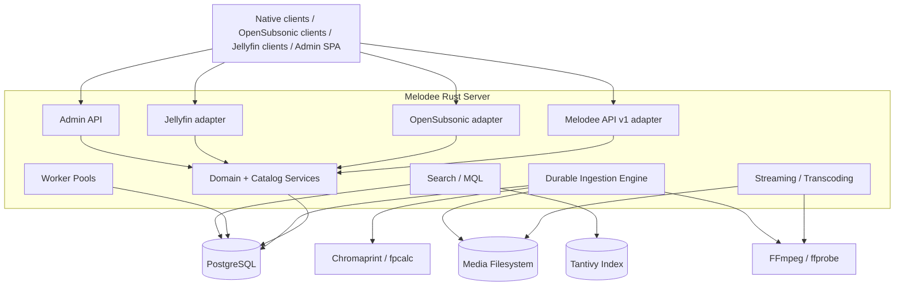
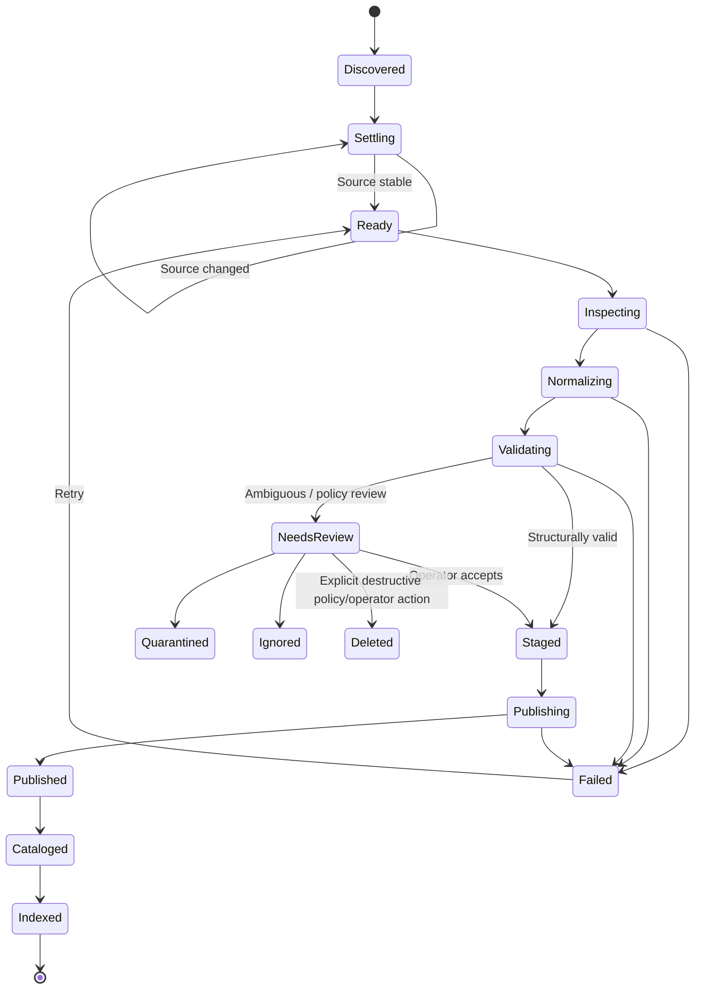
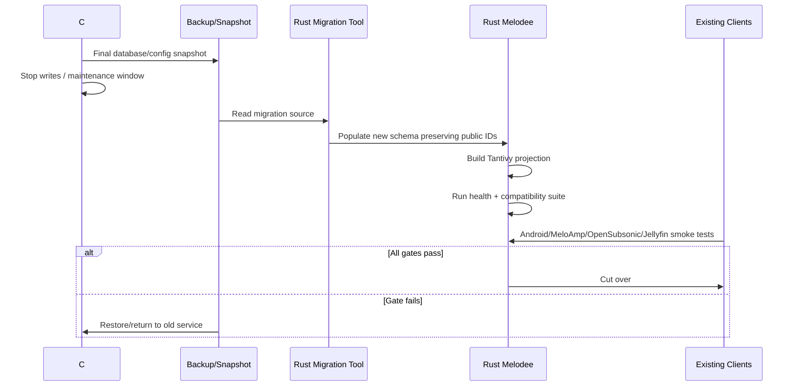

# Melodee Rust Rewrite — Product Requirements Document (PRD)

**Document status:** Draft for architecture and implementation planning  
**Document date:** 2026-08-06  
**Project:** Melodee Rust Rewrite  
**Existing product baseline:** `melodee-project/melodee` C#/.NET implementation, current `main` behavior and Melodee 2.2.x documentation  
**Primary objective:** Build a complete, production-ready Rust replacement for the existing Melodee C# server with full feature parity, preserved client/API compatibility, a substantially more resilient ingestion/catalog engine, and a modern administration experience.

---

## 1. Executive Summary

Melodee is a self-hosted media catalog, processing, and streaming system built for large music libraries. The current C# implementation has accumulated a broad and valuable product surface: automated media ingestion, catalog curation, OpenSubsonic compatibility, a native Melodee REST API, Jellyfin compatibility, streaming/transcoding, playlists, requests, podcasts, sharing, ratings, scrobbling, charts, recommendations, user management, library access control, party mode, jukebox functionality, scripting hooks, localization, theming, onboarding, background jobs, diagnostics, and an administrative web UI.

The rewrite is **not** a language-porting exercise. The C# codebase is the behavioral oracle for what Melodee currently does; it is **not** the architectural template for how the Rust implementation should be structured.

The Rust implementation must preserve existing external behavior while deliberately replacing fragile internal architecture. In particular, the current filesystem-sweep-based ingestion model must become a durable, idempotent, release-oriented work pipeline that survives process crashes, incomplete copies, filesystem changes, and repeated retries without requiring an operator to babysit the system.

The rewrite must also introduce a more rigorous domain model around artist identity, credits/contributions, release classification, catalog novelty, duplicate detection, and policy-driven disposition. The system must stop depending on artist names or third-party metadata providers as canonical identity authorities. Melodee owns its own identities; external providers provide evidence.

The new web experience should be modern, slick, simple, and intuitive. The preferred design direction is a React-based administrative application using the Carbon Design System, while retaining theming, light/dark appearance, localization, and current RTL capability. Dedicated native clients such as the Android/Android Auto player and MeloAmp remain the primary playback experiences; the server web UI should prioritize administration, curation, diagnostics, and operational workflows while preserving existing web-facing capabilities required for feature parity.

---

## 2. Guiding Product Principles

### PRD-PRINCIPLE-001 — Behavioral compatibility over implementation similarity

The existing C# application defines current observable behavior. The Rust implementation may use completely different internal models, storage layout, dependencies, concurrency strategy, and UI architecture.

**Rule:**

> The legacy repository answers **what Melodee does**. The Rust PRD, ADRs, and new code answer **how the new Melodee works**.

Coding agents must not be instructed to “rewrite” individual C# services, controllers, repositories, or classes line-for-line.

### PRD-PRINCIPLE-002 — Existing external contracts are first-class product features

The following are not implementation details:

- Native Melodee API v1 behavior.
- OpenSubsonic compatibility behavior.
- Jellyfin music compatibility behavior.
- Media streaming behavior.
- Authentication and refresh behavior consumed by existing clients.
- Existing public API identifiers.
- Existing client-visible error/status behavior.

A replacement that has a superior internal architecture but breaks an existing client is not complete.

### PRD-PRINCIPLE-003 — The native Melodee API is a core product surface

The native Melodee API is not merely an internal web API. It is the performant first-party API used by Melodee-native applications, including the Android/Android Auto player used for in-car playback and the cross-platform MeloAmp desktop application.

The rewrite may introduce new API versions and may enable new clients, including a future improved Android Auto client, but it must not require a synchronized client rewrite merely to preserve existing functionality at cutover.

### PRD-PRINCIPLE-004 — OpenSubsonic and native Melodee APIs serve different purposes

They must remain separate compatibility surfaces:

- **OpenSubsonic:** interoperability with Subsonic/OpenSubsonic ecosystem clients.
- **Melodee API:** performant, semantically cleaner first-party/native application API.
- **Jellyfin compatibility:** current music-focused compatibility adapter for supported Jellyfin clients.
- **Admin API:** new Rust-native administrative/curation API; free to expose the improved internal vocabulary and workflows.

### PRD-PRINCIPLE-005 — Melodee owns identity

External systems such as MusicBrainz, Discogs, Spotify, iTunes/Apple, Wikidata, Last.fm, or other metadata sources may provide evidence, but they must not be canonical identity authorities inside Melodee.

### PRD-PRINCIPLE-006 — Uncertainty must not become destructive behavior

When Melodee cannot confidently determine identity, release novelty, or disposition, it must prefer **Review** or **Quarantine** over destructive deletion.

### PRD-PRINCIPLE-007 — FOSS-only core stack

All required runtime and development dependencies selected for the new Melodee must be modern, actively maintained, and 100% FOSS for the functionality Melodee requires. A project with a commercial offering is not automatically disqualified, but Melodee must not depend on paid/proprietary tiers for required functionality.

### PRD-PRINCIPLE-008 — Architecture decisions are durable records

Significant or hard-to-reverse decisions must be documented as ADRs. Existing ADR history must be preserved, but current runtime behavior takes precedence when an older ADR and the current product diverge. A changed decision is recorded by superseding the prior ADR, not deleting history.

---

## 3. Product Context and Scale

The architecture must be comfortable with the current real-world library and the project’s stated larger-scale ambitions.

### Current known library scale

| Measure | Approximate current scale |
|---|---:|
| Artists | ~35,000 |
| Releases | ~50,000 |
| Tracks | ~560,000 |
| Canonical media storage | ~5 TB |
| Typical inbound burst | 200+ Releases |

The existing project describes Melodee as intended for libraries reaching **millions to tens of millions of Tracks**. The rewrite must not introduce architectural ceilings that make the current library comfortable but the stated project scale unrealistic.

### PRD-SCALE-001

Normal catalog operations must not require loading all Artists, Releases, or Tracks into application memory.

### PRD-SCALE-002

Large-library API and UI operations must use indexed queries, bounded result sets, keyset or safe server-side pagination where appropriate, and materialized/rebuildable projections where beneficial.

### PRD-SCALE-003

The system must be testable against synthetic large catalogs, including at least a 10-million-Track search dataset.

---

## 4. Definitions and Ubiquitous Language

The Rust core shall use media-neutral domain language.

| Term | Definition |
|---|---|
| **Artist** | A unique person, group, ensemble, character, or other credited identity owned by Melodee. |
| **ArtistAlias** | Another name referring to the **same** Artist identity. |
| **ArtistRelationship** | A relationship between two distinct Artist identities. |
| **GroupMembership** | A person-to-group relationship, optionally date-bounded and role-aware. |
| **ExternalIdentity** | Provider-specific identifier and evidence for an Artist, Release, or underlying audio identity. |
| **Release** | A published/collected set of ordered Tracks. The term is intentionally content-neutral and replaces “Album” in the new core. |
| **Track** | An ordered playable audio item on a Release. It may be a song, spoken word, comedy routine, intro, skit, interview, audiobook chapter, etc. |
| **ReleaseArtist** | Artist identity associated with the Release as a whole. |
| **TrackArtist** | Artist identity under whose name an individual Track is presented/billed. |
| **Contribution** | Known Artist participation or credit on a Track/Release. |
| **DisplayArtist** | Exact presentation/billing string preserved for human display. |
| **ObservedArtist** | Raw artist-like value observed during ingestion before identity resolution. |
| **ArtistMatch** | Proposed or confirmed resolution from an observation to a Melodee Artist. |
| **MediaAsset** | Physical encoded media file or canonical stored byte asset. |
| **ReleaseTrait** | Non-exclusive Release classification such as Live, Compilation, GreatestHits, Remix, etc. |
| **Disposition** | Policy outcome such as Accept, Review, Ignore, Quarantine, or Delete. |

### Legacy/API vocabulary rule

The new core uses `Release` and `Track`. Compatibility adapters may continue to expose `Album` and `Song` exactly where existing APIs require those terms.

The new admin UI must use `Release` and `Track` unless presenting a legacy protocol/API field by name.

---

## 5. Scope

### In scope

1. Complete Rust server replacement.
2. Full functional parity with currently implemented C# product behavior.
3. Backward-compatible Melodee API v1.
4. Backward-compatible OpenSubsonic behavior.
5. Backward-compatible current Jellyfin music compatibility subset.
6. Existing streaming and transcoding capabilities.
7. Media ingestion, normalization, validation, curation, publishing, cataloging, and indexing.
8. Migration of current database/catalog/user state and canonical media without mandatory re-transcoding.
9. New administration UI and administrative API.
10. Search and MQL parity plus significant scale improvements.
11. Current localization, themes, light/dark appearance, and RTL behavior.
12. Existing user, playlist, podcast, request, share, radio, analytics, social/scrobble, party/jukebox, scripting, and operational features.
13. Containerized deployment for amd64 and arm64.
14. Comprehensive compatibility, fault-injection, performance, and migration testing.

### Out of scope for the parity release unless separately approved by ADR

1. Replacing FFmpeg codecs with native Rust codecs.
2. Microservice decomposition.
3. Mandatory RabbitMQ/Kafka/Redis/Elasticsearch/OpenSearch infrastructure.
4. A graph database.
5. Rewriting all native clients as part of server cutover.
6. Mandatory physical media deduplication across Releases.
7. A new public Melodee API v2 unless needed for the admin surface or separately approved.
8. Reimplementing unsupported/full Jellyfin features such as video, TV, books, plugins, Live TV, or Jellyfin server administration.

---

## 6. Feature-Parity Definition

“Full feature parity” has four categories.

### 6.1 Exact contract parity

Required where external software depends on the behavior.

Examples:

- Melodee API v1 routes and response shapes.
- OpenSubsonic request/response behavior.
- Jellyfin compatibility routes.
- Stream URLs and range behavior.
- Authentication flows.
- Public IDs.

### 6.2 Capability parity

The user must be able to accomplish the same task, but the implementation/UI may be redesigned.

Examples:

- Admin media review.
- Artist merge/edit workflows.
- Job monitoring.
- Theme management.
- Settings management.

### 6.3 Negative-behavior parity

Intentional `410 Gone`, `501 Not Implemented`, disabled-feature responses, role restrictions, and similar behavior are part of the current protocol contract and must not accidentally become different failures.

### 6.4 Preview/partial feature parity

A feature documented as preview or incomplete must not be represented as fully implemented merely because the rewrite touches it. The new system must either:

- preserve the current capability and “preview” status; or
- intentionally complete/change it under a new ADR and explicit acceptance criteria.

---

## 7. Existing Product Capability Inventory

The parity program must maintain a living matrix against the C# baseline. The following inventory is the minimum known scope.

| Capability | Parity expectation |
|---|---|
| Onboarding/setup wizard | Required |
| Multiple media libraries | Required |
| Inbound processing | Required, redesigned internally |
| Staging/manual review | Required, redesigned workflow |
| Media conversion/normalization | Required |
| Artwork management | Required |
| Metadata editing | Required |
| Production storage/catalog indexing | Required |
| Artist browsing/editing/merge | Required |
| Release browsing/editing | Required |
| Track browsing/detail | Required |
| Search | Required, improved |
| MQL advanced search | Required |
| Ratings/star/favorite/hate/pin behaviors currently exposed | Required where currently implemented |
| Playlists | Required |
| Smart/dynamic playlists currently implemented | Required |
| Play queue persistence | Required |
| Scrobbling/now-playing | Required |
| Last.fm linking/scrobbling | Required |
| Charts | Required |
| Recommendations | Required |
| Listening analytics/statistics | Required |
| Audio features/BPM analysis currently implemented | Required where currently exposed |
| Equalizer presets/settings currently implemented | Required where currently exposed |
| Internet radio | Required |
| Public/private shares | Required |
| User Requests/comments/activity | Required |
| Podcasts/subscriptions/downloads/resume/history | Required |
| Users/roles | Required |
| User groups/library ACL | Required |
| User avatars/profile/settings | Required |
| Device profiles | Preserve current preview capability; future completion via ADR |
| Party Mode | Required |
| Jukebox/server playback where enabled | Required current behavior |
| Playback backend management | Required where currently implemented |
| JavaScript event scripting hooks | Required compatibility or migration path |
| Config import/export | Required |
| Email/notification templates and notification behaviors currently implemented | Required where currently used |
| API documentation/explorer for published REST contracts | Required capability |
| Admin diagnostics/Doctor | Required |
| Background scheduled maintenance | Required capability |
| Job history/manual trigger/pause/resume | Required capability, implementation may change |
| Themes/custom theme packs | Required capability |
| Light/dark/system appearance | Required |
| Localization | Required |
| RTL for supported RTL cultures | Required |
| OpenSubsonic API | Required exact compatibility |
| Melodee API v1 | Required exact compatibility |
| Jellyfin music compatibility | Required current subset |
| Container images amd64/arm64 | Required |
| CLI administrative operations | Required current capability or documented replacements |

No feature in this table may be silently removed. A deliberate removal requires a product decision and ADR.

---

## 8. Target System Architecture

### PRD-ARCH-001 — Modular monolith first

The initial Rust implementation shall be a modular monolith: one primary server executable, one PostgreSQL database, one canonical media storage tree, and one local/rebuildable search index.



### PRD-ARCH-002 — Compile-time module boundaries

Domain and capability boundaries should be represented by Rust crates/modules rather than deployable microservices unless an ADR later demonstrates a deployment need.

### PRD-ARCH-003 — PostgreSQL is the authoritative state store

PostgreSQL is authoritative for:

- Catalog entities and relationships.
- User state.
- Artist identity decisions.
- Ingestion work/state.
- Policy decisions.
- Durable operation/audit history.
- Search outbox/state.
- Scheduled work definitions/state where required.

### PRD-ARCH-004 — Tantivy is a projection

The search index is rebuildable. Corruption or deletion of the Tantivy index must not destroy canonical catalog data.

### PRD-ARCH-005 — Filesystem is canonical for media bytes, not identity

The storage hierarchy must not be the authoritative source for Artist identity or catalog relationships.

### PRD-ARCH-006 — Avoid unnecessary infrastructure

The parity release shall not require RabbitMQ, Kafka, Redis, Elasticsearch, OpenSearch, or Kubernetes unless an ADR with measured evidence demonstrates a problem the simpler architecture cannot solve.

---

## 9. Suggested Rust Workspace Structure

```text
melodee/
├── Cargo.toml
├── Cargo.lock
├── rust-toolchain.toml
│
├── apps/
│   ├── melodee-server/
│   └── melodee-cli/
│
├── crates/
│   ├── melodee-domain/
│   ├── melodee-config/
│   ├── melodee-catalog/
│   ├── melodee-identity/
│   ├── melodee-ingest/
│   ├── melodee-policy/
│   ├── melodee-media/
│   ├── melodee-storage/
│   ├── melodee-search/
│   ├── melodee-mql/
│   ├── melodee-auth/
│   ├── melodee-api-v1/
│   ├── melodee-opensubsonic/
│   ├── melodee-jellyfin/
│   ├── melodee-admin-api/
│   └── melodee-observability/
│
├── admin-ui/
├── migrations/
├── compatibility/
│   ├── melodee-api-v1/
│   ├── opensubsonic/
│   └── jellyfin/
│
├── tests/
│   ├── compatibility/
│   ├── media-corpus/
│   ├── fault-injection/
│   ├── migration/
│   └── performance/
│
├── docs/
│   ├── product/
│   ├── architecture/
│   ├── contracts/
│   ├── ui/
│   └── adr/
│
└── docker/
```

The exact crate count is not itself a requirement. Avoid creating crates that do not enforce a meaningful domain/dependency boundary.

---

## 10. Ingestion and Media Processing Requirements

### 10.1 Core outcome

The ingestion engine must make this scenario routine:

> Drop 200 Releases into inbound. Restart Melodee repeatedly while processing. Every valid Release eventually becomes cataloged and searchable exactly once. Every invalid or ambiguous Release has an explicit actionable state. No Release requires manual intervention merely because Melodee lost track of it.

### 10.2 Durable work-item model

Each discovered Release must become a durable PostgreSQL work item.

Minimum data:

```text
id
public/admin api id
source_library_id
target_library_id
source_path
current_path
target_path
source_fingerprint
manifest_path
manifest_hash
state
state_reason
attempt_count
next_attempt_at
last_error
lease_owner
lease_expires_at
discovered_at
started_at
last_attempt_at
completed_at
correlation_id
```

### 10.3 Suggested state model



Enrichment may be orthogonal/asynchronous and must not necessarily block catalogability after structural validity.

### PRD-INGEST-001 — Per-Release retry

Failures are retried by Release work item, not by rerunning a full root scan.

### PRD-INGEST-002 — Lease-based concurrency

Workers claim work using durable leases. Multiple server/worker/CLI processes must coordinate through PostgreSQL, not process-local locks.

The preferred initial implementation is PostgreSQL `FOR UPDATE SKIP LOCKED` or equivalent safe queue semantics.

### PRD-INGEST-003 — Watchers are accelerators only

Filesystem watchers may accelerate discovery but cannot be the authoritative source of truth. Periodic reconciliation must recover missed watcher events.

### PRD-INGEST-004 — Settling detection

Melodee must avoid processing partially copied Releases.

Suggested algorithm:

1. Snapshot filenames/count/sizes/mtimes.
2. Wait configured quiet period.
3. Snapshot again.
4. If identical, mark Ready.
5. If changed, remain Settling.

An optional explicit `.melodee-ready` marker may allow immediate readiness.

### PRD-INGEST-005 — Source safety and durable inbound acquisition

Inbound is a transient externally supplied filesystem directory, not long-term storage. Content bytes must be
treated as immutable while Melodee settles and acquires a Release: do not rewrite audio, tags,
artwork, sidecars, or partially mutate a candidate tree. After a durable verified staging handoff,
Melodee must remove the acquired candidate directory from inbound. Do not rename source directories
merely because they contain punctuation or unexpected naming. Reuse of the same inbound path later
must create a new acquisition, not resurrect historic work.

### PRD-INGEST-006 — Safe staging/publishing

Normalization shall write to an attempt-isolated work directory under the independently configured
work-area root (`MELODEE__NORMALIZATION__WORK_AREA`; ADR-0145 made the work area disjoint from
durable staging):

```text
<work-area>/{ingestion-id}/
```

After successful validation, the Release is atomically renamed when the filesystem supports it.

For cross-filesystem publication:

1. Copy.
2. Verify expected size/hash.
3. Flush/fsync as appropriate.
4. Rename destination into final form.
5. Only then delete source.

Every step must be safe to execute twice.

### PRD-INGEST-007 — Versioned manifest

The ingestion engine shall produce a versioned canonical Release manifest containing all information required by downstream catalog insertion where practical.

The catalog phase should not reopen every audio file merely to rediscover hashes/tags already computed during normalization.

### PRD-INGEST-008 — Structural validity is independent of enrichment

A Release with playable media and sufficient local metadata may be structurally valid even when no external service recognizes the Artist or Release.

### PRD-INGEST-009 — Bounded resource pools

Concurrency must be separately bounded for substantially different resource classes, including at minimum:

- Metadata/file I/O.
- Image processing.
- Hashing/fingerprinting.
- FFmpeg conversion/transcoding.
- External enrichment calls.
- Catalog database writes.
- Search indexing.

Do not blindly use `Environment.ProcessorCount`/CPU count as the concurrency setting for every stage.

### PRD-INGEST-010 — Operator visibility

Every Release must expose current state, current/last worker, attempts, last error, timestamps, decision evidence, and next action through the Admin UI/API.

---

## 11. Media Formats, Normalization, and Inspection

### PRD-MEDIA-001

The rewrite must retain current practical input support for the formats currently accepted by Melodee, including common cases such as MP3, FLAC, OGG/Vorbis, WAV, AAC/M4A, WMA, APE, AC3, Opus where currently supported by the C# product/toolchain.

The precise supported-format matrix must be generated from the current code and made a compatibility artifact before implementation freeze.

### PRD-MEDIA-002 — Canonical format policy

The current operational policy of normalizing FLAC/OGG/WAV and other source formats to high-quality VBR MP3 for canonical storage must be preserved initially unless an ADR explicitly changes the storage profile.

The exact FFmpeg parameters shall be captured as a named, versioned media profile and regression tested.

### PRD-MEDIA-003 — Use mature media tools

The rewrite should coordinate FFmpeg/ffprobe rather than implement audio codecs in Rust.

### PRD-MEDIA-004 — Metadata reading

Use a native Rust metadata library for common fast-path tag reading/writing and ffprobe as a fallback/authority for formats or properties not reliably available through the native library.

### PRD-MEDIA-005 — Artwork

Preserve current artwork extraction, validation, replacement, upload, thumbnailing, and serving capabilities.

### PRD-MEDIA-006 — Sidecar files

Preserve support for relevant current sidecars such as NFO, M3U, SFV, and CUE files where they currently influence behavior.

---

## 12. Hashing, Fingerprinting, and Audio Identity

### PRD-FP-001 — Compute once, reuse

File hashes and acoustic fingerprints should be computed during ingestion/normalization and stored in the manifest/catalog for later duplicate/novelty queries.

### PRD-FP-002 — Distinguish byte identity from audio identity

Melodee must distinguish:

- Byte-identical/canonical-file equality.
- Same underlying audio/performance despite encoding differences.
- Alternate recording/version.
- Uncertain similarity.

### PRD-FP-003 — Acoustic fingerprinting

Chromaprint/fpcalc is the preferred initial FOSS fingerprint mechanism, subject to ADR approval and performance testing.

### PRD-FP-004 — Underlying audio identity abstraction

The catalog must support a concept separating a Track occurrence on a Release from the underlying audio/performance identity when needed for deduplication and novelty analysis.

The final ubiquitous-language name (`TrackIdentity`, `AudioIdentity`, or another term) shall be decided by ADR before schema freeze.

### PRD-FP-005 — Physical byte deduplication is optional for parity

The schema/storage design must not preclude multiple logical Tracks from referencing the same MediaAsset, but implementing global byte-level deduplication is not required for the initial parity release.

---

## 13. Artist Identity Requirements

### 13.1 Core identity rule

> **Melodee owns Artist identity. External providers provide evidence.**

A printed/tagged Artist name is an observation or presentation string, not sufficient proof of identity.

### PRD-ARTIST-001 — Names are not unique

Two Artists may share the same normalized and displayed name. The database must never enforce uniqueness on Artist name or name hash.

### PRD-ARTIST-002 — Stable immutable identity

Each Artist has an immutable Melodee identity. Internal IDs may differ from public legacy API IDs, but existing public IDs must survive migration.

Suggested conceptual schema:

```text
artists
  id
  public_api_id
  canonical_name
  sort_name
  artist_type
  disambiguation
  status
  merged_into_artist_id
  created_at
  updated_at
```

### PRD-ARTIST-003 — Artist types remain identity-oriented

Use small identity categories such as:

- Person
- Group
- Orchestra/Ensemble
- Character
- Other
- Unknown

Do not model profession/role such as `Comedian` as an identity type when it belongs in credits/metadata.

### PRD-ARTIST-004 — Aliases mean same identity

`ArtistAlias` is only for alternate names of the same Artist.

Collaboration/billing strings such as `Artist A feat. Artist B` must not become aliases.

### PRD-ARTIST-005 — External identities are normalized rows

Provider IDs shall not become a growing list of provider-specific columns on Artist.

Conceptual shape:

```text
artist_external_identifiers
  artist_id
  provider
  external_id
  confidence
  source
  verified_at

UNIQUE(provider, external_id)
```

### PRD-ARTIST-006 — Relationships do not imply equality

Relationships such as:

```text
Colin Hay --member_of--> Men at Work
```

connect separate Artist identities and never imply they are the same identity.

### PRD-ARTIST-007 — Date-bounded group membership

Group membership should support start/end dates and roles to enable historically correct inference.

### PRD-ARTIST-008 — User decisions outrank providers

A confirmed admin/user resolution may be locked. External data must not later reverse a locked manual decision automatically.

### PRD-ARTIST-009 — Negative identity assertions

Melodee must support “do not match” evidence so a previously rejected candidate is not repeatedly suggested.

### PRD-ARTIST-010 — Safe merge/split

Artist merge must preserve old identity as a redirect/tombstone using `merged_into_artist_id` or equivalent.

Splitting an Artist must permit moving selected Releases, Tracks, contributions, aliases, and external identities to a new Artist with an audit record.

### PRD-ARTIST-011 — Bias against false merges

When evidence is insufficient, create/retain a provisional duplicate rather than automatically merging identities based primarily on string similarity.

### PRD-ARTIST-012 — Do not port the current external-authority identity model

The current local MusicBrainz/DecentDB-style authority mechanism must not be carried forward as the canonical Artist identity mechanism. If local provider caches are retained for performance/offline enrichment, they are evidence/projection data only; Melodee-owned Artist IDs and manual resolution decisions remain authoritative.

---

## 14. Artist Resolution and Evidence

### PRD-RESOLVE-001

Preserve raw source tags and display strings independently from normalized identity relationships.

### PRD-RESOLVE-002

Identity resolution should consider evidence including:

- Embedded trusted external IDs.
- Release context.
- Existing known releases/tracks.
- Alias matches.
- Artist type.
- Geographic/area metadata.
- Active dates.
- Group membership.
- External provider matches.
- Track/release participation.

### PRD-RESOLVE-003

String similarity alone shall never cause automatic identity merge.

### PRD-RESOLVE-004

Conflicting evidence must reduce confidence rather than being ignored.

### PRD-RESOLVE-005

External provider access must be abstracted behind an authority interface rather than hard-wiring canonical identity to MusicBrainz.

Illustrative interface:

```rust
trait ArtistAuthority {
    async fn find_artists(&self, observation: &ArtistObservation)
        -> Result<Vec<ArtistCandidate>>;

    async fn lookup_artist(&self, external_id: &ExternalArtistId)
        -> Result<Option<AuthorityArtist>>;

    async fn match_release(&self, release: &ReleaseObservation)
        -> Result<Vec<ReleaseCandidate>>;
}
```

The exact trait signature is not normative; the separation is.

---

## 15. Release, Track, and Contribution Model

### PRD-CREDIT-001 — ReleaseArtist

Model Artists associated with a Release as structured relationships.

### PRD-CREDIT-002 — TrackArtist

Model Artists under whose names an individual Track is billed.

### PRD-CREDIT-003 — Contribution

Model known participation/credits as first-class data.

Minimum performance-oriented roles should support concepts such as:

- PrimaryArtist
- FeaturedArtist
- GuestArtist
- Performer
- BandMember
- Vocalist
- Instrumentalist

Additional credit roles may include:

- Composer
- Lyricist
- Producer
- Remixer
- Engineer

### PRD-CREDIT-004 — Preserve DisplayArtist

For a tag such as:

```text
Somebody feat. Colin Hay
```

Melodee must preserve the exact display text while also resolving structured relationships.

Example conceptual result:

```text
TrackArtist 1: Somebody   role=Primary    join_phrase=" feat. "
TrackArtist 2: Colin Hay  role=Featured   join_phrase=""
DisplayArtist: "Somebody feat. Colin Hay"
```

### PRD-CREDIT-005 — Parsing does not create identity

A parser may extract candidate names from `feat.`, `with`, `&`, etc., but it must not create/merge Artists without identity resolution.

### PRD-CREDIT-006 — “Everything this Artist is on” is first-class

Queries such as “show all Tracks Colin Hay is on” must include:

- Solo Tracks/Releases.
- Group Tracks where participation can reasonably be inferred from date-bounded membership.
- Explicit featured/guest/performance credits on other Artists’ Tracks.

Default participation search should emphasize performance roles and not automatically include every composer/producer/engineering credit unless requested.

### PRD-CREDIT-007 — Direct vs inferred participation

Store or derive a distinction between:

- `DirectParticipation` — explicitly credited.
- `InferredGroupParticipation` — inferred from group credit plus applicable membership period.

Do not infer every historical member onto every Track.

### PRD-CREDIT-008 — Materialized relationship projection

At current scale, a materialized relation such as:

```text
artist_track_index
  artist_id
  track_id / audio_identity_id
  association_type
  direct_or_inferred
  source_artist_id
  confidence
```

is acceptable and preferred over reconstructing participation from strings at request time.

---

## 16. Release Classification Requirements

### PRD-CLASS-001 — Multi-valued traits

Do not replace the legacy `AlbumType` with another single mutually-exclusive type enum.

A Release may simultaneously be:

```text
Live + Compilation + BoxSet
Soundtrack + Compilation
GreatestHits + Remaster
```

Suggested traits include:

- Studio
- EP
- Single
- Live
- Compilation
- GreatestHits
- Collection
- BoxSet
- Bootleg
- Demo
- Promo
- Broadcast
- RadioShow
- DJMix
- Remix
- Tribute
- Soundtrack
- CastRecording
- SpokenWord
- Comedy
- Audiobook
- Reissue
- Remaster

The first implementation need not support every possible trait, but the model must support multiple traits.

### PRD-CLASS-002 — Evidence and confidence

Classification must retain why Melodee believes a trait applies.

Example:

```text
Trait: GreatestHits
Confidence: 0.97
Evidence:
  - Title contains "Greatest Hits"
  - External metadata says Compilation
  - 15 of 16 Tracks match existing catalog audio
```

### PRD-CLASS-003 — Evidence hierarchy

Approximate trust ordering:

1. Explicit administrator decision.
2. Trusted embedded external ID/type metadata.
3. Structured tags.
4. Catalog/Track analysis.
5. Release title.
6. Current directory name.
7. Parent directory name.

Directory/path naming alone must never authorize destructive action.

---

## 17. Release Policy and Disposition

### Core rule

> **Classification describes what Melodee believes a Release is. Policy decides what Melodee wants to do with it.**

### PRD-POLICY-001 — Dispositions

The policy engine must support at least:

```text
Accept
Review
Ignore
Quarantine
Delete
```

### PRD-POLICY-002 — Semantics

- **Accept:** continue ingestion/publication.
- **Review:** human decision required because confidence or policy is insufficient.
- **Ignore:** the Release is understood but intentionally not wanted; not an error.
- **Quarantine:** move/hold in a managed safe area due to uncertainty or problem.
- **Delete:** explicit destructive outcome.

### PRD-POLICY-003 — Greatest Hits requirement

The user generally does not want redundant Greatest Hits/collection Releases merely because they duplicate already-owned material. A Greatest Hits Release containing genuinely new or meaningfully alternate material may be worth keeping.

Therefore the rule is **not**:

```text
Title contains Greatest Hits -> Delete
```

The rule must use catalog novelty analysis.

### PRD-POLICY-004 — Track novelty categories

At minimum:

- `ExactDuplicate` — same stored/canonical bytes.
- `KnownAudioIdentity` — same underlying performance/audio, possibly different encode.
- `AlternateRecording` — live/acoustic/re-record/remix or meaningfully different performance/version.
- `NewTrack` — no catalog audio identity match.
- `Uncertain` — insufficient evidence.

### PRD-POLICY-005 — Novelty semantics for redundant collections

Default logic:

- ExactDuplicate → not novel.
- KnownAudioIdentity → not novel.
- AlternateRecording → interesting/configurable.
- NewTrack → interesting.
- Uncertain → never automatically delete.

### PRD-POLICY-006 — Example default rules

Illustrative built-in policy behavior:

```text
GreatestHits && new_track_count == 0 && alternate_count == 0 && uncertain_count == 0
  -> Ignore or Delete according to configured operator preference

GreatestHits && (new_track_count > 0 || alternate_count > 0)
  -> Review or Accept according to configured operator preference

GreatestHits && uncertain_count > 0
  -> Review / Quarantine

Corrupt or unreadable media
  -> Quarantine

Explicit administrator override
  -> chosen operator outcome
```

Other traits such as Bootleg/Promo/Live must remain configurable and shall not receive guessed destructive defaults merely because they were historically present in filename regexes.

### PRD-POLICY-007 — Durable decision record before delete

Before deleting source/canonical files, Melodee must persist:

- Policy evaluation.
- Disposition.
- Rule identifier/version.
- Evidence summary.
- Source fingerprint.
- Actor (system/admin).
- Timestamp.

Deletion completion is recorded separately.

### PRD-POLICY-008 — Policy test mode

The admin UI must support testing a proposed policy against the existing catalog without applying it, showing at minimum:

- Number of Releases matched.
- Existing dispositions/states.
- Representative samples.
- Potential destructive impact.

---

## 18. Canonical Storage Requirements

### PRD-STORAGE-001

The physical storage layout must not define Artist identity.

Artist rename, merge, split, alias adjustment, or identity correction should not require multi-terabyte media moves merely because the Artist relationship changed.

### PRD-STORAGE-002

The preferred direction is Release-centric/immutable-ID-centric canonical storage, for example:

```text
storage/
  releases/
    01/
      9A/
        rel_019a.../
          manifest.json
          cover.jpg
          01 - Track.mp3
```

A human-readable prefix may be cosmetic, but an immutable Melodee Release ID must remain authoritative.

The final layout requires an ADR before implementation because it directly impacts migration, backup, public paths, and operational tools.

### PRD-STORAGE-003

Optional filesystem views such as `views/by-artist` may be generated/symlinked projections and must be rebuildable.

### PRD-STORAGE-004

Existing canonical media must be migratable without mandatory re-encoding or unnecessary physical movement.

---

## 19. Catalog and Database Requirements

### PRD-CATALOG-001

PostgreSQL remains the system of record.

### PRD-CATALOG-002

Catalog inserts/updates must use batch/set-based approaches rather than per-Release N+1 lookup/save patterns.

### PRD-CATALOG-003

Common aggregates should be incremental, materialized, or maintained with set-based jobs; do not recalculate every Artist after every insert batch.

### PRD-CATALOG-004

Database migrations must be deterministic, versioned, tested on representative production-scale snapshots, and reversible where practical.

### PRD-CATALOG-005

Catalog write transactions that require search updates shall create an outbox/projection work item in the same durable transaction.

---

## 20. Search and MQL Requirements

### PRD-SEARCH-001 — Search engine

Use a rebuildable embedded full-text search projection. Tantivy is the preferred FOSS candidate.

### PRD-SEARCH-002 — Searchable entities

At minimum:

- Artists.
- Releases.
- Tracks.
- Relevant credits/participants.
- Genres/tags where currently searchable.

### PRD-SEARCH-003 — Participant IDs in Track index

Track documents should include multi-valued participant Artist IDs so an Artist participation query is immediate rather than a string reconstruction.

### PRD-SEARCH-004 — MQL isolation

MQL must parse:

```text
input string -> MQL AST -> catalog/search query plan
```

MQL syntax/domain code must not directly expose Tantivy-specific types.

### PRD-SEARCH-005 — MQL parity

Preserve current capabilities such as:

- Field-specific search.
- Numeric comparisons.
- Date/range expressions.
- Boolean logic.
- Regex/pattern expressions where currently supported.

The new model should additionally make structured participation searchable without collapsing everything into one ambiguous Artist field. Candidate MQL concepts include `artist`, `primaryArtist`, `featuredArtist`, and `performer`; exact syntax requires a contract/ADR before release.

### PRD-SEARCH-006 — Performance target

Warm search p95 target: **< 50 ms** on the agreed synthetic 10-million-Track catalog under the benchmark environment defined by the performance test suite.

### PRD-SEARCH-007 — Rebuild command

Provide an operational command equivalent to:

```text
melodee-cli search rebuild
```

that can destroy and regenerate the full index from PostgreSQL without catalog data loss.

---

## 21. Native Melodee API v1 Requirements

### PRD-API-M1-001 — Compatibility contract

The existing Melodee API v1 shall be captured before rewrite using:

- OpenAPI snapshot.
- Route inventory.
- DTO/schema snapshots.
- Golden responses.
- Authentication flows.
- Real-client traffic where useful.

### PRD-API-M1-002 — No forced synchronized client release

An existing supported native client must be able to use the Rust server without requiring a mandatory client update for baseline existing functions.

### PRD-API-M1-003 — Preserve existing vocabulary

Existing endpoints may continue to expose `Album` and `Song`. The Rust adapter maps internal `Release` and `Track` models to legacy DTOs.

### PRD-API-M1-004 — Preserve public IDs

Existing API identifiers for Users, Artists, Albums/Releases, Songs/Tracks, Playlists, Shares, and other client-visible resources must be migrated and preserved.

### PRD-API-M1-005 — Preserve response details

Compatibility testing must cover:

- HTTP method/path.
- Query and body parameter names.
- Property names/casing.
- Data types.
- Null vs omitted behavior where client-visible.
- Status codes.
- Error envelopes/codes.
- Pagination semantics.
- Stable ordering/defaults.
- URLs.
- Relevant headers/ETags/cache behavior.

### PRD-API-M1-006 — Current native surface

The parity matrix must include current route groups including, where currently implemented:

- Auth/JWT/cookie/social login/refresh/logout/revoke/password reset.
- System info/control.
- Artists.
- Albums.
- Songs.
- Search.
- Charts.
- Recommendations.
- Artist lookup.
- Playlists and smart playlists.
- Queue.
- Scrobbling.
- User profile/stats/users.
- Audio features/BPM.
- Playback settings/backend.
- Podcasts.
- Requests/comments/activity.
- Shares/public shares.
- Genres.
- Equalizer presets.
- Party sessions/endpoints/moderation.
- Analytics.

### PRD-API-M1-007 — Future API evolution

New functionality that cannot be safely represented in v1 may be exposed through an Admin API or future `v2`. Do not mutate v1 merely to make the Rust internal model visible.

---

## 22. Native Streaming Requirements

The existing non-versioned streaming route behavior is compatibility-critical.

### PRD-STREAM-001

Preserve existing client-facing stream URL semantics, including the current HMAC-style native stream authorization contract unless superseded by an intentionally versioned client/API change.

### PRD-STREAM-002

Streaming must support:

- Direct play.
- Range requests/seeking.
- Correct content type.
- Correct content length/range semantics where known.
- Client disconnect handling.
- Configured transcoding paths.
- Concurrent playback.

### PRD-STREAM-003 — Android/Android Auto release gate

Before production cutover, the current Android player must successfully perform at least:

1. Fresh login.
2. Browse/search.
3. Select media.
4. Start playback.
5. Seek.
6. Next/previous.
7. Background playback.
8. Token refresh or credential restoration path.
9. Android Auto browse/search/playback.
10. Playback after application process restart when currently supported.

A future Android client may improve performance/features after parity; this gate verifies that the server rewrite did not inadvertently break the existing core native client surface.

---

## 23. OpenSubsonic Requirements

The current 2.2.x OpenSubsonic compatibility matrix is a baseline contract.

### PRD-API-OS-001

Support both plain and `.view` route forms where the current server does.

### PRD-API-OS-002

Preserve JSON, XML, and JSONP behavior where currently supported.

### PRD-API-OS-003

Preserve current authentication parameters and behaviors including token/salt, password forms, API key/JWT extensions where currently supported, and form POST capability.

### PRD-API-OS-004 — Current supported groups

Parity includes current music-relevant support for:

- System/ping/license/extensions.
- Music folders.
- Indexes/Artists/Artist/Album/Song.
- Genres/directories.
- Artist/Album info.
- Similar/top songs.
- Album lists/random songs/songs by genre/now playing/starred/search.
- Streaming/download/cover art/avatar/lyrics.
- Star/unstar/rating/scrobble.
- Playlists.
- Bookmarks.
- Play queue.
- Shares.
- Internet radio.
- Library scan control/status.
- Conditional jukebox.
- Conditional podcasts.
- Current user-management subset.

### PRD-API-OS-005 — Preserve intentional unsupported behavior

Current routes returning `410 Gone` or `501 Not Implemented` are part of the compatibility matrix and must not silently become unrelated 404/500 behavior unless a new compatibility decision explicitly changes them.

Examples include current video/chat/deprecated surfaces and currently unimplemented user operations.

### PRD-API-OS-006 — Advertised extensions

Preserve current advertised extensions/capabilities unless an ADR explicitly changes them.

### PRD-API-OS-007 — Client verification

Test representative OpenSubsonic clients for:

- Login.
- Artist/release browsing.
- Search.
- Stream and seek.
- Playlists.
- Downloads.
- Star/rating.
- Scrobbling.
- Optional podcast/jukebox features if enabled.

---

## 24. Jellyfin Compatibility Requirements

### PRD-API-JF-001

Preserve the current music-focused Jellyfin compatibility subset; do not attempt to become a complete Jellyfin server as part of parity.

### PRD-API-JF-002

Preserve discovery/login behavior and routing at the server root for normal Jellyfin clients, including the current internal `/api/jf` implementation concept or an equivalent transparent adapter.

### PRD-API-JF-003

Preserve separate Jellyfin access-token behavior and supported authorization header conventions.

### PRD-API-JF-004

Preserve current implemented route areas:

- Discovery/system info.
- Users/authentication.
- User views/items/state.
- Items/playback info/filter/similar/instant mixes/files/downloads.
- Artists/genres.
- Audio streaming/universal streaming/lyrics.
- Images.
- Playlists.
- Sessions/playback reporting/capabilities/logout.

### PRD-API-JF-005

Video, TV, books, Live TV, plugins, server admin, and other non-music Jellyfin surfaces remain out of scope unless separately approved.

### PRD-API-JF-006

Compatibility verification should include currently targeted music clients such as Finamp, Feishin, Streamyfin, and other known working clients as practical.

---

## 25. Admin API Requirements

### PRD-API-ADMIN-001

Create a separate administrative/curation API designed around the new Rust domain vocabulary and workflows.

### PRD-API-ADMIN-002

The Admin API may expose:

- Release work items/state.
- ObservedArtist and ArtistMatch evidence.
- Release classifications/evidence.
- Policy decisions/test results.
- Quarantine/review queues.
- Worker/queue state.
- Storage/search health.
- Audit/history.
- New Release/Track/Contribution models.

### PRD-API-ADMIN-003

The Admin API must not force changes into the Melodee API v1 contract.

---

## 26. Authentication, Accounts, and Security Requirements

### PRD-AUTH-001

Migrate existing users without requiring mass password resets.

The Rust implementation must understand the current password-hash format at migration/cutover. A future transparent rehash to another algorithm may be performed after successful authentication if approved by ADR.

### PRD-AUTH-002

Preserve currently used native flows:

- JWT bearer authentication.
- Refresh-token behavior.
- Cookie/session login where currently exposed.
- Google OAuth/social linking where currently enabled.
- Password reset.
- Logout/revocation.
- Last.fm account linking/session behavior.

### PRD-AUTH-003

Preserve role/permission concepts including Administrator, Editor, ordinary user, feature roles, and library-access restrictions.

### PRD-AUTH-004

Preserve user-group-based library access control.

### PRD-AUTH-005

Sensitive data must never be logged in clear text, including passwords, JWTs, refresh tokens, HMAC secrets, API keys, token/salt credential combinations, or third-party provider secrets.

### PRD-AUTH-006

Preserve configurable rate limiting or introduce equivalent protections without reducing existing client compatibility.

Preserve current account-disabled/locked/blacklisted response semantics and authorization behavior where exposed through the native API.

### PRD-AUTH-007

Configuration export/import must clearly handle secrets and warn before exporting/importing sensitive values.

---

## 27. User and Playback-State Features

### PRD-USER-001

Preserve user profile and preference data including locale, theme/appearance, ratings/favorites, play history, and applicable settings.

### PRD-USER-002

Preserve current Artist/Release/Track user interactions where implemented, including star/favorite, rating, hated/disliked, pinned, or analogous existing states.

### PRD-USER-003

Preserve now-playing and scrobble submission behavior.

### PRD-USER-004

Preserve queue persistence and current queue operations exposed by supported APIs/clients.

### PRD-USER-005

Preserve user statistics/listening analytics currently available.

### PRD-NOTIF-001

Preserve the email/notification template capability where currently used: admin-manageable templates for user-facing notifications (for example password reset, share, and request-activity messages), including template storage, rendering, and delivery wiring.

### PRD-NOTIF-002

Notification delivery must use a FOSS transport, require no new infrastructure service, and fail degraded: a notification failure must never block or roll back the operation that triggered it, and notifications must never log secrets or rendered private content in clear text.

### PRD-NOTIF-003

Notification behavior must be operator-verifiable headlessly (CLI test-send with evidence) and must externalize all user-visible text so the Admin UI localization work can translate it.

---

## 28. Playlists and Smart Playlists

### PRD-PLAYLIST-001

Preserve playlist CRUD, ordering, item addition/removal, sharing/visibility, and all current native/OpenSubsonic/Jellyfin adapter behavior.

### PRD-PLAYLIST-002

Preserve current smart/dynamic playlist functionality and rules. Internal implementation may use the new MQL/query engine where appropriate.

### PRD-PLAYLIST-003

Existing playlist IDs and contents must survive migration.

---

## 29. Requests

### PRD-REQUEST-001

Preserve the current user request system for missing content, including request lifecycle, comments, activity/unread state, and automatic completion/matching where currently implemented.

### PRD-REQUEST-002

Requests must be represented in both parity APIs/UI surfaces where currently exposed.

---

## 30. Shares

### PRD-SHARE-001

Preserve user share creation/list/delete/update behavior where currently implemented.

### PRD-SHARE-002

Preserve public share access without ordinary user authentication where the current route permits it.

### PRD-SHARE-003

Existing share identifiers/URLs should survive migration when technically possible.

---

## 31. Internet Radio

Preserve current internet radio listing/create/update/delete functionality and OpenSubsonic compatibility behavior.

### PRD-RADIO-001

Preserve internet radio station listing/create/update/delete behavior and the captured OpenSubsonic internet-radio compatibility contract.

### PRD-RADIO-002

Internet radio station data must survive migration, and station create/update/delete must remain admin-gated exactly as captured.

---

## 32. Podcasts

### PRD-POD-001

Preserve feature-toggle and role-gated podcast behavior.

### PRD-POD-002

Preserve:

- Channel subscription CRUD.
- Feed refresh.
- Episode listing/search.
- Download queue.
- Download/delete operations.
- Retention cleanup.
- Recovery of stuck downloads/orphan files.
- Playback progress/resume/bookmark.
- Playback history.
- OPML import/export.
- Discovery/trending/lookup features currently exposed.

### PRD-POD-003

Preserve native and OpenSubsonic podcast API compatibility currently supported.

---

## 33. Charts, Recommendations, and Analytics

### PRD-DISCOVERY-001

Preserve chart ingestion/linkage/browse behavior currently exposed.

### PRD-DISCOVERY-002

Preserve recommendations currently exposed by the native API/web/native clients.

### PRD-DISCOVERY-003

Preserve listening analytics and top-content queries currently available.

Implement these at scale using indexed/materialized strategies rather than scanning the whole catalog on each request.

---

## 34. Party Mode, Jukebox, and Playback Backends

### PRD-PARTY-001

Preserve current Party Mode session capabilities including participant roles, queue collaboration, session lifecycle, playback state/control, moderation, endpoints/backends, and queue operations where currently implemented.

### PRD-PARTY-002

Preserve conditional OpenSubsonic `jukeboxControl` behavior when the feature/backend is enabled and current disabled behavior when it is not.

### PRD-PARTY-003

Preserve supported server-side playback backend management where currently implemented.

### PRD-PARTY-004

Historical ADRs concerning jukebox/party mode must be reviewed against the current 2.2.x implementation. The rewrite follows current observable behavior unless a new ADR intentionally supersedes it.

---

## 35. Device Profiles and Transcoding Profiles

The current device-profile model is explicitly preview/partial: users can manage profile records and resolver precedence exists, but current streaming paths do not yet universally consume those profiles.

### PRD-DEVICE-001

Preserve existing profile CRUD, default behavior, validation rules, and stored data during parity migration.

### PRD-DEVICE-002

Do not falsely claim that profile records control transcoding unless the new implementation actually wires them to stream negotiation.

### PRD-DEVICE-003

Completing automatic profile-driven stream selection is a desirable post-parity improvement and must be introduced via ADR/API contract rather than accidentally changing client behavior during the rewrite.

---

## 36. Event Scripting and Extensibility

### PRD-SCRIPT-001

The existing JavaScript scripting hooks are part of current functionality and require either:

- Compatibility such that existing scripts continue to execute; or
- A supported migration/validation process with clearly documented incompatibilities.

### PRD-SCRIPT-002

Inventory all existing script event names, input objects, expected return values, side effects, and failure semantics before implementation.

### PRD-SCRIPT-003

The Rust JavaScript runtime must be 100% FOSS and actively maintained; runtime selection requires an ADR and security review.

### PRD-SCRIPT-004

Scripts must execute under constrained resource/security limits and must not have unrestricted filesystem/process/network access unless explicitly designed.

### PRD-SCRIPT-005

The rewrite need not preserve the C# “plugin” class architecture, but it must preserve current user-visible format parsers, metadata-provider behaviors, and extension capabilities.

---

## 37. External Metadata and Enrichment

### PRD-EXT-001

Inventory and preserve current supported metadata/search/enrichment providers and their settings where they are active product functionality.

Current code/documentation includes provider concepts such as MusicBrainz, Discogs, Spotify, iTunes/Apple, Last.fm, AMG, Wikidata, Brave Search, and others.

### PRD-EXT-002

No external provider may be required for a structurally valid local Release to enter the catalog unless an explicit operator policy says otherwise.

### PRD-EXT-003

Provider responses must be cached/rate-limited appropriately and provider failure must degrade enrichment, not lose ingestion work.

### PRD-EXT-004

Store provenance/evidence describing which source supplied or influenced metadata.

---

## 38. New Administration UI

### 38.1 UX intent

The Admin UI should feel like a modern, polished **Melodee control/curation console**, not merely a database CRUD UI and not another full-featured desktop music player.

Primary question on opening the UI:

> **What needs my attention, what is Melodee doing now, and why did it make each decision?**

### PRD-UI-001 — Modern, slick, simple, intuitive

The design must prioritize clear hierarchy, calm density, predictable interactions, and minimal unnecessary decoration.

### PRD-UI-002 — Preferred stack

Preferred UI direction: React + TypeScript + Carbon Design System, subject to final ADR.

Carbon is preferred because it is actively maintained, Apache-2.0 licensed, feature-rich, accessible, data/admin oriented, supports theming, and does not require a paid component tier for required Melodee functionality.

### PRD-UI-003 — TanStack Table is optional

Start with Carbon DataTable and server-side filtering/sorting/pagination. TanStack Table should only be added if a real Melodee workflow exceeds Carbon’s table capabilities.

### PRD-UI-004 — Admin navigation

Preferred information architecture:

```text
Overview

PROCESSING
  Processing
  Review Queue
  Quarantine
  History

CATALOG
  Artists
  Releases
  Tracks
  Identity Review

POLICIES
  Release Rules
  Matching Rules

SYSTEM
  Storage
  Workers
  Search
  Users & Access
  Settings
  Diagnostics
```

Additional parity web surfaces may be accessible separately for ordinary users/features without making playback the admin console’s design center.

### PRD-UI-005 — Remove `/Data` vs `/Media` from the user mental model

The current implementation distinction between database-backed `/Data` pages and filesystem-backed `/Media` pages is an internal implementation concern.

The new UI presents a Release through its lifecycle:

```text
Discovered -> Processing -> Review -> Cataloged
```

not as two different entity types because its persistence location changed.

### PRD-UI-006 — Primary/detail workflows

High-volume queues should support a persistent table/list with a right-side inspector or equivalent primary/detail interaction so reviewing an item does not lose queue position/context.

### PRD-UI-007 — Preview playback only where useful

Admin Track/Release review should offer lightweight audio preview for validation/A-B comparison. The Admin UI does not need to duplicate the full queue/EQ/theme/player experience of dedicated clients.

### PRD-UI-008 — Destructive action UX

Destructive actions must display:

- What will be affected.
- Why the action is being suggested/performed.
- Number of Releases/Tracks/files.
- Approximate storage impact where known.
- Whether Quarantine is available instead.

### PRD-UI-009 — Command palette

A searchable command/navigation palette is desirable for power administration, provided it remains accessible and does not replace discoverable navigation.

### PRD-UI-010 — Server-side data operations

Large catalog tables must use server-side filtering, sorting, paging, and search. Never send hundreds of thousands of rows to the browser merely because a client table can virtualize them.

---

## 39. Canonical Admin UI Screens

The following eight screens are the canonical visual references for implementation. Full-size 1600×1200 mockups live in `design/ui/reference/` (internal engineering documentation). They are never published to `/docs` as product screenshots; once real screens are accepted, implementation screenshots supersede them (PRD-UI-REF-002).

1. `01-overview-dashboard.png`
2. `02-processing-queue.png`
3. `03-release-review.png`
4. `04-artist-identity-review.png`
5. `05-artist-detail.png`
6. `06-release-detail.png`
7. `07-policies-rule-editor.png`
8. `08-system-workers-diagnostics.png`

### PRD-UI-REF-001

Mockups define approved visual intent/information hierarchy but are not pixel-perfect code specifications. Generated textual hallucinations in mockups must not override product architecture (for example, a mockup label showing the wrong search technology).

### PRD-UI-REF-002

Once real React pages exist, real implementation screenshots become stronger visual-regression references than generated mockups.

### PRD-UI-REF-003

Create a Melodee UI specification covering:

- Design tokens.
- Carbon token overrides.
- App shell dimensions.
- Density.
- Status semantics.
- Shared components.
- Interaction patterns.
- Responsive behavior.
- Accessibility.
- Agent-specific UI rules.

---

## 40. UI Component Standards

Build Melodee-specific reusable components over Carbon rather than hand-authoring each page independently.

Candidate shared components:

```text
<AppShell />
<PageHeader />
<MetricCard />
<StatusTag />
<EntityAvatar />
<ArtistLink />
<ReleaseLink />
<TrackLink />
<ProcessingStateTag />
<EvidenceItem />
<EvidenceSummary />
<DecisionPanel />
<InspectorPanel />
<EntityTable />
<EmptyState />
<HealthIndicator />
<AuditTimeline />
<AudioPreview />
<DestructiveActionDialog />
```

### Agent UI rules

Coding agents must not:

- Introduce another UI component library without ADR approval.
- Invent arbitrary colors/spacing/radii/shadows when a Carbon/Melodee token exists.
- Create new navigation models page-by-page.
- Use emoji as application icons.
- Implement catalog-scale client-side pagination.
- Expose PostgreSQL/filesystem implementation details as primary product concepts.
- Use `Album`/`Song` in new admin-domain UI unless explicitly describing a legacy API.
- Place destructive actions visually equivalent to normal actions.
- Redesign canonical screen workflows without an approved change.

---

## 41. Theming and Appearance

### PRD-THEME-001

Preserve the current concept of customizable themes.

### PRD-THEME-002

Separate **theme/palette** from **appearance mode**:

```text
Theme: Melodee / other installed themes
Appearance: System | Light | Dark
```

A theme may define both light and dark token variants.

### PRD-THEME-003

Carbon theme tokens/custom properties should be the preferred implementation mechanism if Carbon is accepted.

### PRD-THEME-004

Preserve admin theme-management capability/custom packs at a functional level. The exact legacy theme file format may change only with a documented migration path.

---

## 42. Localization and RTL

The current C# application supports a broad set of cultures and includes RTL behavior for Arabic and Persian.

### PRD-I18N-001

Preserve the currently configured culture set unless an explicit product decision changes it:

- en-US
- de-DE
- es-ES
- fr-FR
- it-IT
- ja-JP
- pt-BR
- ru-RU
- zh-CN
- ar-SA
- nl-NL
- pl-PL
- tr-TR
- id-ID
- ko-KR
- vi-VN
- fa-IR
- uk-UA
- cs-CZ
- sv-SE

### PRD-I18N-002

Use a dedicated FOSS localization library; `i18next` + `react-i18next` is the preferred current candidate.

### PRD-I18N-003

All user-visible UI strings must be externalized/localizable.

### PRD-I18N-004

Formatting of date/time/number units must honor user locale using standards-based internationalization APIs.

### PRD-I18N-005

RTL support must not regress. The application must derive `dir=rtl` for applicable languages and verify the canonical screens under at least one RTL locale.

### PRD-I18N-006

Translation maintenance must include key validation and English fallback semantics for incomplete translations.

---

## 43. User-Facing Web Parity

Dedicated native clients are preferred for rich playback, but “admin-first web UI” must not become an excuse to silently remove currently implemented web product capabilities.

### PRD-WEB-001

Inventory all current Blazor pages/routes and classify each as:

- Admin/curation → new Admin UI.
- User account/profile → preserve.
- User music browsing/playback → preserve capability or provide an explicitly approved replacement surface.
- Public share → preserve.
- Onboarding → preserve.
- Feature-specific (requests, podcast, party, jukebox, radio, etc.) → preserve where currently implemented.

### PRD-WEB-002

The parity release shall document any web capability that intentionally moves to another UI surface and obtain an ADR/product approval before removing the old route/workflow.

---

## 44. Onboarding and Configuration

### PRD-SETUP-001

Preserve guided first-run onboarding capability, including validation of:

- Required paths.
- PostgreSQL connectivity/migrations.
- Media tool availability.
- Search/index readiness.
- Critical settings.
- Administrator account.
- Preflight/system health.

The exact step count need not remain eight if the new architecture makes a different flow clearer, but the capability must remain.

### PRD-SETUP-002

Existing installations must bypass onboarding after successful migration and configured completion state.

### PRD-CONFIG-001

Settings must remain admin manageable through the web UI and/or CLI.

### PRD-CONFIG-002

Configuration import/export must include preview/validation and explicit handling of secrets.

### PRD-CONFIG-003

Configuration should support environment variables/files for container deployment while preserving database-backed user/admin settings where appropriate.

---

## 45. Workers, Scheduled Tasks, and Operations

### PRD-WORK-001

The rewrite must replace the “everything is a Quartz job” mental model with durable work queues plus scheduled triggers/maintenance tasks.

### PRD-WORK-002

The Admin UI must show worker pools and queue depth by stage, including:

- Queued.
- Active.
- Throughput.
- Oldest item age.
- Retry count.
- Failure count.
- Worker lease/status.

### PRD-WORK-003

Scheduled tasks are still required for periodic functions such as:

- Reconciliation/discovery.
- Podcast refresh/download/cleanup/recovery.
- Chart updates.
- Housekeeping.
- Enrichment updates.
- Aggregate maintenance.
- Cleanup of stale now-playing/session state.

The scheduler technology is an implementation decision, not a requirement to clone Quartz.

### PRD-WORK-004

Manual CLI/admin triggers must use the same durable state/leases and must not race server-scheduled work.

### PRD-WORK-005

Support pause/resume/retry/reprocess operations with durable history.

---

## 46. CLI Requirements

A Rust `melodee` CLI (or equivalent) must provide safe administrative operations needed for headless/self-hosted management.

Minimum expected capability set:

- Server/config health inspection.
- Library reconciliation/scan trigger.
- Ingestion item inspect/retry/reprocess.
- Search status/rebuild.
- Database migration/status.
- Data migration/import from C# installation.
- User/admin bootstrap/recovery where appropriate.
- Diagnostics/report output.

Commands must coordinate with running server/workers through PostgreSQL/API/leases rather than bypassing safety controls.

### PRD-CLI-001

The CLI must provide the minimum capability set above: server/config health inspection, library reconciliation trigger, ingestion item inspect/retry/reprocess, search status/rebuild, database migration/status, C# data migration/import, user/admin bootstrap and recovery, and diagnostics/report output.

### PRD-CLI-002

CLI commands must coordinate with the running server/workers through PostgreSQL, the API, or leases; a CLI command must never bypass durable safety controls (leases, authorization, audit, or non-destructive disposition rules).

---

## 47. Observability and Diagnostics

### PRD-OBS-001

Use structured logging with correlation IDs propagated across API request, ingestion item, worker actions, external provider calls, and media processing.

### PRD-OBS-002

Expose health for at least:

- PostgreSQL.
- Search index.
- Inbound/staging/storage filesystem access.
- FFmpeg/ffprobe.
- Fingerprinting tool.
- Worker leases.
- Queue backlog/failures.
- Disk space.
- API adapters.

### PRD-OBS-003

A Diagnostics screen must make common failures actionable without requiring log-file archaeology.

### PRD-OBS-004

Provide operator-safe access to recent errors and per-Release processing history.

### PRD-OBS-005

Do not require a proprietary observability SaaS. Exporting standards-based metrics/traces/logs may be supported, but the product must remain independently operable.

---

## 48. Performance and Scalability Requirements

### PRD-PERF-001

All performance claims require repeatable benchmarks and representative datasets.

### PRD-PERF-002

Provide synthetic generators for:

- Filesystem Release trees.
- Release manifests.
- Catalog Artists/Releases/Tracks/contributions.

### PRD-PERF-003

Track at minimum:

- Wall-clock latency.
- Peak memory.
- Database query count/time.
- Files enumerated.
- Bytes read/written.
- Work throughput.
- Queue age.

### PRD-PERF-004

Benchmark ingestion with 200+ simultaneously available Releases and repeated process termination/restart.

### PRD-PERF-005

Benchmark API/search at current real-world scale and synthetic multi-million-Track scale.

### PRD-PERF-006

Avoid full-tree filesystem scans and whole-catalog in-memory shuffles for normal browse/random/index requests.

---

## 49. Migration Requirements

Migration is a first-class product feature, not an afterthought.

### PRD-MIG-001 — Preserve media

Existing ~5 TB canonical media must not require wholesale re-transcoding merely to adopt the Rust server.

### PRD-MIG-002 — Preserve public identity

Migrate public API keys/UUIDs so existing clients, playlists, shares, cached references, and URLs remain valid where currently stable.

### PRD-MIG-003 — Preserve user state

Migrate at minimum:

- Users/password hashes/roles.
- User groups/library access.
- Playlists/smart playlists.
- Favorites/stars/ratings/hated/pinned state.
- Play history/scrobbles/bookmarks/queues where stored.
- Requests/comments/activity.
- Shares.
- Podcast subscriptions/download state/bookmarks/history.
- Radio stations.
- Device profiles.
- Provider links/session state where safe/appropriate.
- Scripts/settings/themes.
- Party/jukebox persistent configuration.

### PRD-MIG-004 — Preserve catalog relationships

Map existing C# `Artist/Album/Song` catalog records into new `Artist/Release/Track` while preserving public API IDs.

### PRD-MIG-005 — No mandatory upfront fingerprint of every byte

The migration may backfill new acoustic fingerprints/hashes incrementally. The Rust system must not require reading/re-encoding all 5 TB before it can become operational unless testing demonstrates that this is unavoidable and an ADR approves the cost.

### PRD-MIG-006 — Search is rebuildable

Do not migrate the old search index as canonical data. Rebuild the new Tantivy projection from migrated catalog data.

### PRD-MIG-007 — Rollback

Cutover must preserve a tested rollback path to the C# server and pre-migration database/storage state until acceptance criteria are met.

### Suggested cutover sequence



---

## 50. Testing Strategy

### PRD-TEST-001 — C# server as oracle

Where behavior is not fully documented, run the same request/scenario against both C# and Rust and compare observable results.

### PRD-TEST-002 — Differential API harness

Support side-by-side testing:

```text
request
   |
   +--> C# server
   |
   +--> Rust server
            |
         compare
```

Comparison must normalize only explicitly non-deterministic fields such as timestamps/correlation IDs.

### PRD-TEST-003 — Golden contracts

Commit canonical OpenAPI specs, request/response fixtures, and edge-case behavior for compatibility APIs.

### PRD-TEST-004 — Real-client compatibility

Run release-gate smoke/integration tests with:

- Current Android/Android Auto Melodee player.
- MeloAmp desktop client.
- Representative OpenSubsonic client(s).
- Representative currently supported Jellyfin music client(s).

### PRD-TEST-005 — Media corpus

Include representative cases:

- Normal release.
- Multi-disc.
- Compilation/Various Artists.
- Unicode.
- Broken/missing tags.
- Duplicate Tracks.
- Corrupt MP3.
- FLAC/OGG/WAV and other supported formats.
- Very large files.
- Missing artwork.
- CUE/NFO/SFV/M3U sidecars.
- Partial copies.
- Files disappearing during processing.
- Permission errors.
- Mixed codecs.
- Absurd/deep paths.
- Same-name Artists.
- Guest/featured collaborations.
- Live/remaster/Greatest Hits ambiguity.

### PRD-TEST-006 — Fault injection

Automated tests must kill/restart the application during important stages and verify safe recovery.

Scenarios:

- Kill during inspection.
- Kill during conversion.
- Kill during copy/publish.
- Kill after destination exists but before source deletion.
- Duplicate submission.
- Lease expiration.
- Source changes mid-run.
- Destination unwritable.
- PostgreSQL temporary outage.
- External metadata provider failure.
- Search index unavailable/corrupt.

### PRD-TEST-007 — Invariant

At every point:

> The engine must know the state of every discovered Release and the next legal action.

### PRD-TEST-008 — UI testing

Use unit/component tests and end-to-end browser tests for canonical workflows.

Add visual-regression screenshots for canonical screens in light and selected dark/RTL variants after the real UI is established.

---

## 51. Security Requirements

### PRD-SEC-001

Perform path traversal/symlink/race safety reviews for all file operations.

### PRD-SEC-002

Never allow low-confidence metadata/classification inference to trigger irreversible filesystem deletion.

### PRD-SEC-003

Validate uploaded artwork/config/script files for size/type/safe paths.

### PRD-SEC-004

Use secure random tokens/IDs for share and authentication features where current behavior requires secrecy.

### PRD-SEC-005

Preserve or improve HTTP security headers without breaking protocol compatibility.

### PRD-SEC-006

Use dependency/advisory/license scanning in CI.

### PRD-SEC-007

No required proprietary security scanning SaaS may be necessary to build or run the project.

---

## 52. FOSS Dependency Policy

Every new production dependency must have a documented reason for inclusion.

### Required dependency gate

A dependency is approved only when:

1. Its required functionality is released under a recognized FOSS license.
2. The project/repository is active and not archived/abandoned.
3. Required Melodee capabilities do not sit behind a paid “Pro/Enterprise” tier.
4. It is stable enough for the role being assigned.
5. A simpler standard-library/existing-stack solution was considered.
6. Its license is compatible with Melodee distribution.
7. It does not require proprietary cloud infrastructure.
8. The selected version is pinned/locked intentionally.

### Operational policy

- Commit `Cargo.lock`.
- Commit frontend lockfile.
- Pin Rust toolchain in `rust-toolchain.toml`.
- Centralize Rust workspace dependencies.
- Prefer deliberate scheduled dependency maintenance rather than continuous churn.
- Security updates may bypass the normal maintenance window.
- CI shall audit license/advisory policy using current FOSS tooling.

---

## 53. Preferred Technology Baseline — Audited 2026-10-08

These are **preferred/proposed architecture choices** and should be ratified through ADRs before implementation freeze. Versions shown are the current audited stable state as of this PRD date; implementation should use the current supported patch release at lock time.

| Area | Preferred technology | Current audited state | License / FOSS note |
|---|---|---|---|
| Language | Rust, Edition 2024 | Rust 1.99.0 current stable point release | Rust project primarily MIT/Apache-2.0 |
| Async runtime | Tokio | 1.53.2 current release | MIT |
| HTTP | Axum | 0.8.9 current release | MIT |
| Database | PostgreSQL | 18.4 current 18.x minor; 17 also supported | PostgreSQL License |
| SQL/data access | SQLx | 0.9.0 current stable line | MIT/Apache-2.0; PostgreSQL driver remains FOSS |
| Search | Tantivy | 0.26.2 current | MIT |
| Audio metadata | Lofty | 0.25.4 current | MIT/Apache-2.0 |
| Media conversion/inspection | FFmpeg/ffprobe | 8.1.2 current stable 8.1 line | LGPL/GPL; FOSS; distribute compliantly |
| Acoustic fingerprint | Chromaprint/fpcalc | 1.6.1 current | FOSS/MIT library |
| Image processing | image-rs/image | Active | MIT/Apache-2.0 |
| HTTP client | reqwest | Current stable at implementation lock | MIT/Apache-2.0 |
| Serialization | Serde / serde_json | Current stable at lock | MIT/Apache-2.0 |
| JWT | jsonwebtoken | v11 current 2026 release | MIT |
| CLI | clap | Current stable at lock | MIT/Apache-2.0 |
| Admin frontend | React | 19.3.0 current | MIT |
| Frontend build | Vite | 8.x stable | MIT |
| UI system | Carbon Design System | Carbon v11 / `@carbon/react` 1.x current stable; v12 upcoming | Apache-2.0 |
| Localization | i18next + react-i18next | i18next 26.4.2 / react-i18next 17.0.16 current | MIT |
| Server state in UI | TanStack Query | Preferred candidate | MIT |
| Table enhancement | TanStack Table | **Not baseline**; add only if Carbon DataTable proves insufficient | MIT |

### Explicitly not required initially

- RabbitMQ.
- Kafka.
- Redis.
- Elasticsearch/OpenSearch.
- GraphQL.
- Next.js.
- Kubernetes.
- Graph database.
- Proprietary UI “Pro” grids.
- Proprietary hosted observability.
- Native codec replacement for FFmpeg.

---

## 54. Container and Deployment Requirements

### PRD-DEPLOY-001

Provide OCI-compliant images for Linux `amd64` and `arm64`.

Official production releases are distributed exclusively as OCI images at
`ghcr.io/melodee-project/melodee`. GitHub Releases are the version and release-note record and
retain GitHub-generated source archives, but do not carry precompiled native executables,
installers, operating-system packages, or binary archives. Users who want a native executable may
build it from source for their target platform; this is a supported development/community workflow,
not an official production release artifact. See ADR-0144.

### PRD-DEPLOY-002

Reference self-hosted deployment should work with FOSS Docker Engine/Moby + Docker Compose-compatible tooling on Linux. Do not require Docker Desktop.

### PRD-DEPLOY-003

Persist and document volumes/directories for:

- PostgreSQL.
- Inbound (transient filesystem drop mount; not durable authority, but writable for candidate rename/removal).
- Durable staging (Melodee-owned original source; review/quarantine retention).
- Normalization work area (disposable attempt scratch).
- Canonical media.
- Search index (rebuildable projection).
- Logs if file logs enabled.
- Podcasts.
- Templates.
- Themes.
- User images.
- Other persistent application state.

### PRD-DEPLOY-004

Support mounted/NAS storage paths and large external filesystems.

### PRD-DEPLOY-005

Upgrade process must run schema migrations safely and preserve user/media data.

### PRD-DEPLOY-006

Provide backup/restore documentation and validation.

---

## 55. Architecture Decision Record Program

Existing ADR history should be retained. The Rust rewrite should create a new ADR sequence or namespace and explicitly supersede old decisions when appropriate.

### Initial ADR backlog

| ADR | Proposed decision topic | Initial status |
|---|---|---|
| ADR-R001 | Rust rewrite architectural principles / C# as behavioral oracle | Proposed |
| ADR-R002 | Modular monolith and deployable-process boundaries | Proposed |
| ADR-R003 | PostgreSQL as catalog + durable work-state store | Proposed |
| ADR-R004 | SQLx vs direct tokio-postgres data-access strategy | Proposed |
| ADR-R005 | Tantivy as rebuildable search projection | Proposed |
| ADR-R006 | Public API compatibility boundaries: Melodee v1/OpenSubsonic/Jellyfin/Admin | Proposed |
| ADR-R007 | Core vocabulary: Artist → Release → Track → MediaAsset | Proposed |
| ADR-R008 | Artist identity/alias/relationship/external-evidence model | Proposed |
| ADR-R009 | Contributions and group-membership inference | Proposed |
| ADR-R010 | Durable ingestion work-item state machine and leases | Proposed |
| ADR-R011 | Filesystem watcher as accelerator; reconciliation authoritative | Proposed |
| ADR-R012 | Canonical Release manifest format/versioning | Proposed |
| ADR-R013 | Canonical storage layout and migration strategy | Proposed |
| ADR-R014 | Audio hash/fingerprint/underlying-audio identity model | Proposed |
| ADR-R015 | Release classification + policy/disposition model | Proposed |
| ADR-R016 | FFmpeg normalization profile and supported-format policy | Proposed |
| ADR-R017 | External Artist/Release authority abstraction | Proposed |
| ADR-R018 | JavaScript scripting runtime/sandbox/migration | Proposed |
| ADR-R019 | Carbon Design System for Admin SPA | Proposed |
| ADR-R020 | Localization stack and RTL preservation | Proposed |
| ADR-R021 | Auth/password/JWT/refresh compatibility strategy | Proposed |
| ADR-R022 | Migration/cutover and legacy public ID preservation | Proposed |
| ADR-R023 | Party Mode/jukebox current behavior vs historical ADRs | Proposed |
| ADR-R024 | Device profile parity vs future completion | Proposed |
| ADR-R025 | FOSS dependency governance and license allowlist | Proposed |
| ADR-R026 | Compatibility/golden/differential testing strategy | Proposed |
| ADR-R027 | Container/deployment and supported host environments | Proposed |
| ADR-R028 | Observability/metrics/export standards | Proposed |

### ADR rule for agents

An agent must not make a new cross-cutting architectural choice merely because it is convenient for the task. If the decision is durable, cross-cutting, difficult to reverse, or likely to be debated, the agent must create/propose an ADR before implementation.

---

## 56. delivery workstreams and Exit Criteria

### baseline capture — Baseline freeze and compatibility capture

Deliverables:

- C# baseline commit/version recorded.
- Native Melodee OpenAPI snapshot.
- OpenSubsonic compatibility matrix snapshot.
- Jellyfin route matrix snapshot.
- Route/DTO fixtures.
- Existing database schema inventory.
- Existing feature/page inventory.
- Media profile inventory.
- Synthetic benchmark generators.

**Exit:** An automated report can enumerate known parity surfaces and run representative baseline performance/compatibility tests against C#.

### runtime foundation — Rust foundation

Deliverables:

- Workspace.
- Config/logging.
- PostgreSQL migrations.
- Core IDs/domain primitives.
- Health endpoints.
- CLI shell.
- CI FOSS/license/advisory policy.

**Exit:** Rust server starts reliably, migrates an empty database, exposes diagnostics, and passes foundational tests.

### inbound processing — Durable ingestion engine

Deliverables:

- Work-item schema/state machine.
- Discovery/reconciliation.
- Settling.
- Metadata inspection.
- Staging/work directory.
- Retry/lease logic.
- Operator endpoints.

**Exit:** 200 Releases can be discovered and tracked through repeated server restarts with no lost work.

### normalization and publication — Media normalization + manifest

Deliverables:

- Lofty/ffprobe metadata pipeline.
- FFmpeg normalization.
- Artwork processing.
- Hash/fingerprint generation.
- Manifest v1.
- Structural validation.

**Exit:** Representative media corpus normalizes deterministically and safely.

### catalog and identity — Catalog/identity/contribution model

Deliverables:

- Artists/aliases/external identities.
- Release/Track schema.
- ReleaseArtist/TrackArtist/Contribution.
- Membership/relationships.
- Identity-resolution evidence/decisions.
- Merge/split/tombstone.

**Exit:** Same-name Artists, aliases, group membership, featured credits, and manual identity decisions are correctly represented and queryable.

### classification and policy — Classification/policy/novelty

Deliverables:

- Multi-trait classification.
- Evidence/confidence.
- Audio/catalog novelty.
- Disposition engine.
- Greatest Hits policy.
- Durable destructive-action audit.

**Exit:** Redundant Greatest Hits with 100% known audio can be safely identified; Releases with new/alternate/uncertain material route according to policy without unsafe deletion.

### search and MQL — Search/MQL

Deliverables:

- Tantivy schema.
- Search outbox/index worker.
- Rebuild command.
- MQL AST/planner.
- Artist-participation search.

**Exit:** Search p95 target is met on agreed synthetic dataset and rebuild from PostgreSQL is proven.

### native API compatibility — Native Melodee API v1

Deliverables:

- Auth.
- Core DTO adapters.
- Browse/search/playlists/user/scrobble/etc.
- Native stream compatibility.
- Differential test suite.

**Exit:** Current Android and MeloAmp clients pass designated compatibility suites against Rust.

### OpenSubsonic and Jellyfin compatibility — OpenSubsonic and Jellyfin adapters

Deliverables:

- Full current compatibility matrices implemented.
- Golden/XML/JSON behavior tests.
- Representative client tests.

**Exit:** No unintended regression versus current documented compatibility matrices.

### server feature parity — Remaining parity domains

Deliverables:

- Podcasts.
- Requests.
- Shares.
- Radio.
- Charts/recommendations/analytics.
- Party Mode/jukebox/backends.
- User groups/access.
- Scripts.
- Themes/localization.
- Onboarding/config import/export.

**Exit:** Feature-parity matrix has no unapproved gaps.

### Admin UI — Admin UI

Deliverables:

- Carbon-based shell.
- Eight canonical screens.
- Theming/light/dark.
- Localization/RTL.
- Responsive/accessibility testing.
- Visual regression suite.

**Exit:** All canonical admin workflows are complete and accepted.

### release qualification — Production migration/cutover

Deliverables:

- Migration tool.
- Production-sized migration rehearsal.
- Rollback rehearsal.
- Final compatibility run.
- Final performance run.

**Exit:** All release gates pass and the C# service can be replaced without media/user-data loss or required synchronized client upgrades.

---

## 57. Release Gates

The Rust server is **not a production replacement** until all mandatory gates pass.

### Gate A — Data integrity

- Existing catalog counts reconcile within documented intentional transformations.
- No unexplained missing Artists/Releases/Tracks.
- Public IDs preserved.
- User state preserved.
- Canonical media unchanged unless intentionally migrated.

### Gate B — Ingestion resilience

- 200+ Release scenario passes.
- Repeated kill/restart passes.
- No lost work.
- No duplicate catalog inserts from retry.
- No inbound candidate removal before its verified durable staging receipt (ADR-0145).
- No deletion of durable staged or canonical source without the separately authorized decision,
  audit, and operator confirmation required by the durability contract.

### Gate C — Native API/client

- Melodee API v1 differential suite passes.
- Current Android app passes phone and Android Auto smoke tests.
- MeloAmp passes required browse/search/playback/playlist/auth flows.

### Gate D — OpenSubsonic

- Current compatibility matrix passes.
- Representative clients pass required workflows.

### Gate E — Jellyfin

- Current music compatibility route matrix passes.
- Representative supported clients pass required workflows.

### Gate F — Search/performance

- Search p95 benchmark target passes.
- API performance does not materially regress without an approved exception.
- Large-catalog memory behavior remains bounded.

### Gate G — Feature parity

- All current supported capabilities classified `Complete`, or an explicit approved ADR/release waiver exists.

### Gate H — Operations

- Backup/restore tested.
- Migration/rollback tested.
- Diagnostics usable.
- Search rebuild tested.
- Failed ingestion can be diagnosed/retried through Admin UI/CLI.

### Gate I — Security/FOSS

- Dependency license policy passes.
- No required proprietary dependencies/services.
- Security scanning/advisories pass agreed severity policy.
- Secrets/logging review passes.

---

## 58. Primary Acceptance Scenarios

### Scenario 1 — “200 Releases overnight”

1. Copy 200 Releases into inbound.
2. Some copies finish immediately; some take minutes.
3. Melodee discovers all without processing incomplete copies.
4. Server is killed/restarted repeatedly.
5. Valid Releases normalize/catalog/index exactly once.
6. Ambiguous Releases appear in Review with reasons.
7. Corrupt Releases appear in Quarantine/Failed with actionable errors.
8. No Release disappears from system knowledge.

### Scenario 2 — “Greatest Hits with no new material”

1. Release classified GreatestHits + Compilation.
2. All Tracks match known catalog audio identities.
3. No uncertain/alternate/new Tracks.
4. Configured redundant-collection policy applies.
5. Decision evidence is persisted before any deletion.

### Scenario 3 — “Greatest Hits with one new Track”

1. 15 Tracks match known catalog audio.
2. 1 Track is new.
3. Release must not be automatically deleted by redundant-Greatest-Hits policy.
4. Route to Review/Accept per configured policy.

### Scenario 4 — “Two Artists with the same name”

1. Two distinct Artists have identical canonical names.
2. They coexist with different immutable IDs/disambiguation/evidence.
3. Name search returns both.
4. No automatic merge occurs solely due to string equality.

### Scenario 5 — “Colin Hay participation”

A query for all Tracks Colin Hay is on returns:

- Solo material.
- Explicit feature/guest/performance credits.
- Applicable Men at Work Tracks based on group membership and dates where inference is justified.
- Does not indiscriminately include unrelated composition/production credits unless requested.

### Scenario 6 — “Existing Android Auto client after cutover”

1. Existing app has no server-specific rewrite.
2. User signs in or restores existing credentials according to current app behavior.
3. Connect phone to Android Auto.
4. Browse/search/play.
5. Seek/skip/scrobble/refresh as applicable.
6. No incompatible response/schema/stream behavior prevents playback.

### Scenario 7 — “Search index deleted”

1. Stop index writer.
2. Delete/corrupt Tantivy directory.
3. Run search rebuild.
4. Index reconstructs entirely from PostgreSQL.
5. No catalog/media loss.

### Scenario 8 — “Artist identity correction after publication”

1. Admin discovers Release credited to wrong same-name Artist.
2. Correct identity relationship.
3. Catalog/search/API views update.
4. Multi-terabyte storage is not moved merely because Artist identity changed.

---

## 59. Risks and Mitigations

| Risk | Impact | Mitigation |
|---|---|---|
| Rewrite misses obscure current features | High | Living parity matrix + route/page/code inventory + release gate |
| API response subtly changes | High | Golden/differential tests + real clients |
| Public IDs change | High | Explicit migration mapping and compatibility tests |
| Ingestion rewrite creates data loss | Critical | Inbound bytes immutable until a verified durable staging receipt (ADR-0145); staged/canonical source deletion separately authorized; idempotent operations; fault injection |
| False Artist merge corrupts catalog | High | Evidence model; manual locks; bias toward provisional duplicate |
| Destructive policy deletes valuable Release | Critical | Confidence/evidence; uncertainty → review; durable pre-delete audit |
| Search index becomes another source of truth | High | Rebuildability requirement and outbox projection |
| FOSS dependency becomes archived/open-core | Medium/High | Dependency gate + periodic audit + ADR before foundational dependency changes |
| Carbon major-version churn (v12 upcoming) | Medium | Pin stable major; upgrade only via deliberate ADR/maintenance work |
| Over-engineering into microservices | Medium | Modular-monolith default; infrastructure requires measured ADR |
| Migration requires scanning all 5 TB before cutover | High | Incremental backfill; reuse manifests/DB metadata; no mandatory re-encode |
| UI mockups contain generated inaccuracies | Medium | PRD/ADRs/data contracts override mockup text; real screenshots replace generated refs |

---

## 60. Open Questions Requiring ADR or Implementation Discovery

1. Final canonical storage layout and whether Release directories move during migration or are adopted in-place first.
2. Final name/schema for underlying audio/performance identity (`AudioIdentity` vs `TrackIdentity` or other).
3. Exact hash algorithm for canonical file identity and whether both cryptographic hash + CRC legacy values are retained.
4. Exact Rust JavaScript runtime for existing scripting parity.
5. Whether device-profile-based automatic transcoding is completed during parity or intentionally remains preview.
6. Whether the admin/user web surfaces are one React application with role-based navigation or two build targets sharing components.
7. Exact migration treatment for historical fields that no longer fit the improved Artist/Release/Track model.
8. Exact retention policy for processing/audit event history.
9. Whether canonical MediaAsset byte sharing/deduplication is implemented in the parity release or postponed.
10. Which representative OpenSubsonic and Jellyfin clients become CI/release-gate clients.
11. Whether server-side playback backends remain in-process or become optional worker/sidecar processes.
12. Exact default policy for redundant Greatest Hits: `Ignore` vs `Delete`, and whether it is installation-configurable.
13. Final list of supported source media formats after parity inventory.
14. Exact versioning guarantees for the new Admin API.

---

## 61. Source Baseline References

These sources are inputs to the parity inventory. They do not replace tests against the running C# baseline.

### Existing Melodee repository

- https://github.com/melodee-project/melodee
- https://github.com/melodee-project/melodee/blob/main/README.md
- https://github.com/melodee-project/melodee/blob/main/src/Melodee.Blazor/Controllers/Melodee/README.md
- https://github.com/melodee-project/melodee/blob/main/docs/pages/opensubsonic-matrix.md
- https://github.com/melodee-project/melodee/blob/main/docs/pages/api-opensubsonic.md
- https://github.com/melodee-project/melodee/blob/main/docs/pages/api-jellyfin.md
- https://github.com/melodee-project/melodee/blob/main/docs/pages/user-device-profiles.md
- https://github.com/melodee-project/melodee/blob/main/CONTRIBUTING_TRANSLATIONS.md
- https://github.com/melodee-project/melodee/blob/main/design/2026-05-25.REVIEW.md
- https://github.com/melodee-project/melodee/tree/main/design/adr

### Native clients

- https://github.com/melodee-project/melodee-player
- https://github.com/melodee-project/meloamp

### Technology verification references

- Rust 1.99.0: https://doc.rust-lang.org/releases.html#version-1990-2026-10-01
- Tokio releases: https://github.com/tokio-rs/tokio/releases
- Axum: https://github.com/tokio-rs/axum
- PostgreSQL versioning: https://www.postgresql.org/support/versioning/
- SQLx: https://github.com/launchbadge/sqlx
- Tantivy: https://github.com/quickwit-oss/tantivy
- Lofty: https://github.com/Serial-ATA/lofty-rs
- FFmpeg: https://ffmpeg.org/download.html
- Chromaprint: https://github.com/acoustid/chromaprint
- Carbon Design System: https://github.com/carbon-design-system/carbon
- React: https://github.com/facebook/react
- Vite: https://vite.dev/
- i18next: https://github.com/i18next/i18next
- react-i18next: https://github.com/i18next/react-i18next

---

## 62. Final Product Definition

The Rust rewrite is complete when Melodee can be described as:

> A self-hosted, FOSS-first media catalog and streaming server whose core is fast, durable, observable, and restart-safe; whose catalog models Artists, Releases, Tracks, identities, and contributions correctly; whose policy engine can intelligently curate redundant and ambiguous media without unsafe deletion; whose search remains effectively instantaneous at very large scale; whose modern administration UI explains what the system is doing and why; and whose existing Melodee, OpenSubsonic, and Jellyfin clients continue to work through a deliberate compatibility layer rather than forcing the new internal architecture onto existing protocol contracts.

The rewrite should make Melodee substantially easier to trust:

- Trust it to ingest 200+ Releases without babysitting.
- Trust it not to lose work after a restart.
- Trust it not to merge Artists merely because names match.
- Trust it not to delete uncertain media.
- Trust it to explain every automated decision.
- Trust it to preserve the APIs and playback paths people already rely on.
- Trust the search results to remain fast as the library grows.
- Trust that foundational dependencies are current, actively maintained, and genuinely FOSS.

That is the product bar for replacing the C# implementation.
