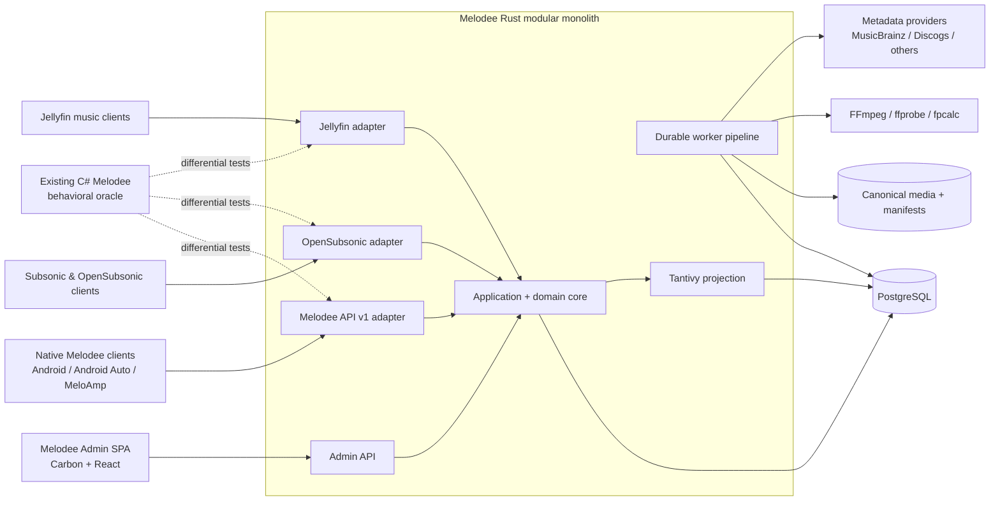
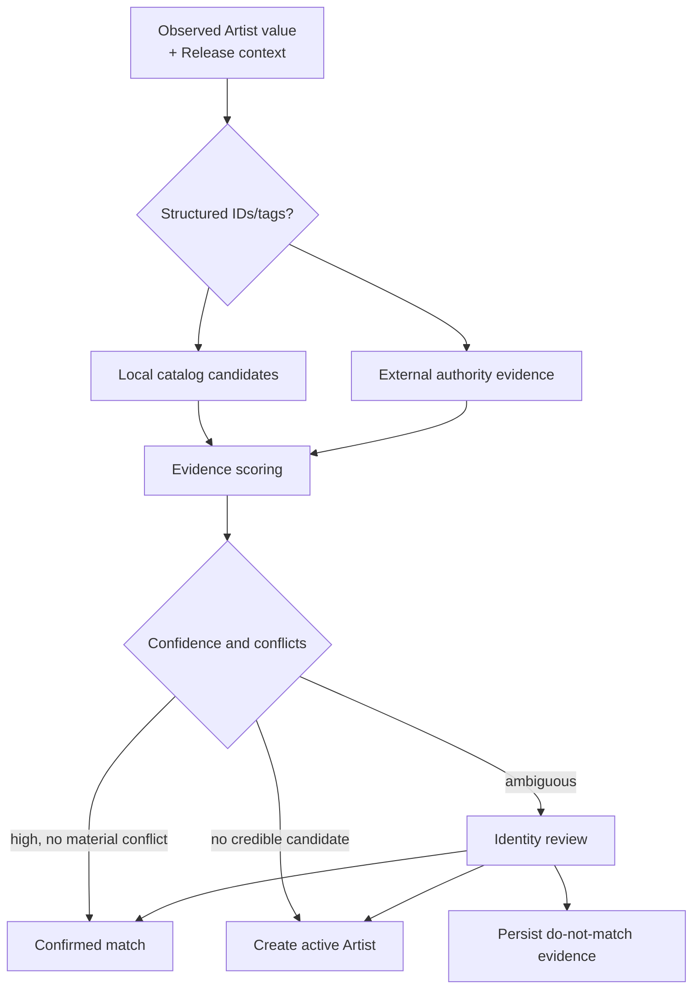
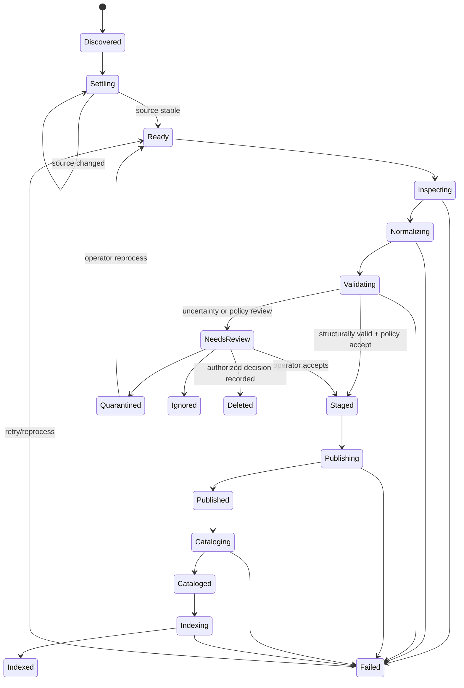

# Melodee Rust Rewrite — System Specification

**Status:** Draft implementation specification  
**Date:** 2026-08-07  
**Applies to:** Ground-up Rust replacement of the existing Melodee C# server  
**Product authority:** [PRD.md](PRD.md)  
**Architecture authority:** Accepted ADRs under [design/adr](design/adr)

## 1. Purpose

This specification translates the product requirements into an implementable system shape. It
establishes architecture boundaries, domain invariants, compatibility rules, data ownership,
operational behavior, test obligations, and the technical scope of the first delivery phases.

This document is not permission to port the legacy implementation. Where legacy behavior and this
specification differ, determine whether the difference is:

1. an existing bug that should not be preserved;
2. an external compatibility behavior that must be preserved in an adapter; or
3. a product/architecture conflict requiring an ADR.

## 2. Specification precedence

1. Accepted ADRs govern decisions.
2. This specification governs implementation invariants.
3. The PRD governs product outcomes and parity scope.
4. The implementation guide governs sequencing, not product scope.
5. Legacy code is evidence, not authority over new architecture.

## 3. System mission

Melodee shall ingest, normalize, curate, catalog, search, and stream very large audio libraries while
supporting existing Melodee-native, OpenSubsonic, and Jellyfin-compatible clients.

The system must be comfortable with the current production scale:

- approximately 35,000 Artists;
- approximately 50,000 Releases;
- approximately 560,000 Tracks;
- approximately 5 TB of canonical MP3 media; and
- inbound bursts of 200 or more Releases.

It must not introduce design ceilings that make a future 10-million-Track catalog unrealistic.

## 4. Architectural invariants

### SPEC-INV-001 — Melodee owns semantic identity

Artist, Release, Track, and MediaAsset identities are Melodee-owned. Names, paths, external IDs, and
hashes are attributes/evidence, not primary semantic identity.

### SPEC-INV-002 — Names are not unique

Two Artists may have identical canonical names and remain separate identities. Different names may
refer to the same Artist through aliases. Multi-Artist billing is modeled as associations, not a new
synthetic Artist string.

### SPEC-INV-003 — Public compatibility IDs are migration data

Existing public API keys/UUIDs must be imported and preserved. Internal IDs may differ, but adapters
must continue to expose the established public IDs.

### SPEC-INV-004 — PostgreSQL is authoritative for mutable application state

The proposed state model places catalog records, identity decisions, work-item state, users, policy
decisions, and audit history in PostgreSQL. Acceptance is governed by ADR-0105.

### SPEC-INV-005 — Media storage owns bytes, not relationships

Canonical storage contains media bytes and versioned manifests. The database determines Artist,
Release, Track, contribution, classification, and policy relationships.

### SPEC-INV-006 — Projections are disposable

Tantivy indexes, generated filesystem views, caches, and aggregates must be rebuildable from
PostgreSQL plus canonical manifests/media.

### SPEC-INV-007 — Work is durable and idempotent

A process crash, restart, duplicate event, or expired worker lease must not lose, duplicate, or
silently skip a Release.

### SPEC-INV-008 — Uncertainty is non-destructive

Ambiguous identity, classification, novelty, or media analysis results become Review or Quarantine,
not automatic deletion.

### SPEC-INV-009 — Compatibility adapters own legacy vocabulary

The Rust core uses Release and Track. `Album` and `Song` remain valid inside legacy API adapters,
migration mappings, captured fixtures, and protocol-specific tests.

### SPEC-INV-010 — Required functionality is 100% FOSS

No required feature may depend on a proprietary service, commercial tier, or open-core “Pro”
component.

## 5. System context



## 6. Deployment shape

The parity release starts as a modular monolith:

- one server executable;
- one optional administrative CLI executable;
- the matching `melodee-script-worker` helper for bounded, single-use script execution (ADR-0193);
- one PostgreSQL database;
- one canonical media root;
- one local Tantivy index root;
- external FFmpeg/ffprobe/fpcalc executables; and
- static admin SPA assets served by the server or a simple reverse proxy.

Worker leases and work state are database-backed from the beginning so workers can be split into
separate processes later without redefining the work model.

## 7. Module boundaries

| Module | Owns | Must not own |
|---|---|---|
| `melodee-domain` | IDs, value objects, state invariants, policy vocabulary | HTTP, SQL, filesystem, provider clients |
| `melodee-application` | Use cases, commands, queries, transaction boundaries | Protocol DTOs, raw SQL implementation |
| `melodee-persistence` | SQLx repositories, migrations, transactional work claims | Product policy, HTTP behavior |
| `melodee-ingestion` | Discovery, settling, work orchestration, retries | UI or external API DTOs |
| `melodee-media` | Metadata probe abstraction, hashing, conversion, artwork | Catalog identity decisions |
| `melodee-identity` | Artist/release resolution, evidence, merge/split | Provider-specific HTTP details |
| `melodee-policy` | Release traits, novelty analysis, disposition rules | File deletion implementation |
| `melodee-search` | Tantivy schema, indexing, query mapping | Canonical catalog truth |
| `melodee-api-v1` | Native v1 routes, auth conventions, DTOs, errors | Core terminology changes |
| `melodee-opensubsonic` | OpenSubsonic routes, auth, XML/JSON/JSONP envelopes | Native API DTOs |
| `melodee-jellyfin` | Implemented Jellyfin music compatibility subset | Full Jellyfin server behavior |
| `melodee-admin-api` | New operator/curation API | Legacy compatibility constraints |
| `melodee-server` | Composition root, listeners, middleware, lifecycle | Domain logic |
| `melodee-cli` | Operator commands and offline/maintenance entry points | Duplicate business logic |

Only crates needed in the current scope should be created. A planned boundary is not justification for
an empty crate.

## 8. Domain model

### 8.1 Artist

An Artist is a stable identity representing a person, group, orchestra, choir, character, or other
credited entity.

Required properties include:

- internal ID;
- preserved public API key where migrated;
- canonical name;
- normalized search name;
- sort name;
- type;
- optional disambiguation;
- optional begin/end dates and areas;
- status (`Active`, `Verified`, `Merged`, `Deprecated`);
- optional `merged_into_artist_id`; and
- audit timestamps.

Canonical name is indexed but never unique.

### 8.2 ArtistAlias

An alias means another name for the **same** Artist. It includes the alias value, normalized value,
type, locale, evidence source, confidence, and optional administrator lock.

Collaborations and groups are not aliases of their members.

### 8.3 ArtistRelationship and GroupMembership

Relationships connect distinct identities. GroupMembership is date-bounded and may include role,
confidence, source, and explicit exclusions for particular Tracks.

### 8.4 ExternalIdentity

External IDs use provider rows rather than provider-specific columns:

```text
entity_type
entity_id
provider
external_id
confidence
source
verified_at
is_locked
```

`provider + external_id` is unique within an entity type where the provider guarantees uniqueness.
An external ID is evidence; it is not Melodee's primary key.

### 8.5 Release

A Release is a published or collected ordered set of Tracks. It is content-neutral and may represent
music, comedy, spoken word, an audiobook, a cast recording, a broadcast, or mixed content.

### 8.6 Track

A Track is an ordered playable item on a Release. It must not assume musical content. Optional
content classification may describe music, spoken word, skit, intro, interview, comedy, chapter, or
unknown, but unknown must remain valid.

### 8.7 ReleaseArtist, TrackArtist, and Contribution

- ReleaseArtist records how a Release is presented.
- TrackArtist records how an individual Track is presented.
- Contribution records participation/credit and role.
- DisplayArtist preserves the exact human-facing billing string and join phrases.

A parsed `feat.`, `with`, `&`, `x`, or similar phrase may create candidate associations but must not
create or merge Artist identities by itself.

### 8.8 MediaAsset

A MediaAsset represents canonical playable bytes. A Track references at least one MediaAsset. The
model must not prevent multiple Tracks from referencing one MediaAsset after future deduplication,
but physical deduplication is not required for parity.

## 9. Artist identity resolution



Resolution evidence may include trusted embedded IDs, exact known Release matches, external provider
agreement, alias match, active-year overlap, area, member relationships, track-list agreement,
labels/catalog numbers, and negative/conflicting evidence.

Name equality alone is weak evidence and must never auto-merge.

Manual decisions and explicit negative assertions outrank future provider refreshes.

## 10. “Everything this Artist is on” projection

The query for an Artist must include:

- direct ReleaseArtist and TrackArtist associations;
- featured/guest/performance contributions;
- direct instrument/vocal contributions when known; and
- date-valid inferred group participation.

Composer, lyricist, producer, engineering, and other non-performance credits are available in an
“All credits” view but are not necessarily included in the default “appears on” view.

A materialized association table/projection should provide indexed reads:

```text
artist_id
track_id
association_type
direct_or_inferred
source_artist_id
confidence
```

## 11. Ingestion work model

### 11.1 Work-item identity

Each discovered Release candidate receives one durable work item with a stable ID, source path,
source fingerprint, current path, target path, state, attempt count, retry time, last error,
lease owner/expiry, manifest reference, timestamps, and correlation ID.

### 11.2 State machine



The state machine distinguishes workflow state from classification and disposition. “Greatest Hits”
is not a failure state.

### 11.3 Discovery and watchers

Filesystem watchers only enqueue candidate reconciliation. Periodic reconciliation guarantees
eventual discovery when events are lost or unsupported.

### 11.4 Settling

A candidate is Ready only after two equivalent source snapshots separated by a configurable quiet
period, or after a trusted explicit ready marker. A snapshot includes names, relative paths, sizes,
modification times, and file counts. Each Release settles independently.

### 11.5 Leases and retries

Workers claim bounded batches through PostgreSQL row locking/leases. Lease expiry makes abandoned
work eligible again. Retries are per Release, with exponential backoff, maximum automatic attempts,
and an operator-readable failure history.

### 11.6 Idempotency

Every stage must be safe to repeat after uncertain completion. Operations require stable idempotency
keys derived from work item and stage. File publication uses temp paths, verification, fsync where
applicable, and atomic rename when supported. Cross-filesystem moves use copy, verify, finalize, then
source removal.

### 11.7 Source protection

Inbound media bytes are immutable until durable staging acquisition. Tag rewriting or partial
mutation in the inbound tree is prohibited. After a verified staging receipt, the acquired
candidate directory is removed from inbound; downstream stages use the durable staged source.

## 12. Structural validity, enrichment, and curation

These are separate axes:

- **Structural validity:** playable files, coherent Track ordering, required titles/artists as text,
  valid durations, safe paths, no missing referenced files.
- **Enrichment:** provider identities, biographies, relationships, artwork, catalog metadata.
- **Curation:** administrator-confirmed identity, classification, or policy decision.

A structurally valid obscure/private Release may enter the catalog with active, unverified Artist identities.
External provider failure must not automatically block it.

Curation includes editing display metadata. The implemented contract (W0, `RELEASE-002`,
2026-08-23) is:

- Metadata edits are **catalog-row only**: they never rewrite media files, embedded tags,
  canonical assets, or semantic identity relationships (merges/splits remain decision actions
  under their own contract).
- Edits are **partial patches** over the admin API
  (`PUT /api/admin/v1/catalog/{releases|artists|tracks}/{id}/metadata`): absent or `null`
  fields are left unchanged; present fields must be valid (non-blank where required,
  well-formed dates, positive track ordinals, non-negative durations, known artist types).
- Every edit is a single transaction that writes the field patch, appends an immutable audit
  event (`catalog_audit_events`), and bumps the entity revision so the search projection
  refreshes.
- Concurrency is last-write-wins at the catalog row: each write atomically increments the row
  revision; there is no client-supplied expected-revision guard on metadata edits.
- The editable field set is migration-backed: only columns that exist in the accepted schema
  are exposed (Release: `title`, `sortTitle`, `displayArtist`, `releaseDate`,
  `releaseDateText`; Artist: `canonicalName`, `sortName`, `artistType`; Track: `title`,
  `sortTitle`, `displayArtist`, `ordinal`, `durationMs`).

## 13. Release manifests

Normalization produces a versioned manifest that includes:

- schema version and manifest ID;
- Release and Track observations;
- resolved Artist IDs and display values when available;
- classification traits, confidence, and evidence;
- contribution relationships;
- source fingerprint;
- media metadata;
- content hash and acoustic fingerprint results;
- normalization profile and tool versions;
- artwork inventory;
- validation findings;
- policy decision reference; and
- file mapping from source to canonical asset.

Catalog insertion consumes manifests instead of reopening every audio file. Manifest upgrades are
explicit, versioned, and tested.

normalization and publication's implemented manifest evolution is:

- v1: inspection observations;
- v2: normalization, acoustic fingerprints, normalized artwork, and parsed sidecars; and
- v3: stable Release ID, structural validation, durable publication authorization, retained source
  disposition, canonical layout/plan identity, and the sorted source-to-normalized-to-canonical
  asset inventory.

V1/v2 remain readable. The v2-to-v3 upgrade preserves the semantic observed-media hash because
publication intent/provenance is a separate fact. catalog and identity consumes the reserved Release ID and v3
facts rather than allocating a replacement identity or reopening audio to rediscover them. See
ADR-0115 and ADR-0116.

## 14. Media inspection and normalization

- Use Lofty for supported tag formats when accepted by ADR.
- Use ffprobe as authoritative fallback for unsupported/uncertain containers.
- Use FFmpeg as an external child process for conversion/transcoding.
- Use Chromaprint/fpcalc for acoustic fingerprints when accepted by ADR.
- Compute a cryptographic content hash once during ingestion and store it.
- Capture tool path, version, arguments profile, exit code, and sanitized diagnostics.
- Bound concurrent FFmpeg, image, hashing, and metadata work independently.
- Preserve the current canonical storage policy that normalizes FLAC/OGG/WAV to high-quality VBR
  MP3, including the exact current profile once captured from the legacy configuration.
- Do not shell-concatenate file paths or user input.

## 15. Release classification and policy

Classification produces non-exclusive ReleaseTraits with evidence and confidence. Policy evaluates
those facts plus catalog novelty and returns a disposition.

Required dispositions:

- Accept
- Review
- Ignore
- Quarantine
- Delete

Greatest Hits/collection logic evaluates Tracks as:

- exact duplicate;
- same underlying audio;
- alternate recording/version;
- new Track; or
- uncertain.

The default safety rules are:

- exact/same-audio matches are not novel;
- alternate versions are potentially valuable;
- new Tracks are valuable;
- uncertainty prevents automatic deletion; and
- deletion occurs only after a durable decision/audit row exists.

Policies support dry-run/testing against the catalog before activation.

## 16. Canonical storage

Canonical layout v1 is Release-centric and sharded by stable ID, never Artist folder ownership:

```text
storage/
  releases/
    <release-id-blake3-byte-0-hex>/
      <release-id-blake3-byte-1-hex>/
        rel_<release-uuid-simple>/
          manifest.json
          media/<blake3>.mp3
          artwork/<blake3>.jpg
```

The shards are the first two bytes of BLAKE3 over the Release UUID's raw 16 bytes, encoded as
separate lowercase hexadecimal components. Canonical asset paths derive from asset kind and BLAKE3
byte hash. Paths stored in PostgreSQL are storage-root-relative. Layout v1 does not include a
human-readable prefix; future generated `by-artist` views may use display values/links and are always
disposable.

Merge/split/rename operations must not require moving media merely because identity metadata changed.
Publication persists immutable authorization/plan intent before filesystem I/O, seals and fsyncs a
hidden incoming bundle, uses a no-replace directory rename, and records the receipt only after final
verification. Retry adopts an exact final and fails closed on a conflict. Canonical publication
retains staged source by default; inbound is drained after ADR-0145 staging acquisition. See
ADR-0106, ADR-0116, and ADR-0145 for the binding layout/publication decision.

## 17. Catalog persistence

The conceptual schema includes:

- Artists, ArtistAliases, ArtistExternalIdentities, ArtistRelationships, GroupMemberships;
- Releases, ReleaseArtists, Tracks, TrackArtists, Contributions;
- MediaAssets and TrackMediaAssets;
- ReleaseTraits and classification evidence;
- ArtistMatch decisions and negative assertions;
- ReleaseWorkItems, work attempts, leases, and transition history;
- Policies, policy versions, policy test results, and disposition decisions;
- Users, groups, library ACLs, tokens, playlists, user state, requests, shares, podcasts, party state;
- search outbox and projection checkpoints; and
- immutable audit events where required.

Indexes are designed from measured query plans, not added generically. Common reads must not perform
N+1 queries.

## 18. Search and MQL

Tantivy is proposed as an embedded, rebuildable full-text projection. PostgreSQL remains truth.

Indexed entities include Artists, Releases, Tracks, aliases, display credits, genres, and participant
Artist IDs. Track documents carry both primary and participant IDs so Colin Hay searches can include
solo, group, featured, and performance associations.

MQL parses to a Melodee AST independent of Tantivy. Separate translators can target Tantivy and SQL
where appropriate. Legacy MQL syntax/semantics require compatibility tests.

Target warm search performance is p95 below 50 ms on the documented 10-million-Track benchmark,
subject to ratification against representative hardware.

## 19. External API surfaces

### 19.1 Native Melodee API v1

The adapter preserves routes, auth/refresh flows, DTO property names and types, pagination metadata,
error objects/codes, sort defaults, null/omission behavior, stream/image URLs, and public IDs.

The non-versioned HMAC stream route remains contractually compatible until explicitly versioned with
a client migration plan.

### 19.2 OpenSubsonic

The adapter preserves query/form authentication conventions, plain and `.view` forms, JSON/XML/JSONP
envelopes, extensions, range/direct/transcode behavior, and intentional Gone/Not Implemented results.

### 19.3 Jellyfin

The adapter preserves the implemented music-only subset, discovery/login/token conventions, root
route rewriting, direct/universal audio streaming, user state, sessions, images, playlists, and
intentional absence of non-music Jellyfin features.

### 19.4 Admin API

The new admin API uses Rust-native vocabulary and exposes work items, evidence, decisions, policies,
workers, health, identities, Releases, Tracks, contributions, storage, and migration status. It is
independently versioned from native v1.

## 20. Authentication and security

- Existing password hashes remain valid after migration.
- Native refresh-token replay/rotation behavior is captured before replacement.
- OpenSubsonic and Jellyfin token conventions remain isolated.
- Stream tokens remain validated exactly as required by clients.
- Authorization is checked server-side for every data-changing action.
- File roots are canonicalized and constrained.
- Audit records capture administrator identity and reason for destructive/identity decisions.
- Secrets are redacted from logs, compatibility captures, fixtures, and diagnostics.

## 21. Admin UI

The admin SPA is an operator and curation console, not the primary playback client.

Canonical navigation:

```text
Overview
Processing
  Activity
  Review Queue
  Quarantine
  History
Catalog
  Artists
  Releases
  Tracks
  Identity Review
Policies
  Release Rules
  Matching Rules
System
  Storage
  Workers
  Search
  Users & Access
  Settings
  Diagnostics
```

Carbon is the preferred FOSS design-system candidate. TanStack Table is not baseline and may be added
only for a proven Carbon DataTable gap.

The UI preserves named themes, light/dark/system appearance, localization, locale formatting, and RTL
for supported cultures. All large lists use server-side search/filter/sort/page operations.

The eight reference mockups define information hierarchy and interaction intent; written
specifications and implemented Carbon components override hallucinated text/data in the images.

## 22. Observability

Every request and work item carries a correlation ID. Structured events include stage, work-item ID,
Release ID, attempt, worker, elapsed time, and sanitized error category.

Required operational views include:

- queue depth and age;
- active/idle workers;
- stage throughput and latency;
- retry/failure/quarantine counts;
- PostgreSQL, storage, Tantivy, and media-tool health;
- API latency/error rates by surface; and
- policy/identity decision history.

No proprietary hosted observability backend is required.

## 23. Performance budgets

Initial budgets to measure and ratify:

| Workload | Budget/requirement |
|---|---|
| 200-Release inbound burst | Every Release receives durable state quickly; independent progress |
| Warm global search, 10M Tracks | p95 < 50 ms target |
| API list endpoints | Bounded memory and indexed server-side pagination |
| Stream start | No catalog-wide work; range/seek compatible |
| No-op reconciliation | Does not deserialize/reprocess the entire catalog |
| Worker crash | Lease expiry enables safe resumption without duplicate publication |
| Search index loss | Full rebuild without media re-ingestion |

Representative hardware and exact budgets are captured during baseline capture.

## 24. Compatibility testing

A differential harness sends equivalent requests to the C# and Rust servers and compares:

- method/path/query/body;
- status and selected headers;
- JSON/XML structure and scalar types;
- null versus omitted properties;
- sort/order/page behavior;
- errors and correlation behavior;
- stream content type, length, ranges, seeking, and resumption; and
- authentication/refresh workflows.

Differences are classified as exact parity, accepted normalization, known legacy bug, or regression.
Accepted differences require documentation and, when external, an ADR.

## 25. Migration

Migration must preserve media without mandatory re-transcoding and preserve all public IDs and durable
user state. It runs through repeatable, restartable stages with validation counts and rollback.

The recommended sequence is:

1. inventory and backup;
2. capture compatibility baseline;
3. provision Rust/PostgreSQL target schema;
4. import identities/catalog/public IDs;
5. import user/application state;
6. reference existing canonical media and generate/upgrade manifests incrementally;
7. build Tantivy projection;
8. run dual-server differential validation;
9. run real-client validation;
10. freeze writes or perform final delta sync;
11. cut traffic; and
12. retain rollback until release gates are satisfied.

## 26. baseline capture technical specification

baseline capture delivers evidence and guardrails, not broad product features.

Required outputs:

1. Canonical native v1 OpenAPI capture.
2. Canonical route inventory for all three public surfaces.
3. Golden public and authenticated request/response fixtures.
4. Explicit normalizers for volatile fields such as timestamps and correlation IDs.
5. Legacy database and public-ID inventory scripts.
6. Media-normalization profile capture, including exact FFmpeg arguments/settings.
7. Current configuration/feature flag inventory.
8. Synthetic catalog and filesystem generators.
9. Baseline reports for search, browse, ingest, stream start, and memory.
10. Real-client smoke-test checklists for Android/Android Auto, MeloAmp, representative OpenSubsonic
    clients, and supported Jellyfin clients.
11. Accepted foundational ADRs needed for runtime foundation.
12. CI that formats, lints, tests, validates docs/requirements, and enforces FOSS dependencies.

baseline capture is complete only when another agent can run documented commands and reproduce the baseline.

## 27. runtime foundation technical specification

runtime foundation establishes the modular Rust runtime without feature breadth:

- server lifecycle, configuration loading, graceful shutdown, request IDs, structured tracing;
- PostgreSQL connectivity and migrations after ADR acceptance;
- readiness/liveness/diagnostic endpoints;
- CLI composition and doctor commands;
- transaction abstraction sufficient for work items;
- no speculative full schema;
- test containers/fixtures for PostgreSQL integration; and
- a committed lockfile and dependency audit.

## 28. Change control

A requirement is not “done” until traceability identifies implementation, tests, and evidence.
Proposed ADRs do not authorize irreversible implementation. Any technology version in the repository
must be rechecked at lock/update time and recorded in the technology baseline.
