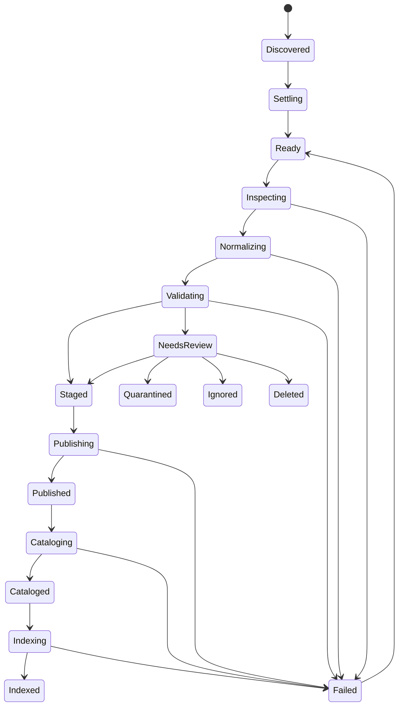

# Ingestion State Machine

The durable state machine is per Release. Classification and disposition are separate facts.

## Transition requirements

- Every transition is durable and timestamped.
- A worker holds a renewable lease while performing a stage.
- Lease expiry never implies success.
- Repeat execution is safe.
- Failure stores a machine category plus operator-safe diagnostic.
- Delete requires a prior durable authorized decision.
- Reprocess is explicit and records who/why reset the item.
