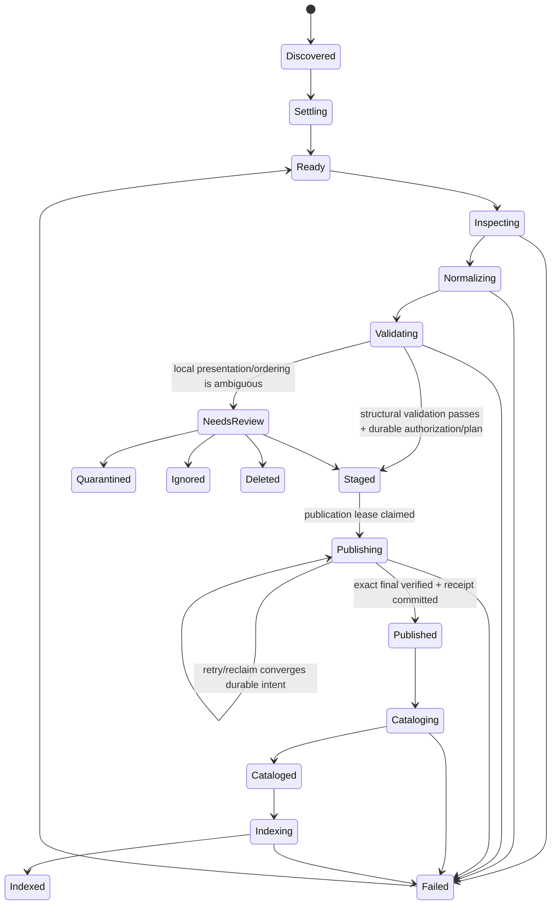

# Ingestion State Machine

The durable state machine is per Release. Classification and disposition are separate facts.

## Transition requirements

- Every transition is durable and timestamped.
- A worker holds a renewable lease while performing a stage.
- Lease expiry never implies success.
- Repeat execution is safe.
- Failure stores a machine category plus operator-safe diagnostic.
- Delete requires a prior durable authorized decision.
- Reprocess is explicit and records who/why reset the item.

## Implemented Phase 3 publication semantics

- `Validating` performs structural/media checks only. It never guesses Artist/catalog identity or
  performs Phase 5 classification/novelty policy.
- A passing result reserves one immutable UUIDv7 Release ID and atomically stores manifest v3,
  `phase3.structural-publication` authorization v1, and an immutable canonical-publication plan
  before entering unleased `Staged`.
- Missing/ambiguous required local presentation or ordering facts store the complete validation
  evidence and enter unleased `NeedsReview`; this does not consume a retry attempt.
- A publication claim moves `Staged` to leased `Publishing`. An expired lease, target conflict, or
  retryable publication problem clears ownership but preserves `Publishing` and its immutable plan
  so the next claim converges rather than generating new identity/intent.
- `Published` requires the exact planned asset-copy, sealed-bundle, and finalization/adoption journal
  evidence plus one durable receipt. Completion atomically clears the lease and records source
  disposition `retained`.
- A matching final directory is adopted after a crash; a mismatching final is never overwritten.

See [ADR-0116](../adr/ADR-0116-use-immutable-release-ids-and-convergent-canonical-publication.md)
and [Phase 3 evidence](../evidence/phase-3/PHASE-3-REPORT.md).
