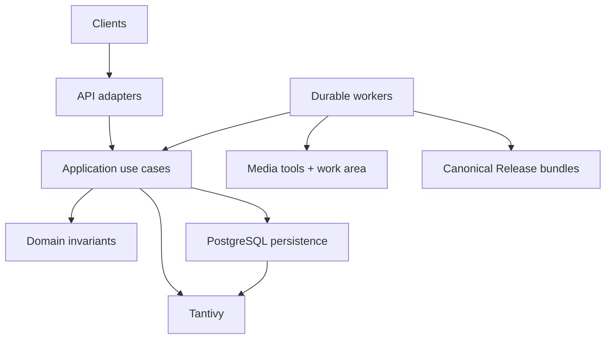

# Architecture Overview

The target is a modular monolith with explicit protocol adapters, a framework-independent domain,
PostgreSQL authoritative state, canonical media/manifests, and rebuildable projections.

Dependencies point inward. Domain code never imports transport, persistence, or filesystem crates.

For Phase 3 publication, PostgreSQL holds durable work state, immutable authorization/plan, journal,
and receipt evidence. Canonical storage holds the verified finalized media bytes and manifest v3.
The two authorities converge through a no-clobber incoming-directory protocol rather than a
fictional cross-resource transaction. Inbound media is a read-only source and is not shown as an
authoritative identity store.
