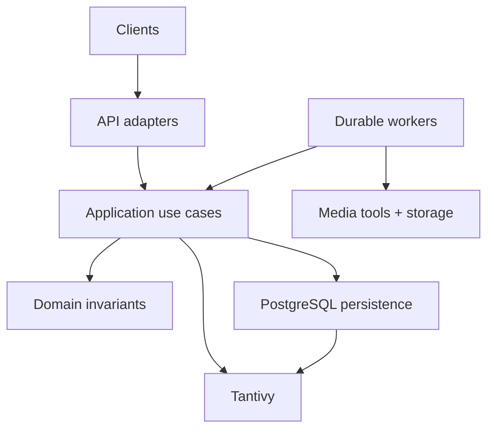

# Architecture Overview

The target is a modular monolith with explicit protocol adapters, a framework-independent domain,
PostgreSQL authoritative state, canonical media/manifests, and rebuildable projections.

Dependencies point inward. Domain code never imports transport, persistence, or filesystem crates.
