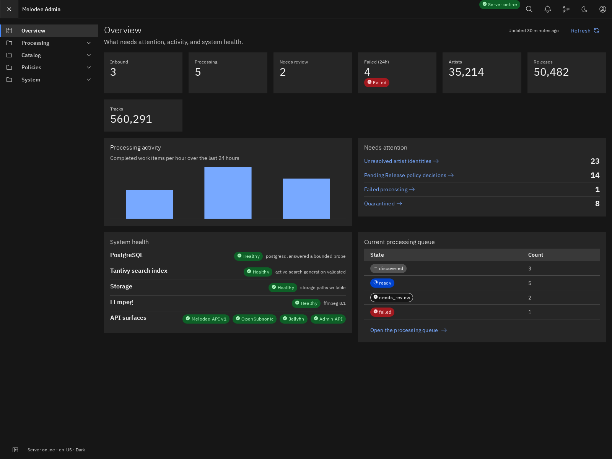
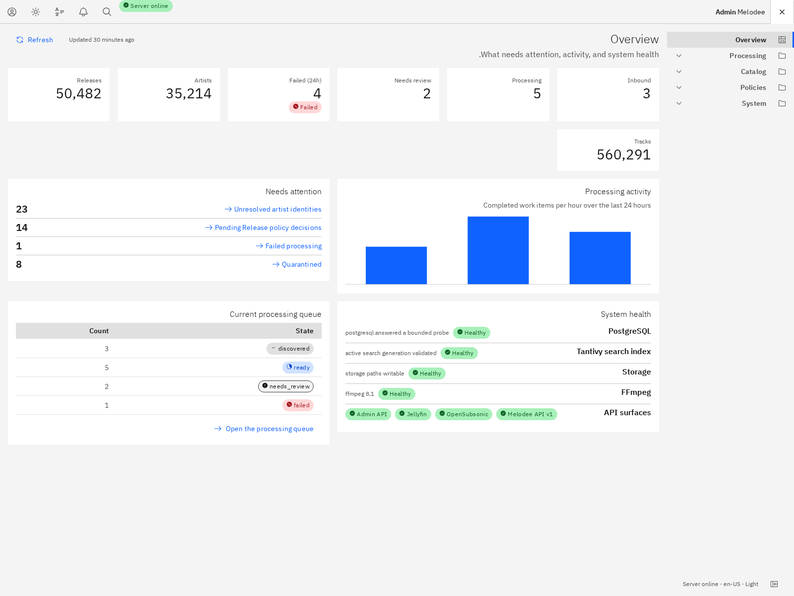

The admin UI at `/admin` is themed and localized on two independent axes: **appearance**
(system/light/dark) and **theme pack** (a token overlay), plus a **language** selection that
covers layout direction.

## Appearance

The header's appearance menu offers **System**, **Light**, and **Dark**. *System* follows the
operating-system preference; the explicit choices override it. The selection persists in the
browser's local storage.

## Theme packs

Theme packs are served by the [native theme endpoints](../api/melodee-api/) and applied from
**System → Settings → Theme** (see [Settings](./settings/)). Applying a pack loads its
`theme.css`, extracts the `--melodee-*` custom-property declarations, and injects them onto the
admin UI's semantic token layer. The choice persists in local storage alongside the appearance.

Packs written for the legacy server's UI work through a **token mapping with a documented
limitation**: only `--melodee-*` tokens are meaningful to this application. Any other CSS in a
legacy pack is ignored, and token values apply flat to both light and dark appearances — a pack
cannot declare per-mode variants. A pack whose `theme.css` declares no recognized tokens is
reported honestly so you can fall back to the default.

Administrators manage packs from the same tab: **rescan** the theme directory, **import** a pack
as a ZIP (bounded, validated in memory, rejecting links/traversal/duplicate paths), **export** a
pack, and **delete** non-built-in packs (the server refuses to delete built-ins).

## Localization

The admin UI ships with twenty cultures:

`ar-SA`, `cs-CZ`, `de-DE`, `en-US`, `es-ES`, `fa-IR`, `fr-FR`, `id-ID`, `it-IT`, `ja-JP`,
`ko-KR`, `nl-NL`, `pl-PL`, `pt-BR`, `ru-RU`, `sv-SE`, `tr-TR`, `uk-UA`, `vi-VN`, `zh-CN`.

The header's language menu switches the UI immediately. **English (`en-US`) is the fallback**:
any string missing from the selected culture renders in English rather than as a raw key.

Arabic (`ar-SA`) and Persian (`fa-IR`) render **right-to-left**: the entire layout mirrors,
including navigation, tables, and dialogs.

Dates, times, durations, and numbers format through the selected culture's locale conventions
throughout the admin screens.
