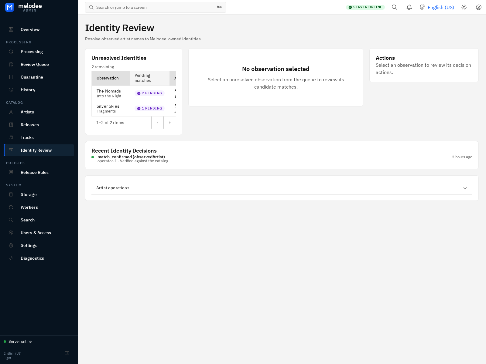

Identity review is where uncertain artist matches are resolved: an observed name string can match
zero, one, or many Artists, and the operator (or evidence rules) decide. Merge and split decisions
are recorded with history and never move media files.

## Identity Review screen

Open **Catalog → Identity Review** (`/admin/catalog/identity`). The screen lists the unresolved
queue: observed artist strings that have no authoritative match decision, with the display, raw,
and normalized values, the source Release (and Track when the observation is track-scoped), and
the pending candidate and evidence counts. The queue is server-paged and sortable; filter state
lives in the URL.

Selecting an observation opens the **candidate comparison**: every candidate Artist with its
confidence, the full persisted evidence breakdown, and any do-not-match assertions already on
record.

## Decisions

Every decision requires a non-blank reason and is recorded in the append-only audit with the
acting administrator:

- **Confirm** — lock the observation to the chosen candidate Artist. A locked administrator
  decision is never superseded by an automated resolver, and the observation leaves the
  unresolved queue.
- **Create New** — create a new provisional Artist from the observation's display value and lock
  the observation to it.
- **Leave Provisional** — an honest, audited no-op: no decision row is written and the
  observation stays queued for a later pass.
- **Never Match** — a durable, locked *negative* assertion against the exact
  observation/candidate pair; automated resolvers then fail closed for that pair. Because this
  shapes future automation, the dialog is danger-styled and the reason is mandatory.

A **recent decisions** feed on the same screen shows the append-only identity audit — matches,
evidence, assertions, and Artist-level events — newest first, with actor and reason.

## Merge and split

The screen also corrects Artist identities directly:

- **Merge** folds a source Artist into a target Artist. The source's public id is preserved as a
  redirect, the merged Artist can no longer participate in identity mutations, and merging an
  Artist into itself is rejected. Merge is destructive-class: the dialog requires typed
  confirmation and a reason.
- **Split** creates a new provisional Artist and moves **only** the explicitly listed
  assignments (Release/Track credits, contributions, aliases, external identities) off the
  source Artist; an empty assignment list is rejected. In this build the form takes the durable
  row ids of the selected links directly (a picker UI is not built yet), so splits are
  typically easier to drive through the
  [Admin API](../api/admin-api/#split-an-artist) when many rows are involved.

Neither operation touches media files; they change catalog relationships only.

All of these flows use the [Admin API identity routes](../api/admin-api/#artist-identity-review),
which are the parallel surface for scripting and automation.

## Artist status

Artists created from imported credit text start as **Provisional**: the catalogue knows
the name, not the identity. Confirming that an observation names an existing Artist (the
`confirm` resolution) promotes that Artist to **Verified** in the same transaction, so the
Artists list shows how much identity work has been done rather than treating every
imported name as an open question. The `create-new` resolution records a distinct Artist
and leaves it Provisional. You can also set the status directly in the Artist's Edit panel.
