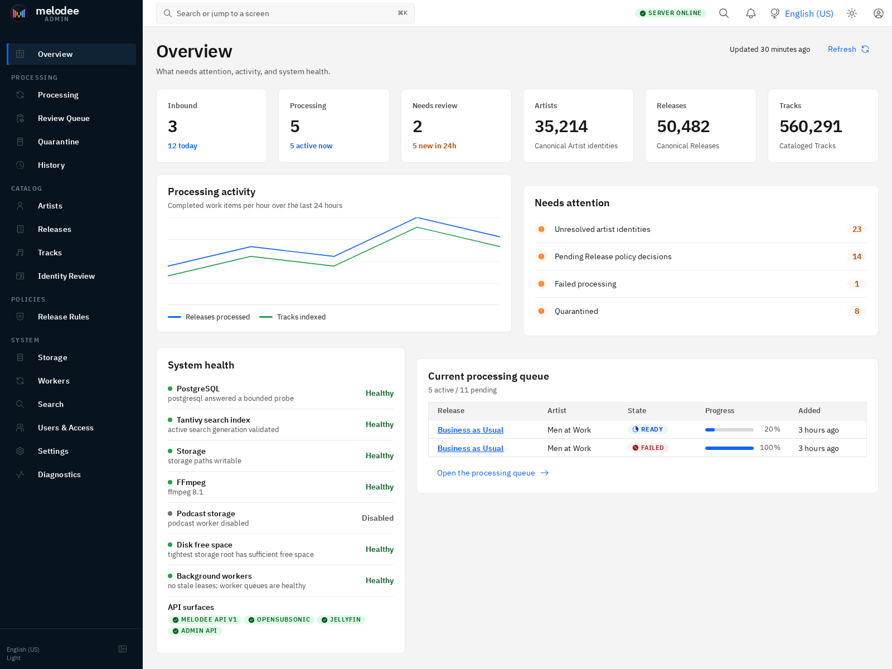
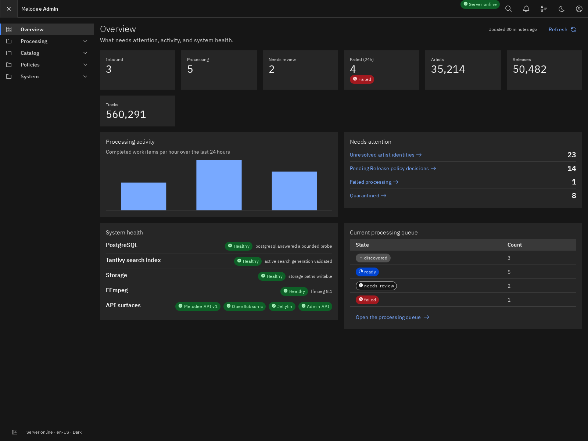

Melodee administration covers processing oversight, catalog curation, policy, identity review,
user access, and system diagnostics.

The admin interface is a Carbon-based single-page application served by the Rust server itself at
`/admin` (the built bundle ships in the directory configured by `MELODEE__ADMIN_UI__DIST`, default
`admin-ui/dist`; see [Configuration](../installation/configuration/)). It is localized in twenty
cultures with light, dark, and system appearance and full right-to-left layout support — see
[Appearance and Localization](./appearance-and-localization/).

## Signing in

Open `/admin` on your server and sign in with an administrator account. The UI uses the native
cookie sign-in session: the server owns the session cookie, and every request is re-checked
against the administrator gate. A signed-in non-administrator sees an explicit access-denied
state, and an expired session returns you to the sign-in screen. The underlying API rejects
anonymous requests with `401` and non-administrators with `403`; see
[Admin API — Authentication](../api/admin-api/#authentication-and-authorization).

If the server was never set up, or first-run checks are still failing, the dashboard shows a
banner pointing at the [onboarding wizard](../getting-started/quick-start/#first-run-onboarding)
at `/admin/onboarding`. Servers migrated from a legacy installation bypass onboarding
automatically.

## The Overview dashboard

The landing screen answers "what needs attention?" first, then summarizes the catalog:

- **KPI cards** — inbound, processing, needs-review, and failed (24 h) work items, plus catalog
  Artist, Release, and Track counts.
- **Needs attention** — direct links to unresolved artist identities, pending Release policy
  decisions, failed processing, and quarantined items.
- **Processing activity** — completed work items per hour over the last 24 hours.
- **System health** — PostgreSQL, the search index, storage, FFmpeg, and the four API surfaces.
- **Current processing queue** — live per-state counts with a link into the queue.

The dashboard refreshes every 60 seconds and keeps showing the last good data if a refresh fails;
a retryable error banner appears instead of a blank screen.

## Navigation map

| Section | Path | What it is |
|---|---|---|
| Overview | `/admin` | Dashboard described above |
| Processing → Processing Queue | `/admin/processing` | Durable work-item queue; see [Processing](./processing/) |
| Processing → Review Queue | `/admin/processing/review` | Releases waiting on a decision; see [Release Review](../library-management/release-review/) |
| Processing → Quarantine / History | `/admin/processing/quarantine`, `/admin/processing/history` | Quarantined items and the transition audit feed |
| Catalog → Artists / Releases / Tracks | `/admin/catalog/…` | Server-side search, sort, and paging over the catalog |
| Catalog → Identity Review | `/admin/catalog/identity` | Unresolved artist-name observations; see [Identity Review](./identity-review/) |
| Policies → Release Rules | `/admin/policies/releases` | The immutable, versioned policy rule set; see [Policies](./policies/) |
| System → Storage | `/admin/system/storage` | Storage subsystem health and the storage-paths preflight; see [System and Diagnostics](./system-diagnostics/) |
| System → Workers | `/admin/system/workers` | Worker pools, failures, search status, health, leases; see [System and Diagnostics](./system-diagnostics/) |
| System → Search | `/admin/system/search` | Search index status and the rebuild trigger; see [System and Diagnostics](./system-diagnostics/) |
| System → Users & Access | `/admin/system/users` | Accounts, groups, and library bindings; see [Users and Access](./users-and-access/) |
| System → Settings | `/admin/system/settings` | Configuration, notifications, scripts, radio, device profiles, themes; see [Settings](./settings/) |
| System → Diagnostics | `/admin/system/diagnostics` | Subsystem health, active leases, and failure drill-down; see [System and Diagnostics](./system-diagnostics/) |

The PRD's Policies → Matching Rules entry is deliberately absent: the policy engine has exactly
one rule model (Release policy rules, served by Release Rules) and artist identity matching is
evidence-based rather than rule-based, so there is no matching-rule surface to show. It returns
only if a future matching-rule engine exists.

Every screen keeps its filter, sort, page, and selection state in the URL, so any view can be
shared as a link with another administrator.

Everything the UI does is also available through the [Admin API](../api/admin-api/), and the
operator CLI (`melodee …`) remains the parallel headless surface for the same durable state.
