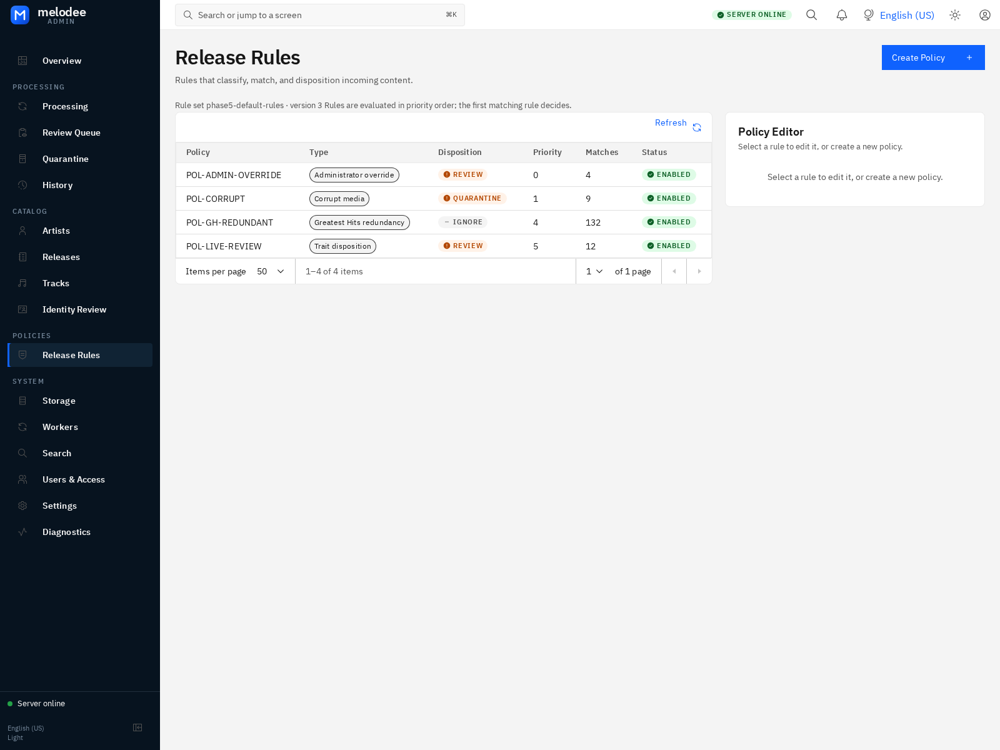

Policies classify cataloged Releases, assess Track novelty, and choose one of five dispositions:
`Accept`, `Review`, `Ignore`, `Quarantine`, or `Delete`. Every durable decision records the exact
immutable rule-set version, matched rules, evidence summary, actor, and sealed-manifest fingerprint.

The server evaluates only authoritative PostgreSQL catalog and manifest evidence. It does not open
source or canonical media. Classification considers structured and embedded evidence, existing
independently asserted catalog traits, and weak title/directory observations. Novelty distinguishes
exact-byte matches, known AudioIdentities, confirmed alternate recordings, audited no-catalog-match
findings, and uncertain material. Unconfirmed identities fail closed as uncertain. A name or
directory match by itself never authorizes deletion.

## Greatest Hits defaults

The built-in rule set defaults to:

- `Ignore` for a Greatest Hits Release whose Tracks are all redundant;
- `Review` when any Track is new or a confirmed alternate recording; and
- `Review` when novelty is uncertain.

The safe preference ranges and exact settings are listed in
[Configuration](../installation/configuration/#policy-evaluation). A `Delete` outcome is never an
instruction to remove media. It creates a pending decision and routes the Release to
`NeedsReview`. The policy CLI has no action that completes deletion.

Rule sets are immutable by name and version. If any configured preference changes, increment
`MELODEE__POLICY__RULE_SET_VERSION`. Reusing a stored version with different rules fails startup
instead of changing the meaning of historical decisions.

## Test and inspect policy

These commands require `MELODEE__DATABASE__URL`:

```bash
melodee-cli policy config
melodee-cli policy rules
melodee-cli policy test --limit 100 --actor <administrator-id>
melodee-cli policy evaluate <release-id>
melodee-cli policy inspect <release-id>
```

`policy test` requires a nonblank administrator identity, evaluates a bounded catalog sample, and stores an audit summary containing proposed
dispositions, matched-rule counts, existing-disposition counts, destructive impact, and up to 20
sample Release IDs. It does not persist the proposed decisions. `policy evaluate` reports one
Release's proposed decision without persisting that decision. Both commands provision the exact
configured rule set idempotently if it is not present. `policy inspect` prints the current durable
decision and its append-only audit history.

## Administrator decisions

A pending `NeedsReview` decision can be overridden explicitly:

```bash
melodee-cli policy decide <release-id> <accept|review|ignore|quarantine|delete> \
  --actor <administrator-id> \
  --reason "<operator-safe reason>"
```

The current sealed-manifest fingerprint is checked in the same transaction as the audited update.
The actor and non-empty reason are mandatory. `Accept`, `Ignore`, and `Quarantine` complete the
non-destructive decision and route the work item accordingly. `Review` and `Delete` remain pending
in `NeedsReview`; the command does not access, move, or delete media.

## Policies screen

Open **Policies → Release Rules** (`/admin/policies/releases`). The screen lists the active
rule set as an ordered table — rule type, disposition, confidence threshold, priority
(zero-based evaluation position; lower wins, first match applies), enabled state, and how many
durable decisions each rule produced — plus the rule-set identity (`name`, `version`,
`createdBy`).



Key workflows:

- **Structured rule editor** — creating or editing a rule builds its conditions from the two
  dimensions the engine evaluates (`release_trait` and existing dispositions), the disposition,
  and the confidence threshold. There is no free-text predicate surface.
- **Immutable, versioned rule sets** — every mutation (create, update, delete, enable, disable)
  appends a new immutable `(name, version)` rule-set row validated through the engine
  invariants; nothing is edited in place and history is never rewritten. A concurrent edit
  loses with a conflict and the listing refetches after each mutation so the displayed version
  always reflects durable state. The running policy worker adopts a new version when its
  configured version matches (`MELODEE__POLICY__RULE_SET_VERSION`); authoring a version here
  never interrupts in-flight evaluations.
- **Protected safety rules** — the built-in administrator-override and corrupt-media quarantine
  rules cannot be removed; the UI explains this and the server enforces it
  (`409 protected_rule`).
- **Test against the catalog** — any enabled rule, or an ad-hoc candidate definition, can be
  dry-run against a bounded catalog sample. The result reports evaluated and matched counts,
  proposed and existing disposition counts, the destructive impact (Releases whose proposed
  disposition is `delete`), and a bounded sample of matched Releases. Tests of stored rules are
  persisted to the durable test-run audit; ad-hoc tests are marked as not persisted because the
  candidate rule has no durable identity. Tests never persist proposed decisions.

The equivalent CLI commands remain available and are listed above; the underlying routes are
documented under [Admin API — Policies](../api/admin-api/#policies). Deciding a specific
pending Release happens in [Release Review](../library-management/release-review/), not in the
rule editor.
