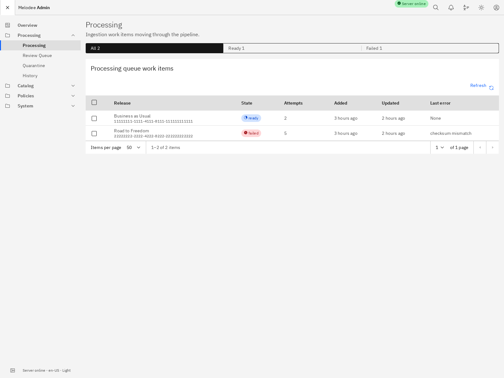

The processing queue shows one durable work item per inbound Release, with per-item status,
history, and a read-only inspector. A stalled or failed Release never blocks the others.

## Processing Queue screen

Open **Processing → Processing Queue** (`/admin/processing`). The screen is a dense table backed
by the server-side work-item listing: state filter chips show live counts per durable state
(`discovered`, `settling`, `ready`, `inspecting`, `normalizing`, `needs_review`, `failed`, and so
on), sorting is restricted to the backend whitelist (`addedAt`, `updatedAt`, `state`,
`attemptCount`), and paging is envelope-driven with honest totals. Filter, sort, page, and
selection state live in the URL, so a filtered view can be shared as a link.

Selecting a row opens the **inspector**, which shows the work item's full durable state —
attempts, lease evidence, last error, timestamps — together with its append-only **event
timeline**: the answer to "what happened to this Release and why". Both come from the
[Admin API](../api/admin-api/#work-item-detail) diagnostics endpoints and show only durable
PostgreSQL state; nothing is inferred from a running process.

Bulk actions are deliberately not offered, and the queue screen itself is read-only: every
queue mutation in this build is a per-item, audited decision made from the
[Release Review](../library-management/release-review/) workspace or the CLI.

## Quarantine and History

- **Processing → Quarantine** (`/admin/processing/quarantine`) lists quarantined work items —
  Releases held out of the catalog by policy or by an operator decision — with the same paging
  and inspector behavior as the main queue.
- **Processing → History** (`/admin/processing/history`) is the queue-wide transition feed: the
  append-only record of state changes across work items, newest first.

## Steering processing

Queue throughput is controlled at the worker-pool level, not per item: pause or resume pools from
[System and Diagnostics](./system-diagnostics/) (or `melodee worker-pools pause|resume`). A
paused pool claims no new work; already-claimed items finish or are released under the normal
lease contract, so pausing never strands a lease.

Reprocessing a Release that already carries a policy decision is a review action — see
[Release Review](../library-management/release-review/).

The equivalent CLI surfaces are `melodee ingest status`, `melodee work list`,
`melodee work show <id>`, and `melodee catalog status`; see
[System and Diagnostics](./system-diagnostics/#command-line-diagnostics).
