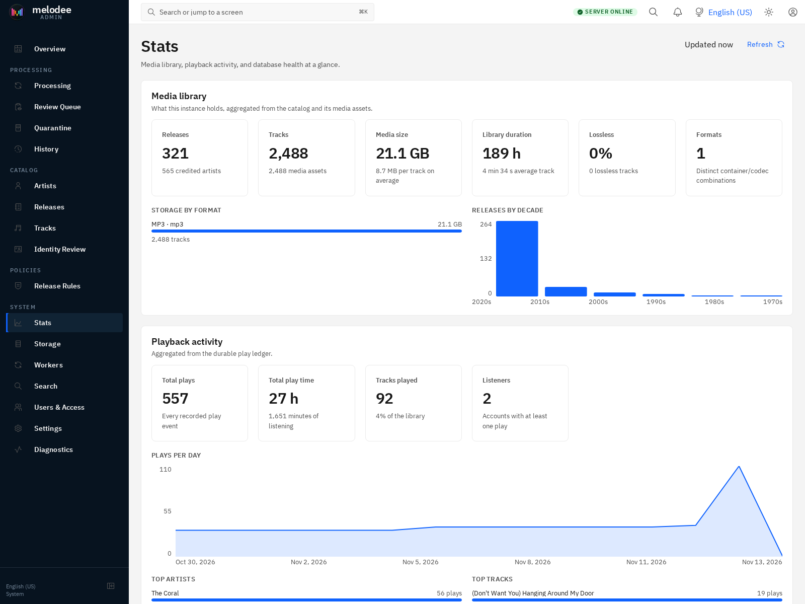

**System → Stats** (`/admin/system/stats`) is the quantitative view of the instance: what the
library holds, how it is used, and how large the database has grown. Every number is computed by
the server in bounded aggregate queries (`GET /api/admin/v1/stats`) — the page renders them and never
re-aggregates client-side, so what you see matches `melodee-cli` and SQL.

## Release processing

**Published in the last hour** counts Releases with a completed library publication receipt.
**Imported in the last hour** counts completed catalog imports. Each card also shows the
trailing 24-hour total. A Release can publish and reach the catalog at different times.
Select **Waiting for publication** or **Awaiting review** to open the corresponding queue.

## Media library

| Metric | Meaning |
|---|---|
| Releases, Tracks, Artists | Catalog counts (Artists excludes merged identities) |
| Media size | Total bytes of published media assets, with the per-Track average |
| Library duration | Summed Track duration, with the average Track length |
| Lossless | Share of Tracks whose codec is lossless (FLAC, ALAC, WAV, APE, WavPack) |
| Formats | Distinct container/codec combinations present |

Below the tiles, **Storage by format** compares the byte weight of each format and **Releases by
decade** buckets Releases by release year (the typed release date when present, otherwise the
observed year text). **Largest releases** lists the five Releases holding the most bytes.

## Playback activity

| Metric | Meaning |
|---|---|
| Total plays | Every recorded play event in the durable ledger |
| Total play time | Summed recorded play duration, with a minutes figure |
| Tracks played | Distinct Tracks with at least one play, and the share of the library |
| Listeners | Accounts with at least one play |

**Plays per day** plots the last two weeks; days with no plays are plotted as zero, so the shape
shows real quiet periods instead of a jump between isolated samples. **Top artists** and **Top
tracks** rank the same ledger by play count.

## Database

**Database size** is the on-disk size of the database. **Connections** reports in-use connections
against the server's `max_connections`. The panel also repeats the durable counters that matter for
freshness — work items, play events, and search-outbox rows still waiting for the index — and
**Largest tables** sizes the relations that dominate the database (a fixed, bounded list).

## How the charts work

Charts follow the same rule as the Overview activity chart (ADR-0184): no chart library. Each plot is
a token-styled inline SVG with a visible value axis and a localized accessible name, and the same
series is available as a visually hidden table, so the data is readable with assistive technology and
without relying on colour.

Every chart timestamp and day label is rendered in the active locale. Empty states say so plainly
("No plays recorded yet.") rather than drawing an invented zero line.
