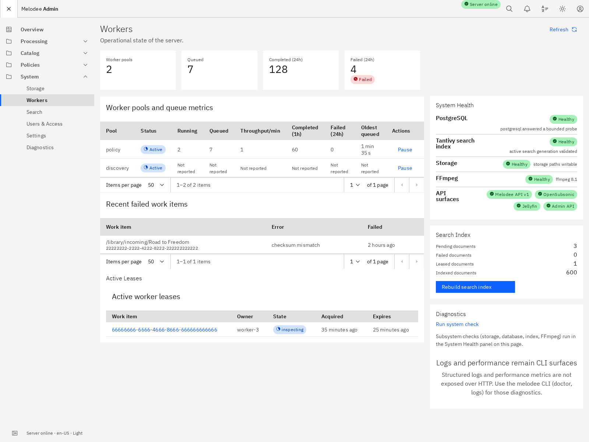

The Rust server exposes service health and version metadata plus durable queue diagnostics,
surfaced both in the admin UI and over the [Admin API](../api/admin-api/).

## System → Workers screen

Open **System → Workers** (`/admin/system/workers`). The screen aggregates the operational
surfaces:

- **Worker pools** — every registered pool with its durable pause state and audit fields
  (`pausedBy`, timestamps), plus running, queued, throughput, completed-last-hour, and
  failed-24 h metrics. Pools without a durable queue table report *not reported* instead of
  invented zeros. **Pause** and **Resume** write the durable pause row (pause asks for
  confirmation): a paused pool claims no new work, while already-claimed items finish or are
  released under the normal lease contract — pausing never strands a lease.
- **Recent failures** — the failed work items, server-paged and sortable; activating a row jumps
  to that item in the [Processing queue](./processing/).
- **Search index** — pending/failed/leased projection rows, active generation, and the last
  rebuild status, with a **Rebuild** trigger (confirmation-gated). The button requests a durable
  rebuild job that the search worker claims in the background — it never fakes progress — and
  reports honestly when a rebuild is already running or search is disabled.
- **System health** — the aggregated subsystem health panel (database, search index, storage,
  media tools, API surfaces).
- **Active leases** — unexpired lease evidence with owner and acquire/expiry timestamps. An
  active lease proves PostgreSQL holds an unexpired lease; it does not prove the owner process
  is currently alive.



Structured logs and performance metrics are not exposed over HTTP; use the command-line
diagnostics below for those. The routes behind this screen are documented under
[Admin API — System, workers, and search](../api/admin-api/#system-workers-and-search).

## System → Search screen

Open **System → Search** (`/admin/system/search`). It carries the same search index panel as the
Workers screen — projection pending/failed/leased counts, active-generation document counts,
latest rebuild status, and the confirmation-gated **Rebuild** trigger — so the status and rebuild
behavior is identical on both screens.

Query tooling is intentionally not part of this screen: MQL query, autocomplete, parse, and
explain run through the CLI (`melodee search …`) and the native search API. The admin API exposes
index status and rebuild only, so there is no query box.

## System → Storage screen

Open **System → Storage** (`/admin/system/storage`). It renders real server data only:

- **Storage subsystem** — the storage verdict of the aggregated health check (status plus the
  server-reported detail).
- **Storage paths preflight** — the `storage_paths` first-run check re-evaluated on every read:
  how many inbound sources are configured and the storage root, or the failing path with its
  remediation guidance.

Per-path capacity and free space are not exposed over HTTP and are not shown; use
`melodee doctor` and `melodee config validate` for path-level checks.

## System → Diagnostics screen

Open **System → Diagnostics** (`/admin/system/diagnostics`). It aggregates the subsystem health
panel (the same storage, database, index, and media-tool checks as onboarding and readiness),
the active-leases table, and a link to the recent-failures table on System → Workers. Structured
logs and performance metrics remain CLI surfaces, as noted on the screen.

## Service health

## Service health

```http
GET /healthz
```

The route returns HTTP 200 with service, version, and status fields:

```json
{
  "service": "melodee-server",
  "version": "0.1.0",
  "status": "ok"
}
```

The same metadata is available to Admin API consumers at
`GET /api/admin/v1/system/info`.

## Service readiness

```http
GET /readyz
```

The readiness route performs a bounded PostgreSQL query. When the search worker is enabled it also
requires a readable, schema-compatible active search generation. It returns HTTP 200 with
`status: "ready"` when those configured dependencies answer and HTTP 503 with
`status: "not_ready"` otherwise.
The server also connects to PostgreSQL and applies migrations before binding its listener.

It does not test media tools, disk space, or every worker process; use the diagnostics below for
those checks.

## Queue and lease diagnostics

The implemented [Admin API](../api/admin-api/) provides:

- per-state work-item counts;
- bounded, filtered work-item listings;
- one work item's state, attempts, timestamps, and last error;
- append-only transition history; and
- active, unexpired lease evidence.

An active lease proves that PostgreSQL contains an unexpired lease. It does not prove that the
owner process is currently alive.

## Command-line diagnostics

- `melodee doctor` checks whether `ffmpeg`, `ffprobe`, and `fpcalc` are executable and whether the
  database URL variable is present. It does not connect to PostgreSQL.
- `melodee work list` and `melodee work show <id>` inspect durable queue state and event history.
- `melodee ingest status` prints a concise ingestion queue summary.
- `melodee catalog status` prints bounded catalog entity/outbox counts and the effective worker
  limits.
- `melodee catalog inspect <id>` resolves a work-item ID or API key and prints its immutable catalog
  import receipt. A pending or failed item reports `catalog_import: none` alongside its current
  durable state, attempt count, next retry time, and last error.
- `melodee catalog import` runs one bounded import pass using the same lease, retry, and catalog
  concurrency configuration as the server worker.
- `melodee policy config` and `melodee policy rules` print the active safe preferences and exact
  immutable rule-set identity.
- `melodee policy test --limit 100 --actor <administrator-id>` runs a bounded catalog test and reports proposed outcomes,
  matched rules, existing dispositions/states, destructive impact, and sample Release IDs.
- `melodee policy evaluate <release-id>` proposes one decision without persisting it;
  `melodee policy inspect <release-id>` prints the current durable decision and audit history.
- `melodee policy decide <release-id> <disposition> --actor <id> --reason <reason>` records an
  explicit administrator override. It does not complete or execute deletion.
- `melodee search status` reports unleased pending rows, separately leased rows, permanently failed
  outbox rows, oldest availability, checkpoint, latest rebuild, active generation, sealed snapshot
  and current live document counts, and index-open errors. Retryable rows become permanent failures
  after `MELODEE__SEARCH__MAX_OUTBOX_ATTEMPTS` so a poison row cannot churn forever.
- `melodee search rebuild --actor <administrator-id>` synchronously builds, validates, catches up,
  and activates a new generation. `search query`, `autocomplete`, `parse`, and `explain` exercise
  the same bounded query contracts used by the worker.
- `melodee worker-pools list` prints every registered worker pool with its durable pause state and
  audit fields. `melodee worker-pools pause <pool> --by <operator>` durably pauses a pool and
  `melodee worker-pools resume <pool> --by <operator>` resumes it; the `--by` operator identity is
  mandatory and recorded with the transition (the last-pause audit survives a resume). The podcast,
  policy, and discovery workers honor the durable row between claim batches: a paused pool claims
  no new work, while already-claimed work finishes or is released under the normal lease contract —
  pausing never strands a lease. Pausing a pool name that has no wired worker yet registers the row
  so the pool is paused from its first check once it exists.
- `melodee config list` prints every known setting's effective value and its source layer;
  secrets are always redacted. `melodee config validate` runs the first-run preflight checks and
  exits non-zero when a required check fails. `melodee config export [--output <path>]` writes the
  redacted export document and `melodee config import <path> [--apply] [--allow-unknown]` previews
  (default) or applies a validated import. See
  [Configuration](../installation/configuration/#import-and-export) for the secret-handling
  contract.

See [Policies](./policies/) for disposition and safety behavior, and
[Troubleshooting](../troubleshooting/) for operational checks.

Media-tool and filesystem checks also run as part of the first-run preflight — see
[Quick Start — First-run onboarding](../getting-started/quick-start/#first-run-onboarding) — and
`melodee doctor` verifies that `ffmpeg`, `ffprobe`, and `fpcalc` are executable on the host.
