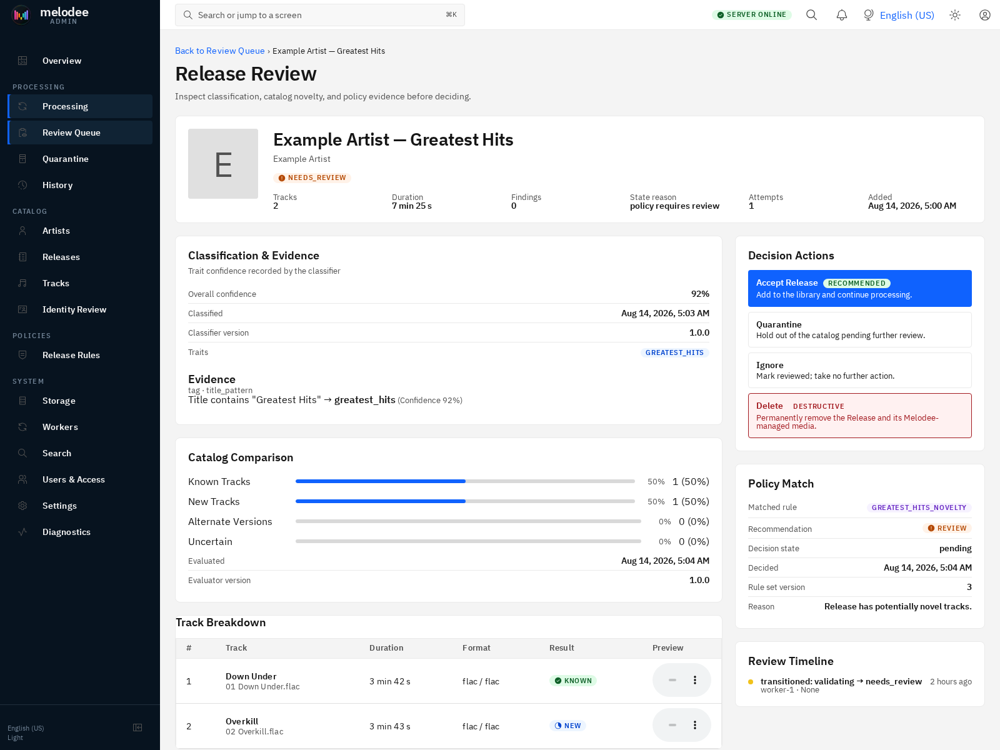

Release review is the human gate between inbound processing and the published catalog. Review
decisions are explainable and audited: policy says *why* a Release was flagged, and operator
decisions are remembered. The graphical review workflow lives in the
[Release Review workspace](#review-queue-and-release-review-workspace) below; the CLI is the
parallel headless surface.

The CLI can inspect and override a pending decision:

```bash
melodee-cli policy inspect <release-id>
melodee-cli policy decide <release-id> review \
  --actor <administrator-id> \
  --reason "<operator-safe reason>"
```

The override requires the exact current sealed-manifest fingerprint and records the administrator
and reason in append-only audit history. Use `accept`, `ignore`, or `quarantine` to complete and
route a non-destructive decision. The CLI can record a pending `delete` authorization but does not
remove media; complete destructive deletion through the Admin UI workflow below. See
[Policies](../admin/policies/) for the full command and safety contract.

## Review Queue and Release Review workspace

Open **Processing → Review Queue** (`/admin/processing/review`) in the admin UI. The queue lists
the review-able slice of the pipeline — `needs_review`, `failed`, and quarantined work items —
as a server-paged table with state filter pills fed by the listing's own counts. There is no
bulk mutation over review items; every decision is per-Release and audited.

Selecting a row opens the **Release Review workspace** (`/admin/processing/review/{id}`), which
presents evidence first and choices last:

- **Classification and evidence** — overall confidence, the classifier version, and each
  finding (for example `Title contains "Greatest Hits" → greatest_hits`).
- **Catalog comparison** — known, new, alternate-version, and uncertain Track counts with
  percentages, evaluated timestamp, and evaluator version. Comparison uses durable evidence
  recorded at import: an identical canonical byte hash makes a Track an **exact duplicate**, and an
  identical acoustic fingerprint (the Chromaprint observation every import already computes) makes
  it a **known** recording even when the file itself differs, for example a copy that was only
  retagged. A Track stays **uncertain** until a catalogue comparison actually concludes something —
  a locally computed fingerprint is evidence, not a verdict — and re-encodes at a different bitrate
  keep that honest verdict until a similarity matcher exists.
- **Track breakdown** — per-Track duration, format, and novelty result, with an **inline audio
  preview** transport (never autoplaying; a missing preview degrades gracefully).
- **Policy match** — the matched rule ids, the recommended disposition, the decision state, the
  immutable rule-set version, and the evidence summary.
- **Review timeline** — the append-only transition history for the work item.



### Deciding

The decision rail offers the ordered actions **Accept**, **Quarantine**, **Ignore**, and
**Delete**. Every decision requires an operator-supplied **reason**, recorded in the audit with
the acting administrator. `Accept`, `Quarantine`, and `Ignore` complete the non-destructive
decision and route the work item. **Delete** is destructive-class: it opens an impact dialog,
requires typed confirmation plus a reason, and sends an explicit override flag. Melodee first
records that authorization, then removes the Release's canonical bundle and retained staged source.
Only after both removals succeed does it mark the Release deleted and retire it from catalog,
search, artwork, and playback surfaces. Catalog identifiers and audit evidence remain as
non-browsable tombstones. A storage, path-safety, or stale-fingerprint failure leaves the deletion
pending and surfaces an error; inspect the server log, correct the problem, and repeat the confirmed
action.

**Reprocess** re-queues the Release for another processing pass, with an optional reason.

## Safe metadata transformations

Administrators can open a published Release's metadata transformation panel from its catalog
detail screen. The panel previews field-level changes and affected files before an apply action;
apply requires the returned preview hash and an explicit confirmation. Supported operations cover
featuring cleanup, artist replacement/clearing, year updates, track renumbering, and bounded text
replacement. Every apply records the acting administrator, deltas, hashes, decoded-audio
fingerprints, and recovery evidence. The rewrite changes tags only: paths, extensions, audio
payloads, and Melodee-owned identifiers remain unchanged.

The history view shows successful and failed attempts. A successful attempt can be reverted while
its same-directory recovery copies remain available. A failed write or integrity check restores
the originals and leaves an operator-visible failed audit. This workflow never deletes source
media and is separate from the policy disposition controls below.

The underlying routes are documented under
[Admin API — Release review](../api/admin-api/#release-review).
